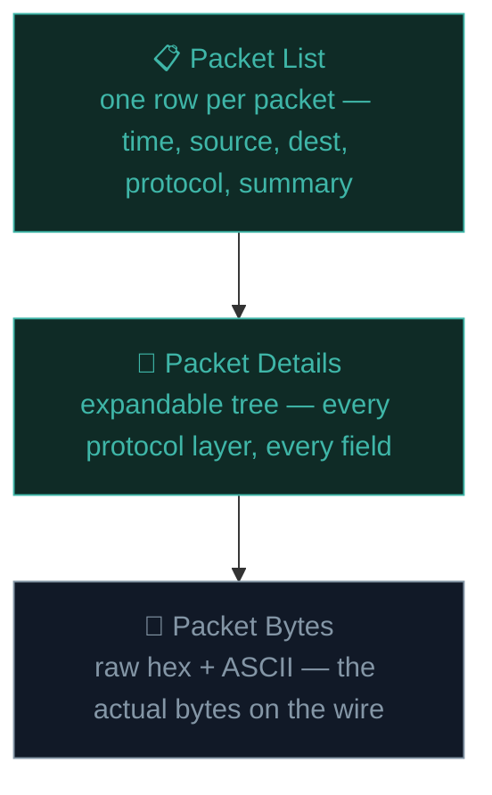

# Wireshark & packet analysis

If Nmap tells you *what's* on a network, **Wireshark** shows you *exactly what's happening on the wire*, packet by packet. It's the microscope of network security — indispensable for both attackers and defenders.

## What Wireshark actually does

Wireshark **captures** raw network traffic passing through a network interface and displays it in human-readable form, letting you inspect every layer of every packet — from the Ethernet frame up through IP, TCP/UDP, all the way to the application-layer protocol itself (HTTP, DNS, etc).

## Starting a capture

```bash
# Launch Wireshark (needs elevated privileges to capture):
sudo wireshark
```

1. On launch, you'll see a list of available network interfaces (eth0, wlan0, etc.), each showing live traffic activity as a little heartbeat graph.
2. Double-click an interface to start capturing immediately.
3. Generate some traffic (browse a site, ping something) and watch packets flood in.
4. Click the red square (■) to stop the capture.

## Reading the packet list

```
No.  Time      Source           Destination      Protocol  Length  Info
1    0.000000  192.168.1.5      93.184.216.34    TCP       74      54123 → 443 [SYN]
2    0.021340  93.184.216.34    192.168.1.5      TCP       74      443 → 54123 [SYN, ACK]
3    0.021390  192.168.1.5      93.184.216.34    TCP       66      54123 → 443 [ACK]
```

Recognise that? It's the **TCP three-way handshake** from Path 02, now visible with your own eyes, packet by packet, exactly as it happens.

## The three-pane view



Clicking any packet in the top pane populates the middle pane with an **expandable tree** — click the arrow next to "Transmission Control Protocol" to see every TCP field (source port, destination port, flags, sequence numbers) exactly as they exist in the real packet. This is the single best way to *actually* internalise the protocol concepts from Path 02, rather than just reading about them.

## Display filters — finding the needle in the haystack

A live capture can have thousands of packets in seconds. **Display filters** narrow what you see:

```
http                          # only HTTP traffic
dns                           # only DNS queries/responses
tcp.port == 443               # only traffic on port 443
ip.addr == 192.168.1.5        # only traffic to/from this IP
tcp.flags.syn == 1 && tcp.flags.ack == 0   # only SYN packets (connection attempts)
http.request.method == "POST" # only HTTP POST requests
frame contains "password"      # packets containing this string anywhere
```

Type these directly into the filter bar at the top. Wireshark's filter language is powerful and precise — you'll build fluency with regular practice.

## Following a TCP stream

Right-click any packet → **Follow → TCP Stream** reassembles an entire conversation (all the packets belonging to one connection) into a single readable view — showing exactly what was sent and received, in order, both directions colour-coded.

This is enormously useful for understanding **unencrypted** protocols — HTTP, FTP, Telnet, plain SMTP — where you can literally read the entire conversation, including any credentials sent in plaintext.

## The critical lesson: why encryption matters, made visceral

```bash
# Set up a deliberately unencrypted FTP or HTTP login form test (in your own lab)
# then capture the traffic and Follow → TCP Stream
```

If you capture traffic to an HTTP (not HTTPS) login form, or a plain FTP login, you will see the **actual username and password in cleartext**, sitting right there in the packet bytes. This single exercise makes Path 02's "why TLS/HTTPS matters" lesson concrete in a way no explanation ever fully achieves — seeing a real password sitting unencrypted in a packet capture is a formative moment for most security learners.

:::danger ONLY CAPTURE YOUR OWN TRAFFIC
Capturing traffic on a network you don't own or lack authorization to monitor is illegal in most places — exactly the legal boundary from Path 01. Always practise on your own lab traffic, your own home network, or explicitly-provided training captures (like the sample `.pcap` files linked below).
:::

## Analysing pre-captured files (.pcap)

You don't always need to capture live — Wireshark opens saved capture files (`.pcap`/`.pcapng`) from anywhere, including ones shared for training, or evidence from a real incident (a core skill in digital forensics, Path 11.7):

```bash
wireshark suspicious-traffic.pcap
```

Numerous sites provide free, legal sample captures specifically for learning — including deliberately malicious traffic samples for practising detection (linked below).

## Common things security analysts look for in captures

- **Plaintext credentials** in unencrypted protocols (as above).
- **Unusual destination IPs/domains** — traffic to known-malicious infrastructure, or simply unexpected countries/ASNs for a given organisation's normal traffic pattern.
- **DNS requests for suspicious domains** — malware often uses DNS for command-and-control communication (Path 06.3's "C2" concept, now visible in a capture).
- **Large, unusual data transfers** — potential data exfiltration.
- **ARP anomalies** — signs of ARP spoofing (next lesson's MITM territory).
- **Repeated connection attempts** — potential scanning or brute-force activity, visible as unusually repetitive SYN packets.

## Capture filters vs display filters — a distinction that trips up beginners

It's easy to conflate these, but they operate at fundamentally different points: a **capture filter** (set before you start capturing, using tcpdump-style syntax like `port 80`) decides which packets Wireshark records *at all* — packets that don't match are discarded before ever touching disk or the packet list. A **display filter** (typed into the filter bar after capturing, using Wireshark's own richer syntax like `tcp.port == 443`) only decides which *already-captured* packets are currently shown — nothing is discarded, you can always clear the display filter and see everything again. The practical implication: capture filters are for controlling capture *volume* on a busy interface (avoid recording gigabytes of irrelevant traffic), while display filters are for *analysis* after the fact — when in doubt, capture broadly and filter narrowly during display, since you can't display-filter your way back to packets a capture filter already threw away.

## Statistics menu — the bird's-eye view

Beyond packet-by-packet inspection, Wireshark's **Statistics** menu offers several aggregate views that reveal patterns invisible in the raw packet list. **Statistics → Conversations** summarises every distinct connection in the capture (by IP pair or port pair) along with total bytes and duration — an efficient way to spot a single host that transferred unusually large amounts of data, a classic exfiltration signal. **Statistics → Protocol Hierarchy** breaks down the entire capture by protocol as a percentage tree, useful for quickly answering "what kind of traffic is even in this capture" before diving into individual packets. **Statistics → I/O Graph** plots traffic volume over time, making sudden spikes (a possible DoS attempt, a large exfiltration burst) visually obvious at a glance rather than requiring you to scroll through thousands of rows.

## Command-line packet capture — tshark and tcpdump

For automation, scripting, or headless servers without a GUI:

```bash
# tcpdump — classic, always available, great for quick captures:
sudo tcpdump -i eth0 -w capture.pcap
sudo tcpdump -i eth0 port 80
sudo tcpdump -i eth0 host 192.168.1.5

# tshark — Wireshark's command-line sibling, supports the same filter syntax:
tshark -i eth0 -f "port 443"
tshark -r capture.pcap -Y "http.request.method == GET"
```

These are the tools you'd actually use in a Python-driven automation pipeline (Path 04) or on a remote server where a GUI isn't available.

## 🧪 Lab — Capture and analyse your own traffic

1. Start a Wireshark capture on your primary network interface.
2. In another window, visit an **HTTP** (not HTTPS) site — try `http://testphp.vulnweb.com` again.
3. Stop the capture. Filter for `http`.
4. Right-click a request → **Follow → HTTP Stream**. Read the entire raw request and response.
5. Now visit an **HTTPS** site with a fresh capture, filter for `tls`, and try the same "Follow" trick — notice you can see the TLS handshake metadata, but **not** the actual encrypted content. That contrast is the entire point of encryption made visible.
6. Try filtering for `dns` and watch every domain name your machine resolves during normal browsing — often surprisingly revealing of background app activity you didn't realise was happening.

:::challenge Test yourself
You capture traffic to a plain HTTP login form and successfully read the submitted username and password directly in the packet bytes. What single change to the website would have prevented this specific exposure?

<details><summary>Show answer</summary>Serving the login form over <strong>HTTPS instead of HTTP</strong> — TLS encryption (Path 02, Path 05.1) would mean the packet capture still shows the connection exists, but the actual credential data inside would be encrypted ciphertext, unreadable without the private key.</details>
:::

## Key terms

- **Wireshark** — the standard GUI tool for capturing and analysing network traffic.
- **Display filter** — a query narrowing which packets are shown from a capture.
- **Follow TCP Stream** — reassembling an entire conversation into readable form.
- **.pcap/.pcapng** — the standard packet capture file formats.
- **tcpdump / tshark** — command-line packet capture tools for automation and headless use.

## Recap

- Wireshark captures and displays raw network traffic at every protocol layer, packet by packet.
- Display filters and "Follow TCP Stream" are the two most-used features for real analysis.
- Capturing unencrypted traffic makes the value of HTTPS/TLS immediately, viscerally clear.
- tcpdump and tshark bring the same capabilities to the command line for scripting and headless environments.
- Only ever capture traffic you own or are explicitly authorised to monitor.

???refs
- [Wireshark official documentation](https://www.wireshark.org/docs/) — the definitive reference.
- [Wireshark sample captures](https://wiki.wireshark.org/SampleCaptures) — free, legal `.pcap` files for practice, including malicious traffic samples.
- [Malware Traffic Analysis](https://www.malware-traffic-analysis.org/) — real, legal, deliberately-provided malicious traffic captures with full write-ups, excellent for advanced practice.
- [tcpdump manual](https://www.tcpdump.org/manpages/tcpdump.1.html) — official reference.
???

**Next up →** [Firewalls & VPNs](#/lesson/08-network-security/firewalls-vpns)
