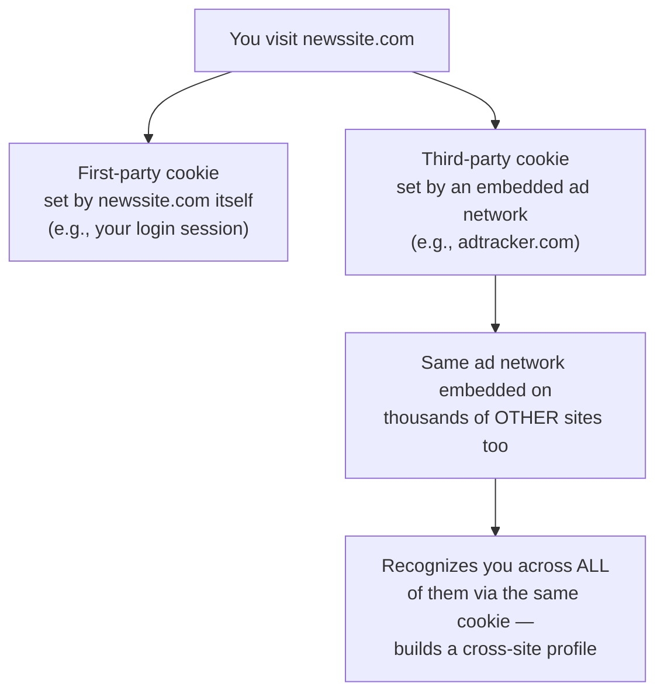

# Browser Privacy

Path 05's cookies-and-sessions lesson covered cookies from a web-security angle — how they authenticate you. This lesson covers the privacy angle: how the same underlying mechanisms, plus several others, are used to track your browsing behavior across the entire web, often without your awareness.

## First-party vs. third-party cookies

Path 05 established what a cookie is. The privacy-relevant distinction is *who sets it*:

A **first-party cookie** is set by the site you're actually visiting, typically for legitimate functionality (staying logged in, remembering your cart). A **third-party cookie** is set by a different domain embedded within the page you're visiting — usually an advertising or analytics network — and because that same third party is embedded across thousands of unrelated websites, it can recognize your browser across all of them, building a cross-site profile of your browsing habits from many different sites, not just the one you're currently viewing.

## Browser fingerprinting — tracking without cookies at all

Even with all cookies blocked entirely, sites can still often identify and track your browser through **fingerprinting** — combining details like your exact browser version, installed fonts, screen resolution, timezone, and dozens of other subtle characteristics into a combination unique (or nearly unique) enough to identify your specific device across visits, with no cookie required at all.

:::tip Test your own fingerprint uniqueness
[Cover Your Tracks](https://coveryourtracks.eff.org/) (a free tool from the Electronic Frontier Foundation) tests your specific browser's fingerprint uniqueness and shows exactly which characteristics contribute most — a genuinely eye-opening exercise most people find surprising.
:::

## Practical browser privacy settings

- **Block third-party cookies** — available in every modern browser's privacy settings, this alone eliminates a huge share of cross-site tracking while leaving normal site functionality (which relies on first-party cookies) intact.
- **Private/incognito browsing** — prevents your *local device* from retaining history and cookies after the session ends, but provides essentially zero protection from tracking *during* the session itself — your ISP, the sites you visit, and any VPN you're not using can all still see and track that traffic exactly as normal. This is a genuinely common, important misconception worth correcting explicitly.
- **Browser extensions** — tools like **uBlock Origin** (free, open-source, widely regarded as effective) block many trackers and ads at the network request level, before they ever load.
- **DNS-level filtering** — services and router-level tools can block known tracker/ad domains at the DNS resolution step (Path 02's DNS lesson), providing protection across every application on a device, not just the browser.

## Tracking pixels and supercookies — beyond ordinary cookies

Third-party cookies and fingerprinting aren't the only tracking mechanisms worth knowing by name. A **tracking pixel** is a tiny (often literally 1x1, invisible) image embedded in an email or webpage — the moment your client loads it, a request fires to the tracker's server, confirming exactly when (and often from what IP and device) you opened that specific email or page, which is precisely how marketers know whether you've actually read a newsletter. **Supercookies** and similar persistent-identifier techniques go further than ordinary cookies specifically to survive attempts to delete them — storing tracking data in less obvious browser storage locations (like `localStorage`, Path 05.4's discussion of its non-cookie persistence, or even browser cache mechanisms) that ordinary "clear cookies" actions don't always touch, meaning a user who diligently clears cookies but not every other storage mechanism can still be re-identified. Modern browsers and privacy tools increasingly target these broader storage mechanisms specifically because cookie-blocking alone no longer fully addresses the tracking landscape — worth knowing these exist so "I cleared my cookies" isn't mistaken for "I'm no longer trackable."

## HTTPS-only and Do Not Track

Modern browsers can be configured to refuse plain HTTP connections entirely, forcing HTTPS wherever available (directly reinforcing Path 02's HTTPS lesson) — a meaningful security improvement, separate from tracking specifically. The "Do Not Track" browser signal, by contrast, is worth knowing is **not legally binding** on most sites — it's a polite request most trackers simply ignore, unlike the technical blocking mechanisms above which actually prevent tracking regardless of a site's cooperation.

:::warn Private browsing is not a privacy tool against your ISP or the sites themselves
This is worth repeating with emphasis, since it's such a widespread misconception: incognito/private mode only affects what's stored *locally on your own device* after you close the window. It provides zero protection against your ISP seeing which sites you visited, zero protection against the sites themselves tracking you during that session, and zero protection on a shared/work computer against sufficiently privileged network-level monitoring. For genuine protection from your ISP or local network observers, you need the encryption a VPN or HTTPS provides (this path's previous lesson), not private browsing mode.
:::

:::challenge Perform a browser privacy audit
Using Cover Your Tracks, test your own browser's fingerprint uniqueness. Then review your browser's privacy settings: confirm whether third-party cookies are blocked, whether HTTPS-only mode is enabled, and install uBlock Origin if you don't already have a tracker-blocking extension. Re-test with Cover Your Tracks afterward and compare the results.
:::

## Key terms

- **Third-party cookie** — a cookie set by a domain other than the one you're visiting, typically enabling cross-site tracking.
- **Browser fingerprinting** — identifying a device through the unique combination of its browser/system characteristics, without requiring cookies.
- **Private/incognito browsing** — prevents local storage of history/cookies after the session, but provides no network-level tracking protection.

## Recap

- Third-party cookies embedded across many unrelated sites are the primary mechanism behind cross-site advertising tracking.
- Fingerprinting can track your browser even with all cookies fully blocked, using combinations of browser/device characteristics.
- Private/incognito browsing only affects local storage on your device — it provides no protection against ISP or website-level tracking during the session itself.
- Blocking third-party cookies, using a tracker-blocking extension, and enabling HTTPS-only mode together form a genuinely effective, practical browser privacy baseline.

???refs
- [Cover Your Tracks (EFF)](https://coveryourtracks.eff.org/) — free browser fingerprinting and tracker-blocking test, referenced throughout this lesson.
- [uBlock Origin](https://ublockorigin.com/) — free, open-source, widely-regarded tracker/ad blocking extension.
???

**Next up →** [Secure Communications](#/lesson/09-digital-privacy/secure-communications)
