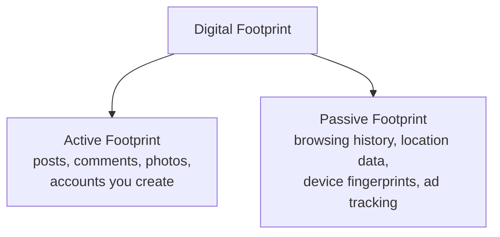
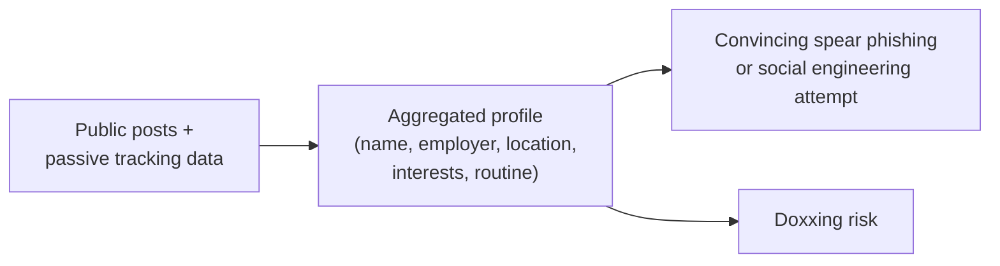

# Your Digital Footprint

Path 00 covered the absolute basics of staying safe online. This path goes considerably deeper into personal digital security and privacy — starting here with a concept that underlies everything else in it: the trail of data you leave behind simply by existing online, and why it matters more than most people realize.

## What a digital footprint actually is

Your **digital footprint** is the accumulated trace of data generated by your online activity — some of it deliberate (a photo you post, a review you write), and a huge amount of it passive and largely invisible to you (sites you visit, how long you spend on each page, your approximate location, your device fingerprint).

## Active footprint — what you deliberately share

Every social media post, forum comment, uploaded photo, and public profile contributes to your active footprint — and much of it persists far longer than people expect, is more widely visible than the platform's interface suggests, and can be aggregated by anyone willing to look. This directly connects to Path 14's OSINT reconnaissance material: the exact techniques used to research a company during an authorized penetration test work identically well against an individual — and attackers doing reconnaissance for a targeted phishing attempt (spear phishing, Path 00) do exactly this.

## Passive footprint — what you don't realize you're leaving

Far larger, and far less visible, is your **passive footprint**: every website you visit can log your IP address, browser characteristics, and behavior; advertising networks track you across sites using cookies and other techniques (covered in depth in this path's browser privacy lesson); and your phone's location data, even with GPS "off," can often still be roughly inferred through Wi-Fi and cell tower proximity.

## Why this matters beyond "creepy ads"

Beyond the more obvious targeted-advertising concern, an aggregated digital footprint creates real security risk: **doxxing** (publicly revealing someone's private information, often maliciously), successful **spear phishing** (a personalized attack crafted using details gathered about you specifically, far more convincing than generic phishing per Path 00's lesson), and **social engineering** (Path 10) all become dramatically easier the more information about you is publicly aggregable.

## Metadata hiding inside your own uploads

A specific, often-overlooked passive footprint source worth calling out directly: photos and documents you upload yourself frequently carry hidden **metadata** describing far more than the visible content alone. A photo taken on a smartphone typically embeds **EXIF data** — the exact GPS coordinates where it was taken, the device model, and the precise timestamp — meaning a seemingly innocent photo posted to a forum or marketplace listing can reveal your home address if GPS tagging wasn't stripped before upload. Documents carry their own metadata too: a PDF or Word file's properties often retain the original author's name, the organization, and sometimes prior-revision content that was "deleted" from the visible text but persists in the file's underlying structure (Path 14.3's document-metadata OSINT technique, applied here to your own files instead of a target company's). Many social platforms now strip EXIF data automatically on upload, but not all do, and files shared directly (email attachments, cloud-storage links, marketplace listings) frequently retain it in full — worth checking explicitly with a tool like `exiftool` before sharing anything sensitive.

## Google yourself — a genuinely useful first exercise

A simple, immediately actionable exercise: search your own name (and variations of it) in a search engine, and separately check what's publicly visible on your social media accounts when viewed *while logged out*, simulating what a stranger actually sees. Most people are meaningfully surprised by how much is visible and how easily it can be found — exactly the reconnaissance discipline from Path 14, turned inward on yourself defensively.

:::tip Data broker sites are a real, often-overlooked exposure
Beyond social media, "people search" and data broker websites aggregate and sell personal information (address history, phone numbers, relatives) compiled from public records — often without most people ever realizing these sites exist. Many offer an opt-out process (search "[site name] opt out"), and periodically checking a handful of the largest ones is a genuinely worthwhile addition to a personal privacy routine.
:::

:::challenge Audit your own digital footprint
Search your own name across a search engine, review what's publicly visible on your main social media accounts while logged out (or using a private/incognito window), and check at least two major data broker sites for your own listing. Document what you find, and identify the single most concerning piece of publicly discoverable information about yourself.
:::

## Key terms

- **Digital footprint** — the accumulated trace of data generated by your online activity, active and passive.
- **Doxxing** — maliciously publishing someone's private information publicly.
- **Data broker** — a company that aggregates and sells personal information, often compiled from public records.

## Recap

- A digital footprint has both an active component (what you deliberately share) and a much larger passive component (tracking, metadata, behavioral data) most people never see directly.
- An aggregated digital footprint directly enables spear phishing, social engineering, and doxxing — the same OSINT techniques used in authorized penetration testing (Path 14) work identically against individuals.
- Periodically searching yourself and reviewing what's publicly visible is a simple, genuinely useful defensive habit.

???refs
- [Have I Been Pwned](https://haveibeenpwned.com/) — check whether your accounts have appeared in known data breaches, referenced back in Path 00.
- [EFF: Surveillance Self-Defense](https://ssd.eff.org/) — a free, comprehensive, well-regarded guide to digital privacy practices.
???

**Next up →** [Social Media Privacy & Oversharing](#/lesson/09-digital-privacy/social-media-privacy-oversharing)
