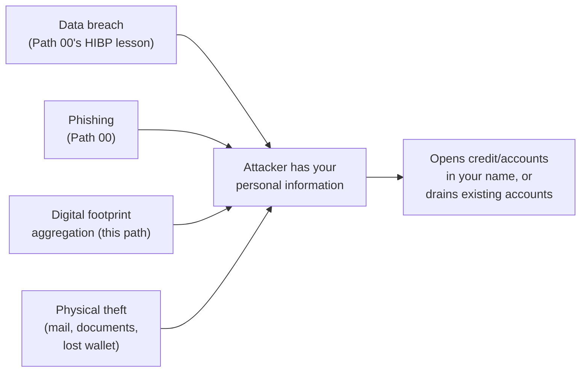

# Identity Theft Protection

This path has covered your footprint, your network traffic, and your communications. This lesson covers the consequence that ties them together when defenses fail: **identity theft** — someone using your personal information to impersonate you, typically for financial gain — and the concrete, practical steps that meaningfully reduce your risk and limit damage if it happens anyway.

## How identity theft actually happens

Identity theft rarely stems from one dramatic hack — it's usually the accumulation of smaller exposures (a data breach here, a phished password there, publicly aggregable details from this path's digital footprint lesson) reaching a critical mass an attacker can exploit, exactly the "small failures compounding" pattern from Path 10's threat/risk lesson.

## Credit freezes — the single most effective preventative control

A **credit freeze** locks your credit file at each major credit bureau, preventing new credit accounts from being opened in your name without first unlocking it yourself (via a PIN only you possess). This is, by a meaningful margin, the single most effective preventative control against new-account identity theft — it's free, reversible, and doesn't affect your existing accounts or credit score at all, only blocking *new* account openings while active.

:::tip Freeze it now, unfreeze temporarily only when genuinely needed
Unlike a credit monitoring service (which only *alerts* you after something has already happened), a credit freeze actively *prevents* new accounts from opening in the first place. It's genuinely one of the highest-leverage, lowest-cost personal security actions available, directly echoing Path 00's framing of MFA as the single highest-impact account security control — this is the credit-specific equivalent.
:::

## Monitoring — catching what prevention misses

Beyond freezing new credit, regularly reviewing your **existing** accounts matters too: bank and credit card statements for unrecognized transactions, your credit report (free, at least annually, through official channels in most countries) for accounts you don't recognize, and Path 00's Have I Been Pwned check periodically for new breach exposures involving your accounts.

## If it happens anyway — a concrete response checklist

1. **Freeze your credit immediately** if it wasn't already frozen (see above).
2. **Change passwords** on any potentially compromised accounts, prioritizing your primary email first (Path 00's passwords lesson — email is the "master key" that can reset almost everything else).
3. **Enable MFA everywhere it isn't already on** (Path 00), specifically on financial and email accounts first.
4. **Contact affected institutions directly** — banks and credit card companies have established fraud-response processes, and reporting quickly generally limits your financial liability significantly under most consumer protection frameworks.
5. **File an official report** — most countries have a government-run identity theft reporting resource (the US has IdentityTheft.gov, for instance); filing creates an official record that can help resolve disputes and limit your liability.
6. **Document everything** — dates, who you spoke with, reference numbers — exactly the same evidence-preservation discipline from Path 16's DFIR lab, just applied to a personal financial incident instead of a technical one.

## SIM-swapping — a distinct, fast-moving attack worth knowing by name

Beyond the general breach/phishing/footprint pathways above, **SIM-swapping** deserves its own specific mention, since it's a genuinely distinct attack vector that can bypass many of the protections this lesson otherwise recommends. An attacker who's gathered enough personal information about you (often from exactly the digital footprint aggregation this path's first lesson describes) contacts your mobile carrier impersonating you, and convinces a support representative to transfer your phone number to a SIM card the attacker controls — at which point every SMS-based verification code and password-reset text intended for you goes directly to the attacker instead. This is precisely why SMS-based MFA (Path 10.5's mention of it as the "weakest form" of MFA) is genuinely vulnerable in a way app-based TOTP or hardware security keys are not — those alternatives don't depend on your phone *number* at all, only a specific physical device or app installation the attacker doesn't control even after a successful SIM swap. Concrete mitigation: set up a **carrier PIN or port-freeze** with your mobile provider specifically to require additional verification before any SIM transfer, and migrate MFA away from SMS wherever a stronger alternative is available, especially on your email and financial accounts.

## Reducing exposure proactively

- **Minimize what you share publicly** — directly connecting to this path's digital footprint lesson; the less publicly aggregable information exists about you, the harder targeted identity theft becomes.
- **Shred physical documents** containing sensitive information before disposal — a genuinely common, low-tech theft vector still worth guarding against.
- **Use unique, strong passwords with MFA** (Path 00) — since compromised account credentials are one of the most direct paths to identity theft.
- **Be skeptical of unsolicited requests for personal information**, exactly the phishing red flags from Path 00's lesson, since a huge share of identity theft starts with successfully phished information rather than a technical breach at all.

:::challenge Build your own response plan
Write out your own personal identity theft response checklist, adapted from this lesson's 6-step framework to your specific country/region's actual reporting resources and your own financial institutions' specific fraud-reporting processes. Check now (before you'd ever need it) whether your credit is currently frozen, and freeze it if not.
:::

## Key terms

- **Identity theft** — using someone else's personal information to impersonate them, typically for financial gain.
- **Credit freeze** — locking your credit file to prevent new account openings without your explicit, PIN-authenticated unlock.
- **Credit monitoring** — a service alerting you to changes on your credit report after they occur, distinct from prevention.

## Recap

- Identity theft typically results from accumulated smaller exposures (breaches, phishing, footprint aggregation) rather than one dramatic event.
- A credit freeze is the single most effective preventative control — free, reversible, and actively blocking new accounts rather than just alerting after the fact.
- Regularly monitoring existing accounts and your credit report catches what prevention alone misses.
- Having a concrete response plan ready before an incident happens meaningfully reduces both the damage and the resolution time if it does.

???refs
- [IdentityTheft.gov](https://www.identitytheft.gov/) — the official US government identity theft reporting and recovery resource.
- [Have I Been Pwned](https://haveibeenpwned.com/) — check your accounts against known breaches, referenced throughout this course since Path 00.
???

**Next up →** [Privacy Laws & Your Rights](#/lesson/09-digital-privacy/privacy-laws-your-rights)
