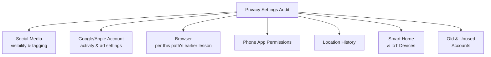

# Privacy Settings Audit

This lesson is entirely hands-on — taking every concept from this path so far (digital footprint, cookies/tracking, VPNs, secure communications, identity theft prevention) and applying it directly to your own real accounts, in a structured, repeatable audit you can genuinely complete today.

## Why a structured audit beats occasional worry

Most people's approach to privacy settings is reactive — noticing a setting only after something goes wrong, or vaguely worrying without ever systematically checking anything. A structured audit, run periodically (quarterly is a reasonable cadence), catches drift as platforms change their defaults and adds new features over time — directly mirroring the periodic re-testing discipline from Path 18's LLM red teaming playbooks lesson, just applied here to personal accounts instead of AI systems.

## The audit checklist

### 1. Social media accounts

For each platform you use, check: **who can see your posts** (public, friends-only, custom), **who can see your friends/connections list** (often overlooked, and genuinely useful reconnaissance data per this path's digital footprint lesson), **tagging permissions** (can others tag you without approval, instantly making tagged content visible through your profile), and **profile information visibility** (birthdate, employer, phone number — each individually useful for the kind of social engineering covered in Path 10).

### 2. Google/Apple/Microsoft account privacy dashboards

Major account ecosystems provide a centralized activity and privacy dashboard (Google's **myactivity.google.com**, Apple's **Privacy** settings, Microsoft's **account.microsoft.com/privacy**) — review: **ad personalization settings** (whether your activity is used to target ads), **location history** (often retained far more granularly and for far longer than users expect), and **connected third-party apps** (applications you've granted account access to, sometimes years ago and long forgotten — exactly the "excessive agency"/unnecessary access risk pattern from Path 18's agentic AI risks lesson, here applied to your own account permissions rather than an AI agent's tool access).

### 3. Browser settings

Revisit this path's browser privacy lesson directly: confirm third-party cookies are blocked, a tracker-blocking extension is installed and active, and review your saved passwords/autofill data for anything outdated or no longer needed.

### 4. Phone app permissions

Directly connecting to Path 13's mobile security fundamentals lesson: review every app's granted permissions (Settings → Apps → Permissions on Android; Settings → Privacy on iOS) and revoke anything disproportionate to the app's actual purpose — the flashlight-app-requesting-contacts red flag from Path 13, now applied to your own actual device rather than as a hypothetical example.

### 5. Location history and sharing

Check whether location history is being recorded (and for how long it's retained) across your accounts, and review which apps have "always" location access versus "only while using" — a meaningful distinction, since background location access reveals patterns (your home, your workplace, your routine) that occasional foreground access doesn't.

### 6. Smart home and IoT devices

Recall Path 10.7's Mirai botnet reference and Path 12's IoT security discussion — smart home devices (cameras, voice assistants, smart TVs, connected doorbells) deserve their own explicit audit pass, since they're frequently overlooked in a "privacy audit" that mentally stops at phones and computers. Check each device's own companion app for: **recording/listening history** (many voice assistants retain audio snippets of every interaction, reviewable and deletable in the associated account's privacy dashboard), **default credentials** (a smart camera or doorbell still using its factory-default password is a genuinely common, genuinely serious real-world exposure, exactly the router-default-password risk from Path 10.7 applied to an always-on camera instead), and **third-party data sharing settings** (many smart home platforms share usage data with partner companies by default, buried in settings most users never open). A device with a camera or microphone that's rarely or never actually used for its recording features is worth explicitly checking whether that capability can be disabled entirely, rather than left dormant-but-active.

### 7. Old and unused accounts

A category easy to forget precisely because it's about accounts you no longer actively think about: old social media profiles, forum accounts, and services you signed up for once and abandoned all remain part of your digital footprint and, more concerningly, remain potential breach targets holding your personal data indefinitely, with security patches and monitoring you're no longer paying any attention to. Services like **Have I Been Pwned** (Path 00, referenced throughout this course) can help identify which of your email addresses have appeared in breaches tied to services you may have genuinely forgotten you ever used. Where possible, formally delete (not just stop using) accounts you no longer need — a deleted account's data, once fully purged per the platform's data-retention policy, can no longer be breached at all, which is a meaningfully stronger outcome than simply abandoning it while your old data sits on their servers indefinitely.

:::tip Do this audit with a specific mindset: "what would a stranger learn?"
For each setting you review, ask specifically: if a stranger — not a friend, not someone you trust — found this, what would they learn, and could it be used against me (for social engineering, for identity theft per this path's earlier lesson, or simply for something you'd rather remain private)? This concrete framing produces much more decisive settings choices than a vague "is this private enough?" question.
:::

:::challenge Complete a full personal audit
Work through all 7 categories above for your own accounts and devices, documenting at least one setting you changed in each category. For the single change you consider most impactful, explain specifically what risk it reduces and why.
:::

## Key terms

- **Privacy dashboard** — a centralized settings area (Google, Apple, Microsoft) for reviewing and controlling account-wide privacy and activity settings.
- **Connected third-party apps** — external applications granted access to your account, often forgotten long after initial authorization.

## Recap

- A structured, periodic privacy audit catches settings drift that a reactive, occasional approach misses.
- Social media visibility/tagging, account privacy dashboards, browser settings, phone app permissions, location history, smart home/IoT devices, and old unused accounts together form a genuinely comprehensive personal audit checklist.
- Framing each setting as "what would a stranger learn, and could it be used against me" produces clearer, more decisive privacy decisions than vague general concern.

???refs
- [Google: My Activity](https://myactivity.google.com/) and [Google: Ad Settings](https://adssettings.google.com/) — official dashboards referenced in this lesson.
- [EFF: Privacy Behind the Firewall (settings guides)](https://ssd.eff.org/) — free, platform-specific privacy settings walkthroughs.
???

**Next up →** [Protecting Family & Children's Privacy](#/lesson/09-digital-privacy/protecting-family-childrens-privacy)
