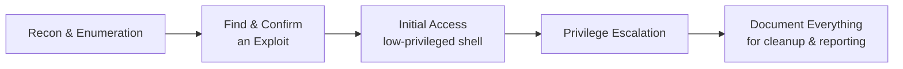

# Advanced Exploitation Lab

Basic exploitation gets you one shell on one machine. Real engagements are rarely that simple — this lab practices chaining vulnerabilities and thinking through a full compromise the way an actual penetration test unfolds.

## Recommended environment

**Metasploitable 3** (a step up in complexity from Metasploitable 2), Hack The Box machines, or TryHackMe rooms specifically tagged for exploitation practice — all free or low-cost, legal targets built for exactly this kind of exercise.

## Tasks

1. **Chain multiple vulnerabilities to gain initial access.** Real targets often don't have one single "obvious" flaw — practice the full methodology from Path 09's earlier lessons: reconnaissance to map the attack surface, enumeration to find specific service versions, then searching for and confirming an exploit (`searchsploit <service> <version>`) rather than jumping straight to a guess.
2. **Perform privilege escalation after getting a shell.** Once you have initial (likely low-privileged) access, apply the systematic enumeration approach from Path 11's Linux/Windows privesc labs — SUID binaries, `sudo -l`, weak service permissions, depending on the target OS — to escalate to full administrative control.
3. **Use or adapt existing exploit code.** Metasploit's built-in modules cover common, well-documented vulnerabilities, but real assessments regularly encounter situations requiring a public exploit script (from Exploit-DB or GitHub) adapted to the specific target — practice reading through an unfamiliar exploit script's code well enough to understand what it's actually doing before running it, rather than blindly executing code from the internet.
4. **Clean up after yourself, per the rules of engagement.** In real authorized penetration tests, cleaning up test artifacts (files dropped, accounts created, configuration changes made) after an engagement is a genuine professional responsibility defined by the client's rules of engagement — practice tracking everything you create or modify during this lab so you could remove it all afterward, exactly as a real report's methodology section would document.

:::tip Read the exploit before you run it
Especially with public exploit scripts pulled from the internet, get in the habit of at least skimming the code before executing it — beyond the security risk of running unreviewed code from an unknown source, understanding *why* an exploit works is far more valuable long-term than just knowing it works, and it's exactly the depth a real client report (and a real technical interview, per Path 13) expects.
:::

:::challenge Document the full chain
Successfully compromise your lab target using at least two distinct exploitation paths (different initial vulnerabilities, or the same initial access followed by two different privesc techniques), and document the complete chain from first reconnaissance through final privileged access — screenshots, commands used, and what each step revealed.
:::

## Key takeaway

Real compromises are almost always **chains of smaller steps**, not one dramatic exploit — recon informs which vulnerability to target, initial access is rarely the final goal, and privilege escalation usually requires its own separate investigation. Practicing the full chain, not just isolated techniques, is what actually prepares you for real engagement work.

**Next up →** [Metasploit Practical Lab](#/lesson/09-ethical-hacking/metasploit-lab)
