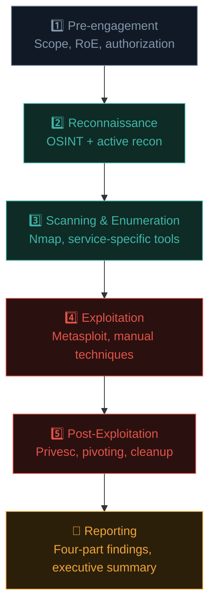
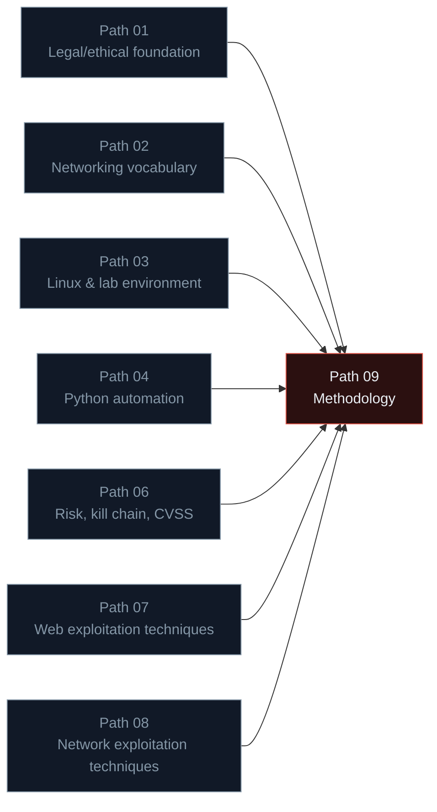
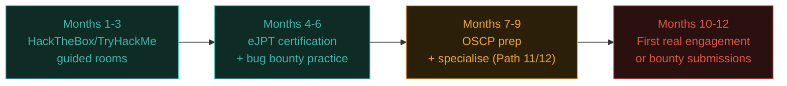

# Your ethical hacking roadmap

You now have the complete professional methodology — from signed contract to final report. This closing lesson consolidates the full picture and charts your path forward into specialisation and real-world practice.

## The complete methodology, assembled

Every single phase in this diagram now has real, hands-on lesson content behind it — you're not just reciting a framework, you've practised each piece directly in your own lab environment.

## How every previous path feeds into this one

This is genuinely the moment where the entire course converges — every earlier path was building a specific piece of the methodology you now hold as one coherent whole.

## Choosing your specialisation

Ethical hacking is a broad field. Most professionals eventually specialise. Based on what you've enjoyed most so far:

- **Loved Path 07 (web exploitation)?** → Web application penetration testing, or bug bounty hunting (Path 10 is built exactly for this).
- **Loved Path 08 (network security)?** → Network/infrastructure penetration testing, internal assessments, red teaming.
- **Curious about what happens after initial access?** → Path 11's Active Directory and privilege escalation content is your natural next step.
- **Interested in cloud environments?** → Path 11's cloud security content, plus specialised cloud security certifications.
- **Fascinated by AI systems?** → Path 12 covers AI/LLM security — a rapidly growing, relatively less-crowded specialisation.
- **Enjoy the investigative, "what actually happened" side?** → Path 11's digital forensics and incident response (DFIR) content.

There's no wrong choice — the methodology in this path applies across every one of these specialisations; only the specific technical toolkit changes.

## Building real-world credibility

Beyond certifications (Path 09.1's OSCP/eJPT/CEH/CPENT), a few concrete ways to build a genuine, verifiable track record as you progress:

- **CTF (Capture The Flag) competitions** — gamified security challenges (web, crypto, binary exploitation, forensics) that sharpen specific technical skills in a legal, structured environment. [HackTheBox](https://www.hackthebox.com/) and [TryHackMe](https://tryhackme.com/) offer excellent structured practice beyond CTFs too, with guided learning paths.
- **Bug bounty participation** (Path 10) — real, disclosed findings on real platforms build a genuinely verifiable public track record.
- **Writing up your own labs and findings publicly** — a technical blog documenting your learning (even your Metasploitable walkthroughs from this path) demonstrates communication skill directly, exactly the skill Path 09.7 emphasised.
- **Contributing to open-source security tools** — even small contributions to tools like Nmap's NSE scripts, Nuclei templates, or Metasploit modules are genuinely noticed by hiring managers in this field.

## A realistic first-year plan

This is a realistic, not overly optimistic, timeline for someone dedicating consistent part-time effort — matching well against Ishfaq's own real documented trajectory of eJPT/CEH toward CPENT and OSCP pursuit over a similar multi-month arc.

## Freelance and consultancy paths — the business side of the craft

Beyond employment at a security firm, a meaningful number of experienced testers eventually work independently — as freelance consultants or founders of small boutique testing firms. This path trades the steady structure of employment for direct control over client relationships, pricing, and specialisation focus, but it also demands a genuinely different skill set layered on top of the technical one: writing proposals and statements of work (a formalised, business-facing version of the scoping document from Path 09.2), managing client expectations and communication throughout an engagement, and handling the administrative and legal overhead of running a small business. It's not the right path for everyone, and most testers benefit from several years of employed experience first — but worth knowing it exists as a genuine long-term option, since the methodology in this path transfers completely regardless of who's signing your paycheck.

## 🧪 Lab — Your first end-to-end mini-engagement

Treat your Metasploitable VM as a genuine, if small, client engagement. Produce a **complete mini-report** covering the entire methodology from this path:

1. A one-paragraph mock scope/RoE (Path 09.2) — pretend Metasploitable is "Example Corp's legacy internal server."
2. A recon summary (Path 09.3) — even though it's a lab VM, note what you'd expect to find via OSINT in a real equivalent scenario.
3. Your scanning/enumeration findings table (Path 09.4).
4. Your exploitation log (Path 09.5).
5. Post-exploitation notes — situational awareness commands run, any privesc paths identified (Path 09.6).
6. At least one fully-written finding using the four-part structure (Path 09.7).
7. A short executive summary tying it all together.

This complete document is genuinely portfolio-worthy — a real demonstration of methodology, not just isolated technique knowledge, and a strong answer to "walk me through a penetration test you've done" in any future interview.

:::challenge Reflection
Looking back across Paths 07, 08, and 09 together — which single moment or lab felt like the biggest "click" for you, where a concept suddenly made complete sense? What was it about that moment that made it click?

A thought on this
There's no right answer, but noticing your own learning pattern here is genuinely useful — some people click hardest on hands-on labs (actually exploiting vsftpd), others on the "aha" of seeing a concept visualised (Wireshark showing a plaintext password), others on connecting theory across paths (realizing CVSS from Path 06 directly powers Path 09's reporting). Recognising which mode works best for <em>you</em> helps you choose how to structure your own continued learning in Paths 10-12 and beyond.

:::

## Key terms

- **CTF (Capture The Flag)** — gamified security challenges for legal, structured skill-building.
- **HackTheBox / TryHackMe** — popular structured practice platforms beyond this course.

## Recap

- The complete 5-phase methodology, now practised hands-on, is the foundation for every specialisation ahead.
- Every previous path in this course fed directly into the methodology assembled in Path 09.
- Specialisation (web, network, AD/privesc, cloud, AI, DFIR) builds on this shared methodology with different technical toolkits.
- CTFs, bug bounty, public writeups, and open-source contributions build genuine, verifiable real-world credibility.
- A complete, well-documented mini-engagement is a portfolio piece far more valuable than isolated technique knowledge alone.

???refs
- [HackTheBox](https://www.hackthebox.com/) — the leading hands-on practice platform.
- [TryHackMe](https://tryhackme.com/) — structured, guided learning paths for every skill level.
- [PTES — Penetration Testing Execution Standard](http://www.pentest-standard.org/) — the methodology reference underlying this entire path.
- [SANS — Security career roadmaps](https://www.sans.org/cyber-security-careers/) — further guidance on specialisation paths.
???

## 🎉 You've finished Path 09

You now hold the complete, professional penetration testing methodology — from signed authorization through recon, scanning, exploitation, post-exploitation, and clear, actionable reporting. Combined with Paths 07-08's technical depth, you have a genuinely practical, employable foundation in ethical hacking.

**Next up →** [Advanced Exploitation Lab](#/lesson/09-ethical-hacking/advanced-exploitation-lab)
