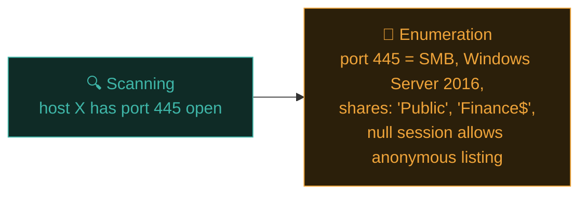

# Scanning & enumeration

Reconnaissance told you what exists. This phase goes deeper on every discovered system — systematically identifying services, versions, and configuration details that directly feed the exploitation phase. Think of it as turning a rough map into a detailed, actionable blueprint.

## Scanning vs enumeration — the distinction

- **Scanning** — broad discovery: which hosts are alive, which ports are open (Path 08.2's Nmap territory).
- **Enumeration** — going deeper on each discovered service: what exact software and version, what usernames/shares/configuration details can be extracted, often through direct interaction with the service itself.



## A systematic scanning workflow, professionally applied

Building on Path 08.2's staged approach, now across an entire in-scope environment:

```bash
# 1. Host discovery across the full scope:
nmap -sn 203.0.113.0/24 -oA discovery

# 2. Fast scan of live hosts to prioritise:
nmap -F -iL live-hosts.txt -oA quick-scan

# 3. Full, deep scan with version detection on everything:
nmap -p- -sV -sC -iL live-hosts.txt -oA full-scan

# 4. Targeted vulnerability scripts against anything interesting:
nmap --script vuln -iL live-hosts.txt -oA vuln-scan
```

For larger scopes, **Masscan** (mentioned in Path 08.8) handles the initial fast discovery across huge IP ranges far faster than Nmap alone, with Nmap then used for the detailed follow-up on whatever Masscan finds alive.

## Service-specific enumeration

Once you know *what's* running, each service type has its own enumeration techniques:

### SMB (Windows file sharing)

```bash
# List shares:
smbclient -L //target-ip -N

# Enumerate with enum4linux (comprehensive Windows/Samba enumeration):
enum4linux -a target-ip

# Modern replacement, more actively maintained:
enum4linux-ng -A target-ip
```

SMB enumeration frequently reveals share names, usernames, password policies, and sometimes even readable file shares containing genuinely sensitive documents — one of the highest-value enumeration targets in Windows environments, directly relevant to Path 11's Active Directory content.

### Web servers (building on Path 07.3)

```bash
whatweb -a 3 target-ip
gobuster dir -u http://target-ip -w /usr/share/seclists/Discovery/Web-Content/common.txt
nikto -h http://target-ip
```

### FTP

```bash
# Check for anonymous access (a shockingly common misconfiguration):
ftp target-ip
# Username: anonymous
# Password: (blank or any email-looking string)
```

### SSH

```bash
# Banner grab to identify exact version (relevant CVE lookup):
nc target-ip 22
ssh -V target-ip
```

### SNMP (often overlooked, often revealing)

```bash
# SNMP with default "public" community string is a classic, still-common misconfiguration:
snmpwalk -v2c -c public target-ip
```

A surprising number of real internal network assessments still find SNMP configured with the default `public`/`private` community strings, sometimes revealing entire network topology, running processes, and configuration details with zero authentication.

## Cross-referencing versions against known vulnerabilities

Once you have exact service versions, cross-reference against public vulnerability databases — echoing the CVE/CVSS concepts from Path 06.2:

```bash
# searchsploit — searches Exploit-DB's local mirror (pre-installed on Kali):
searchsploit "OpenSSH 7.2"
searchsploit "Apache 2.4.49"

# Or check the National Vulnerability Database directly:
# https://nvd.nist.gov/vuln/search
```

```python
#!/usr/bin/env python3
"""
version-check.py — Cross-reference Nmap XML output against searchsploit.
"""
import subprocess
import xml.etree.ElementTree as ET

def parse_nmap_xml(path: str) -> list[tuple[str, str]]:
    """Return list of (service, version) tuples from Nmap XML output."""
    tree = ET.parse(path)
    services = []
    for host in tree.findall(".//host"):
        for port in host.findall(".//port"):
            service = port.find("service")
            if service is not None:
                name = service.get("product", "")
                version = service.get("version", "")
                if name:
                    services.append((name, version))
    return services

def check_exploits(name: str, version: str):
    query = f"{name} {version}".strip()
    result = subprocess.run(
        ["searchsploit", query], capture_output=True, text=True
    )
    if "Exploits: No Results" not in result.stdout:
        print(f"\n[!] Potential match for {query}:")
        print(result.stdout)

def main():
    services = parse_nmap_xml("full-scan.xml")
    for name, version in services:
        if name and version:
            check_exploits(name, version)

if __name__ == "__main__":
    main()
```

This is exactly the kind of Python automation from Path 04 applied directly to real penetration testing workflow — parsing tool output and cross-referencing it programmatically rather than manually, at scale.

## Prioritising what to test first

A real environment might reveal dozens of services across dozens of hosts — you can't exhaustively deep-dive everything with equal priority in a time-boxed engagement. Prioritise based on:

- **Known CVEs found** for the exact version identified — highest priority, often quick wins.
- **Internet-facing vs internal-only** — external attack surface usually takes priority in external engagements.
- **Sensitive-sounding names** — shares/services named "finance," "hr," "backup," "admin" warrant closer attention.
- **Default/weak configurations** — anonymous FTP, default SNMP community strings, default credentials generally.
- **Business context from recon** — if recon revealed the company uses a specific CMS or framework, prioritise testing that stack specifically.

## Building the enumeration output into a working document

```markdown
## Scanning & Enumeration Findings — Example Corp

| Host | Port | Service | Version | Notes |
|------|------|---------|---------|-------|
| 203.0.113.10 | 445 | SMB | Samba 4.6.2 | Anonymous listing allowed; 2 shares readable |
| 203.0.113.10 | 22 | SSH | OpenSSH 7.2p2 | CVE-2016-XXXX (user enum) — searchsploit match |
| 203.0.113.15 | 80 | HTTP | Apache 2.4.49 | CVE-2021-41773 (path traversal) — HIGH PRIORITY |
| 203.0.113.20 | 161 | SNMP | net-snmp | Default 'public' community string works |
```

This table becomes the direct input for the exploitation phase — a prioritised, evidence-backed target list rather than an undifferentiated pile of scan output.

## 🧪 Lab — Full enumeration pass on your lab environment

Using your Kali VM against a second lab VM (Metasploitable is ideal — it's deliberately packed with exactly these kinds of misconfigurations):

```bash
# Full scan first:
nmap -p- -sV -sC 192.168.56.20 -oA metasploitable-scan

# Then enumerate whatever services appeared:
enum4linux-ng -A 192.168.56.20        # if SMB is present
smbclient -L //192.168.56.20 -N
ftp 192.168.56.20                      # test anonymous access
snmpwalk -v2c -c public 192.168.56.20  # if SNMP is present

# Cross-reference any identified versions:
searchsploit "vsftpd 2.3.4"    # a famously backdoored version, present on Metasploitable
```

Build a findings table like the example above from what you discover. This exact table structure is what feeds directly into Path 09.5's exploitation phase.

:::challenge Test yourself
Why is enumeration considered a distinct, deeper phase from scanning, rather than just "more scanning"?

<details><summary>Show answer</summary>Scanning answers <strong>breadth</strong> questions ("what hosts exist, what ports are open") across potentially many systems quickly. Enumeration answers <strong>depth</strong> questions on each specific discovered service — exact software versions, configuration details, usernames, shares, and other artifacts extracted through direct, service-specific interaction. It requires different tools and techniques <em>per service type</em> (SMB enumeration looks nothing like SNMP enumeration), rather than one generic broad sweep.</details>
:::

## Key terms

- **Enumeration** — deep, service-specific investigation following broad scanning.
- **enum4linux / smbclient** — SMB-specific enumeration tools.
- **searchsploit** — local Exploit-DB search tool for cross-referencing discovered versions against known exploits.
- **Anonymous/null session** — unauthenticated access sometimes still permitted by misconfigured services.

## Recap

- Scanning finds breadth (what's open); enumeration finds depth (exact versions, configs, artifacts) per service.
- Each service type (SMB, FTP, SNMP, SSH, HTTP) has its own dedicated enumeration techniques and tools.
- Cross-referencing discovered versions against searchsploit/CVE databases directly identifies exploitation candidates.
- Prioritisation (known CVEs, sensitive naming, default configs) is essential given real-world time constraints.
- A clear findings table bridges enumeration output directly into the next phase's prioritised target list.

???refs
- [enum4linux-ng](https://github.com/cddmp/enum4linux-ng) — actively maintained SMB/Samba enumeration tool.
- [searchsploit / Exploit-DB](https://www.exploit-db.com/searchsploit) — official usage documentation.
- [SANS — Enumeration techniques](https://www.sans.org/security-resources/) — further reading across service types.
- [Metasploitable 2 documentation](https://docs.rapid7.com/metasploit/metasploitable-2/) — the deliberately vulnerable practice VM used in this lesson's lab.
???

**Next up →** [Exploitation techniques](#/lesson/09-ethical-hacking/exploitation)
