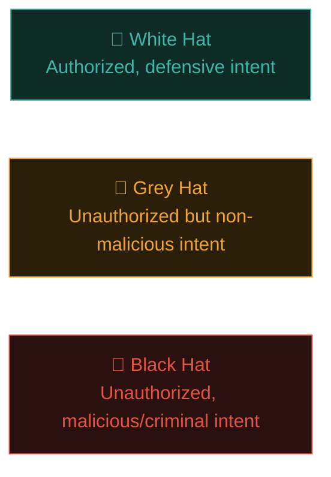

# What is ethical hacking?

You've spent Paths 07 and 08 learning individual attack techniques in isolation. Path 09 is where they come together into a **professional discipline** — with legal authorization, defined methodology, and a duty to report responsibly. This is the difference between "knowing how to pick a lock" and being a licensed locksmith hired to test a building's security.

## The core definition

**Ethical hacking** (also called **penetration testing** or **pentesting**) is the practice of legally and formally simulating real attacker techniques against an organisation's systems, with explicit authorization, in order to find and report vulnerabilities **before** malicious actors do.

The single word that separates ethical hacking from a crime is **authorization** — everything else (the tools, the techniques, the mindset) can be identical to what a real attacker does.

## The hats — a useful, if informal, taxonomy

- **White hat** — has explicit authorization, works within a defined scope, reports findings responsibly through legitimate channels. This is what this entire course prepares you for.
- **Black hat** — no authorization, malicious intent — theft, sabotage, extortion. Illegal, and outside the scope of anything this course endorses.
- **Grey hat** — technically unauthorized (e.g., testing a site without permission, or publicly disclosing a bug before the vendor is notified) but without malicious intent — often reports what they find anyway. Legally risky territory even with good intentions; most professionals and bug bounty programs (Path 10) exist specifically to give grey-hat-inclined researchers a **legal, white-hat path** to do the same work.

The overwhelming professional and legal consensus, and the position of this course: always work within explicit authorization. "I meant well" is not a legal defence in most jurisdictions if you lacked permission.

## Why organisations actually pay for this

It might seem strange that companies pay people to attack them — but the logic is simple and compelling:

- **Real attackers will try anyway**, for free, without permission, without a defined scope, and without ever telling you what they found.
- **Finding a vulnerability yourself, on your own terms, is vastly cheaper** than the cost of an actual breach — incident response, regulatory fines, reputational damage, customer trust (recall the risk framework from Path 06.2).
- **Compliance requirements** (Path 06.8 — PCI DSS, SOC 2, HIPAA) often explicitly *mandate* regular penetration testing as a condition of certification or contract.
- **A fresh, adversarial perspective** genuinely finds things internal teams miss — the same reasoning behind Path 10's bug bounty model.

## Penetration testing vs. other related disciplines

It's worth distinguishing ethical hacking from adjacent, sometimes-confused roles:

| Discipline | Focus |
|---|---|
| **Penetration testing** | Simulating specific attack scenarios against defined scope, typically time-boxed (days to weeks) |
| **Red teaming** | Broader, more realistic adversary simulation — often testing detection/response capability too, not just finding vulnerabilities, over a longer engagement |
| **Vulnerability assessment** | Primarily identifying and cataloguing vulnerabilities (often via automated scanning), less emphasis on active exploitation |
| **Bug bounty** | Ongoing, crowdsourced, pay-per-valid-finding model open to many researchers simultaneously (Path 10) |
| **AppSec engineering** | Building security *into* the development process itself (SAST/DAST pipelines, secure code review) — proactive rather than adversarial testing |

Ishfaq's own real-world role spans several of these — secure SDLC and pipeline work (AppSec engineering) alongside active penetration testing and bug bounty work.

## The essential legal foundation, reinforced

Recall Path 01's golden rule. Before *any* ethical hacking engagement begins, professional practice requires:

- **A signed contract or Statement of Work (SOW)** defining exactly what's in scope.
- **Explicit written authorization** — often called a **"Get Out of Jail Free" letter** in the industry, though it's a real, legally meaningful authorization document, not a joke.
- A clearly defined **Rules of Engagement (RoE)** — covered in depth next lesson — specifying testing windows, prohibited techniques, emergency contacts, and escalation procedures.

Skipping any of this, even with good intentions, transforms legitimate security work into a potential crime — the exact distinction the "hats" taxonomy above is built around.

## Black box, white box, and grey box — how much the tester knows going in

Beyond intent and authorization, engagements are also categorised by how much internal information the tester starts with, and this choice shapes the entire methodology that follows. **Black box** testing gives the tester nothing beyond a target's public-facing name or URL — mimicking a genuine external attacker with zero inside knowledge, which makes Phase 1 reconnaissance (next lesson) especially critical and time-consuming. **White box** testing gives the tester full access up front — source code, network diagrams, credentials, architecture docs — trading realism for thoroughness, since far more of an application's attack surface can be reviewed directly rather than discovered through trial and error. **Grey box** sits between the two — some information provided (perhaps a test account and basic architecture) but not full internal access — and is, in practice, the most common real-world engagement type, since it balances realistic external testing with efficient use of a client's limited testing budget and timeline.

## Relevant certifications in this space

You'll encounter these constantly in job listings and professional development:

- **eJPT (eLearnSecurity Junior Penetration Tester)** — a well-regarded, practical entry-level certification.
- **OSCP (Offensive Security Certified Professional)** — one of the most respected, famously difficult, hands-on penetration testing certifications in the industry.
- **CEH (Certified Ethical Hacker)** — a widely-recognised, broad-coverage certification, often useful for HR/compliance checkbox requirements even where its practical rigor is debated among practitioners.
- **CPENT (Certified Penetration Testing Professional)** — an advanced, heavily practical certification covering AD attack chains, binary exploitation, IoT, and pivoting — directly relevant to Ishfaq's own recent professional achievement.
- **OSCE³ / OSWE** — advanced, specialised offensive security certifications for web application exploitation and beyond.

## The mindset shift this path represents

Everything from Path 07 and Path 08 was learned largely **in isolation** — one vulnerability class at a time, one tool at a time, in hosted labs. Path 09 is about developing **methodology** — the disciplined, repeatable process of moving from "nothing" to "a complete, professional assessment," in the right order, with the right documentation, and the right communication throughout.

## 🧪 Lab — Research a real, disclosed engagement

Search for a publicly disclosed penetration test report or bug bounty writeup (many security firms and researchers publish sanitised, anonymised examples; HackerOne's Hacktivity feed, mentioned in Path 07.4, is a great source). For one you find, identify:

1. What was explicitly in scope?
2. What methodology steps are visible in the writeup (recon, then testing, then reporting)?
3. How is the finding communicated — technical detail, business impact, remediation guidance?

This is exactly the kind of "read real examples" research that accelerates learning a new professional discipline faster than theory alone.

:::challenge Test yourself
Two people use the exact same tools and techniques to find the exact same SQL injection vulnerability on the exact same website. One has a signed contract and defined scope from the company; the other does not. What's the single word that determines whether one is legitimate professional work and the other is a crime?

Show answer
<strong>Authorization.</strong> The technical actions are identical — the entire legal and ethical distinction rests on whether explicit, informed permission was granted beforehand. This is the single most important concept underlying this entire path.

:::

## Key terms

- **Ethical hacking / penetration testing** — authorized simulation of real attacks to find vulnerabilities before malicious actors do.
- **White hat / grey hat / black hat** — the informal taxonomy of hacker intent and authorization status.
- **Red teaming** — broader adversary simulation, often testing detection/response, not just finding bugs.
- **Rules of Engagement (RoE)** — the formal document defining scope, boundaries, and procedures for an engagement.
- **OSCP / eJPT / CEH / CPENT** — major industry certifications in this field.

## Recap

- Ethical hacking is legally authorized adversarial testing — authorization is the entire distinction from criminal hacking.
- Organisations pay for this because real attackers try anyway, for free, and a breach costs far more than a proactive test.
- Penetration testing, red teaming, vulnerability assessment, bug bounty, and AppSec engineering are related but distinct disciplines.
- Explicit written authorization and defined Rules of Engagement are non-negotiable prerequisites for any real engagement.
- This path shifts focus from individual techniques (Paths 07–08) to professional methodology.

???refs
- [PTES — Penetration Testing Execution Standard](http://www.pentest-standard.org/) — a widely-referenced methodology framework.
- [SANS — Penetration Testing resources](https://www.sans.org/security-resources/) — extensive further reading.
- [Offensive Security — OSCP](https://www.offsec.com/courses/pen-200/) — the certification's official page.
- [EC-Council — CPENT](https://www.eccouncil.org/train-certify/certified-penetration-testing-professional-cpent/) — official certification details.
???

**Next up →** [The 5 phases of penetration testing](#/lesson/09-ethical-hacking/the-5-phases)
