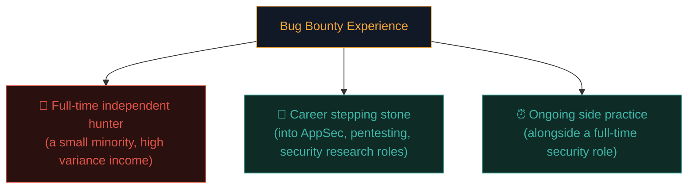
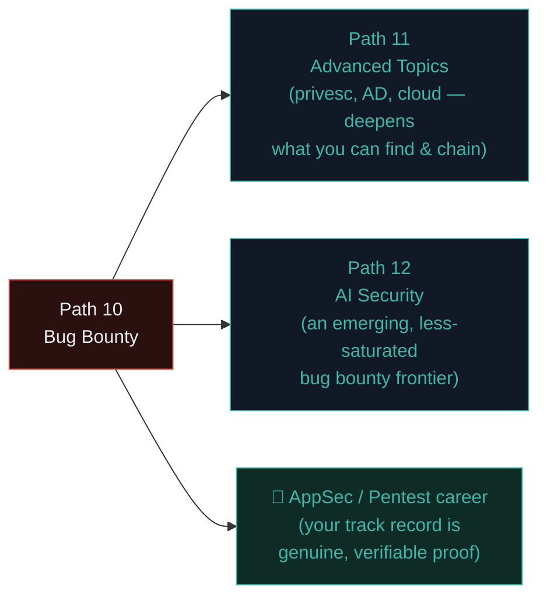

# Building a bug bounty career

You've now covered the complete practical toolkit — program selection, recon automation, IDOR/access control hunting, business logic and chaining, and Nuclei automation. This closing lesson looks at the bigger picture: building this into a sustainable practice, whether as a side pursuit, a career, or a stepping stone into other security roles.

## The three broad paths bug bounty hunters take



All three are legitimate, valuable paths — and importantly, **not mutually exclusive over time**. Many successful full-time hunters started as side-practice hobbyists; many AppSec engineers (Ishfaq's own professional context) maintain active bug bounty practice alongside full-time employment specifically because it keeps offensive skills sharp against real, current systems in a way that defensive daily work alone doesn't always provide.

## Building a genuine track record

Recall Path 09.8's career-building section — bug bounty provides something particularly powerful: **verifiable, public proof of skill**, independent of where you went to school or who you know.

- **HackerOne/Bugcrowd profile reputation** — accumulated valid findings, response quality, and platform-specific reputation scores are directly visible to potential employers who know to look.
- **CVE credits** — some bug bounty findings, especially against open-source software or widely-used products, result in an official CVE assigned with your name credited — a genuinely durable, searchable public credential.
- **Hall of Fame / acknowledgment pages** — many companies maintain public security acknowledgment pages crediting researchers who've reported valid findings, even without monetary reward for lower-severity issues.
- **Conference talks and write-ups** — presenting an interesting chained finding (Path 10.6) at a local security meetup or conference, or publishing a detailed technical write-up (after receiving disclosure authorization, per Path 10.4), builds visibility and demonstrates communication skill directly.

## Specialising for a competitive edge

Recall Path 10.2's "fit with your own skillset" factor — as you progress, genuine specialisation tends to outperform staying a generalist:

- **Deep API/GraphQL specialists** — as more applications move to API-first architectures (Path 05.5), specialists who deeply understand API-specific bug patterns (BOLA, excessive data exposure, rate limiting gaps) find a genuinely under-saturated niche.
- **Mobile application specialists** — a substantially different skillset (static/dynamic analysis of iOS/Android binaries) with far fewer hunters actively competing than web-focused programs.
- **Cloud misconfiguration specialists** — directly building on Path 11's cloud security content; misconfigured cloud storage, overly permissive IAM roles, and SSRF-to-metadata patterns (Path 07.8) remain a rich, ongoing source of findings.
- **A specific tech stack or CMS** — becoming genuinely expert in one widely-used platform's common misconfiguration patterns (a specific popular CMS, a specific API gateway product) lets you efficiently apply that deep knowledge across every program using that same stack.

## Time management and avoiding burnout

A realistic, sustainable practice pattern that experienced hunters consistently recommend:

- **Time-box hunting sessions** — decide in advance ("I'll spend 2 hours on Program X tonight") rather than open-ended, potentially demoralising unlimited searching for a bug that may not exist on a given day.
- **Rotate between programs** — recall Path 10.2's under-hunted-program strategy; getting genuinely "stuck" on one heavily-picked-over target for weeks is a common trap.
- **Celebrate learning, not just payouts** — every session that deepens your recon pipeline (Path 10.3), sharpens your logic-flaw intuition (Path 10.6), or adds a working Nuclei template (Path 10.7) to your permanent toolkit has lasting value **independent** of whether that specific session produced a paid finding.
- **Recognise duplicate/no-bugs-found sessions as entirely normal**, not a sign of failure — recall Path 10.1's realistic expectations section.

## Building your own recon and tooling library over time

The scripts and templates you've built throughout Path 10 — the diffing script, the custom Nuclei templates, the report-drafting automation — should be treated as a **growing, permanent personal asset**, not one-off exercises:

```bash
# A sensible personal structure to maintain and grow over time:
~/bugbounty/
├── recon-pipeline.sh
├── diff-recon.py
├── nuclei-to-report.py
├── custom-templates/
│   ├── exposed-env-file.yaml
│   └── (your own templates, growing over time)
├── programs/
│   ├── program-a/
│   │   ├── recon-2026-07-13/
│   │   └── notes.md
│   └── program-b/
└── report-templates/
    └── standard-report-template.md
```

This structure — genuinely mirroring how experienced hunters (and directly, Ishfaq's own real Burp Suite + MCP + Cline automation setup) actually organise their ongoing practice — compounds in value every single session, since each new custom template or refined script immediately benefits every future target you point it at.

## How this connects to the rest of your security journey



- **Path 11** directly deepens what you're capable of finding and chaining — privilege escalation and Active Directory knowledge, in particular, massively expand the scope of realistic post-access impact you can demonstrate in a report (recall Path 10.6's chaining lesson).
- **Path 12 (AI Security)** represents a genuinely emerging, comparatively under-saturated bug bounty frontier as more companies deploy LLM-powered features and correspondingly launch AI-specific bounty scope — an area worth watching closely given the field's current early-stage maturity.
- Every skill in this path — systematic methodology, clear reporting, disciplined scope respect — is **directly, immediately transferable** to a formal AppSec or penetration testing career, exactly as Path 09.8 outlined.

## 🧪 Lab — Write your own personal bug bounty practice plan

Drawing on everything from this entire path, write a short, personal plan covering:

1. Which 2-3 programs will you focus on initially (from your Path 10.2 shortlist)?
2. What's your weekly time commitment, and how will you time-box sessions to avoid burnout?
3. Which specialisation area (API, mobile, cloud, a specific tech stack) most interests you, and why?
4. What's the first custom Nuclei template or automation script you'll build and add to your permanent toolkit?
5. How will you track your own progress and learning, independent of whether you find a paid bug this month?

This plan — genuinely written for yourself, not as an abstract exercise — is exactly the kind of self-directed structure that turns course content into sustained, real-world practice.

:::challenge Reflection
Across this entire path, which single concept do you think will matter most for your own long-term practice: program selection strategy, recon automation, the IDOR/access-control methodology, business logic thinking, or Nuclei template-writing?

<details><summary>A thought on this</summary>There's no universally correct answer, but it's worth noticing that <strong>program selection</strong> and <strong>business logic thinking</strong> are the two skills that scale entirely independent of any specific tool — they're durable, transferable judgment that will still matter even as specific tools evolve or get replaced over the coming years, while tool-specific skills (a particular Nuclei syntax, a particular platform's UI) will need periodic refreshing as the ecosystem changes. Building strong fundamentals in the durable, judgment-based skills tends to pay off longest.</details>
:::

## Key terms

- **Track record** — the accumulated, publicly verifiable body of valid findings and platform reputation.
- **Specialisation** — focusing deeply on a specific bug class, tech stack, or platform type for competitive advantage.
- **Personal toolkit** — the growing library of scripts, templates, and automation built and refined across sessions over time.

## Recap

- Bug bounty experience serves as full-time work, a career stepping stone, or sustained side practice — all legitimate paths.
- Public track record (platform reputation, CVE credits, acknowledgment pages) provides genuinely verifiable proof of skill.
- Specialisation in API/GraphQL, mobile, cloud, or a specific tech stack offers a competitive edge over staying a generalist.
- Sustainable practice requires time-boxing, program rotation, and valuing learning independent of payout outcomes.
- Your personal recon pipeline and template library compound in value every session — treat it as a permanent, growing asset.

???refs
- [HackerOne — Hacker101](https://www.hacker101.com/) — free, structured bug bounty learning platform with its own CTF.
- [Bugcrowd University](https://www.bugcrowd.com/hackers/bugcrowd-university/) — free structured learning content.
- [Nahamsec — YouTube](https://www.youtube.com/@Nahamsec) — a well-known bug bounty hunter's extensive free educational content and live hacking sessions.
- [CVE Program](https://www.cve.org/) — official CVE assignment process for eligible findings.
???

## 🎉 You've finished Path 10

You now have a complete, practical bug bounty methodology — program selection, automated recon pipelines, systematic IDOR/access-control hunting, business logic and chaining thinking, Nuclei-based automation, and a realistic framework for building this into a sustainable long-term practice. Combined with Paths 07-09, you have genuine, employable, and directly monetisable security skills.

**Next up →** [Path 11: Linux privilege escalation](#/lesson/11-advanced/linux-privesc)
