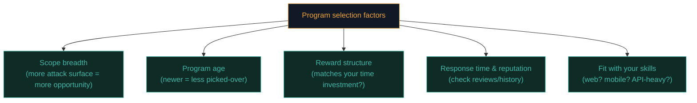

# Choosing programs & scope

With thousands of active bug bounty programs available, choosing *where* to spend your time is arguably as important as your technical skill. This lesson teaches the selection strategy experienced hunters actually use.

## Why program selection matters so much

Recall Path 10.1's reality check — most bugs get found by *someone*, and duplicates are common. Choosing a program with **less competition relative to its attack surface** dramatically improves your odds versus randomly picking the most famous, most-hunted programs everyone else is already hammering.

## Reading a scope document properly

Every program publishes a **scope** — exactly what's in bounds. Read it as carefully as a legal document, because that's precisely what it is.

```markdown
## Example scope excerpt

IN SCOPE:
- *.example.com (all subdomains)
- Example iOS app (App Store, version 4.2+)
- api.example.com

OUT OF SCOPE:
- blog.example.com (third-party hosted, WordPress.com)
- Denial of service testing
- Social engineering of employees
- Physical security testing
- Third-party integrations (Stripe, Auth0) — report to those vendors directly

PROHIBITED ACTIONS:
- Automated scanning without rate limiting (max 10 req/sec)
- Testing against production data belonging to real customers
- Accessing more data than necessary to prove a vulnerability
```

Notice: `*.example.com` looks broad, but `blog.example.com` is explicitly **excluded** despite matching that wildcard pattern — a direct, careful read is essential, not just a glance at the top-line scope statement.

## Key factors when choosing a program



### Program age and popularity

A program that just launched, or one that's relatively unknown, has had **far fewer eyes on it** than a famous, years-old program with a huge, prominent reward table. Newer/smaller programs are often systematically under-hunted relative to their actual attack surface — genuinely valuable bugs are more likely to still be sitting there, unfound.

### Scope breadth — wildcards are opportunity

A program scoping `*.example.com` (all subdomains) offers vastly more attack surface than one scoping only `www.example.com`. Recall Path 07.3's subdomain enumeration techniques — a broad wildcard scope rewards exactly that recon work, since many hunters only test the obvious main domain and never discover the forgotten staging environment or internal tool accidentally exposed on a subdomain.

### Reward structure alignment

Some programs pay generously for critical findings but poorly for mediums; others have flatter, more consistent reward curves. If you're specialising in a particular bug class (Path 10.5's IDOR focus, for instance), check whether that program's reward table actually values that class appropriately relative to your expected time investment.

### Response time and program reputation

Platforms typically show **average response time** and **resolution rate** statistics for each program. A program with a poor track record of slow responses or frequent "informative" (unpaid) closures on valid-seeming reports is a signal to weigh carefully — your time has real value, and a well-run program respects that with prompt, fair triage.

### Fit with your own skillset

If you've specialised deeply in web application testing (Path 07's content), a program primarily focused on mobile app or hardware/IoT testing may not be the best use of your current strengths — though cross-training is valuable long-term, focusing early efforts where your skills are already strongest tends to produce results faster.

## Building a target shortlist

A practical, systematic approach:

```python
#!/usr/bin/env python3
"""
program-shortlist.py — A simple framework for scoring bug bounty programs
based on the factors discussed in this lesson. Scores are illustrative —
adjust weights to match your own priorities.
"""

programs = [
    {"name": "BigTechCorp", "age_months": 60, "scope_wildcards": 2, "avg_reward_high": 3000, "response_days": 3},
    {"name": "NewFinTechApp", "age_months": 4, "scope_wildcards": 8, "avg_reward_high": 1500, "response_days": 5},
    {"name": "EstablishedSaaS", "age_months": 36, "scope_wildcards": 1, "avg_reward_high": 5000, "response_days": 14},
]

def score(program: dict) -> float:
    # Lower age = higher opportunity score (newer, less picked-over)
    age_score = max(0, 100 - program["age_months"]) / 100
    # More wildcards = more attack surface
    scope_score = min(program["scope_wildcards"] / 10, 1.0)
    # Faster response = better experience
    response_score = max(0, 30 - program["response_days"]) / 30
    reward_score = min(program["avg_reward_high"] / 5000, 1.0)

    return (age_score * 0.3 + scope_score * 0.3 +
            response_score * 0.2 + reward_score * 0.2)

for p in sorted(programs, key=score, reverse=True):
    print(f"{p['name']}: {score(p):.2f}")
```

This is a genuinely realistic example of the kind of small Python tool (Path 04's skills, directly applied) experienced hunters build to systematically evaluate opportunities rather than picking programs purely by gut feeling or fame.

## Private vs public programs

- **Public programs** — open to any registered researcher immediately. More competition, but zero barrier to entry.
- **Private programs** — invite-only, typically extended to researchers who've demonstrated quality work on public programs first. Significantly less competition, since the researcher pool is deliberately limited — often where experienced hunters find their best results.

Building toward private program invitations is a genuine, achievable milestone — consistently submitting high-quality, well-written reports (Path 09.7's discipline, applied here) on public programs is exactly how those invitations get extended.

## Bounty type — pay-per-report vs managed/continuous programs

Beyond public/private status, programs also differ in how consistently they pay out. **Pay-per-report** programs reward each individual valid finding on its own merits, which is the default model most beginners picture. Some platforms also offer **managed programs** where the company works with the platform's own internal triage team before a report ever reaches the client — often resulting in faster, more consistent responses since a professional triager has already validated the report's quality and severity before the client sees it, compared to **self-managed** programs where the company's own (sometimes less experienced, sometimes slower) internal team handles every incoming report directly. Checking which model a program uses is a genuinely practical signal worth factoring into the response-time expectations from the scoring framework above — a managed program's triage overhead can mean a slightly longer initial wait but a more consistent, professional outcome.

## Reading program policy for legal safety

Beyond scope, always check:

- **Safe harbor language** — does the program explicitly commit not to pursue legal action against good-faith research within scope? Most reputable programs include this; treat its absence as a serious red flag.
- **Data handling requirements** — many programs require you to **stop testing and report immediately** upon accessing real sensitive data, rather than continuing to explore (directly echoing Path 09.6's "demonstrate, don't exfiltrate" principle).
- **Disclosure policy** — can you ever publish your findings publicly, and if so, after what waiting period and with what approval process?

## 🧪 Lab — Build your own shortlist

1. Browse HackerOne's and Bugcrowd's public program directories.
2. Identify 5 programs that interest you, and for each, note: scope breadth, program age (if visible), reward range, and response time statistics.
3. Read the full scope and policy document for your top 2 choices, specifically checking for safe harbor language and any prohibited actions.
4. Using the scoring framework above (or your own weighting), rank your shortlist and pick one program to focus your Path 10 practice on for the remaining lessons in this path.

:::challenge Test yourself
A program's scope lists `*.example.com` as in-scope. During recon, you discover `blog.example.com` is hosted entirely on a third-party platform (WordPress.com) with no direct infrastructure connection to Example Corp. Should you test it?

<details><summary>Show answer</summary>Check the scope document's explicit exclusions <strong>before</strong> assuming a wildcard covers everything — many programs specifically exclude third-party-hosted subdomains exactly like this, even when they technically match the wildcard pattern, precisely because the underlying infrastructure isn't actually owned or controlled by the company running the program (WordPress.com's own security, not Example Corp's, would be responsible for that infrastructure). Always look for an explicit "out of scope" list before testing anything that seems like it might be third-party hosted.</details>
:::

## Key terms

- **Scope document** — the precise, legally-meaningful definition of what's authorized for testing.
- **Safe harbor** — a program's explicit commitment not to pursue legal action against good-faith in-scope research.
- **Private program** — invite-only, typically extended after demonstrating quality on public programs.
- **Wildcard scope** — a broad scope definition (e.g., `*.example.com`) rewarding thorough subdomain recon.

## Recap

- Program selection is a genuine strategic skill, not just picking the most famous option available.
- Program age, scope breadth, reward structure, and response reputation all factor into smart selection.
- Wildcard scopes reward the subdomain enumeration techniques from Path 07.3.
- Private programs, earned through consistent quality public work, typically offer significantly less competition.
- Always verify safe harbor language and explicit scope exclusions before testing anything.

???refs
- [HackerOne — Directory](https://hackerone.com/directory/programs) — browsable public program listings.
- [Bugcrowd — Programs](https://www.bugcrowd.com/programs/) — browsable public program listings.
- [Disclose.io — Safe Harbor project](https://disclose.io/) — standardised safe harbor language and legal resources for researchers.
- [Bugcrowd — Vulnerability Rating Taxonomy](https://bugcrowd.com/vulnerability-rating-taxonomy) — understanding how severity maps to reward expectations.
???

**Next up →** [Building a recon pipeline](#/lesson/10-bug-bounty/recon-pipeline)
