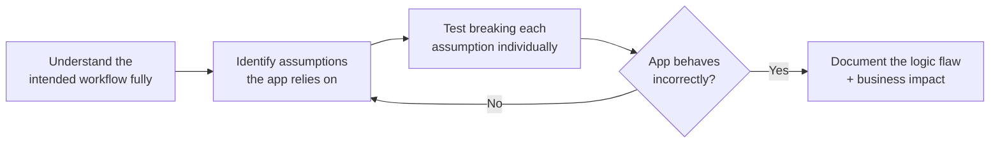

# Logic Bug Hunting Lab

Business logic vulnerabilities are, in many ways, harder to find than technical bugs like SQLi or XSS — no scanner catches them, because there's no malformed input involved at all, only a *legitimate* request made in a sequence or context the developer never anticipated. This lab practices the specific mindset that finds them.

## Focus areas

- **Race conditions** — exploiting the tiny time window between an action being checked and being completed (e.g., submitting the same "redeem coupon" request twice, simultaneously, before the server marks it as used).
- **Payment bypasses** — manipulating price, quantity, or currency parameters client-side before a request reaches the server, or exploiting a checkout flow that trusts a client-supplied total instead of recalculating it server-side.
- **IDOR with business impact** — beyond simply viewing another user's data (Path 07's IDOR lesson), IDOR that lets you *modify* another user's data or *act as* them carries far greater real-world severity.
- **Workflow bypasses** — skipping a required step by directly navigating to a later step's URL or API endpoint (e.g., reaching an order confirmation page without ever completing payment).
- **Price manipulation** — modifying a hidden price field, a discount code's underlying value, or a quantity that goes negative to produce an unintended (often favorable-to-the-attacker) total.
- **Authentication/authorization logic flaws** — a password reset flow that doesn't properly bind the reset token to the specific account requesting it, or a permission check that verifies a role client-side but not server-side.

- **State desynchronization across multiple sessions/tabs** — opening the same workflow (a shopping cart, a multi-step form) in two browser tabs simultaneously and making conflicting changes in each, checking whether the server correctly resolves the conflict or silently corrupts state by trusting whichever request happened to arrive last.

## Lab approach

Use a deliberately vulnerable app (several free options exist for business-logic-specific practice, or a wide-scope real bug bounty program) and, critically, spend real time *understanding the intended workflow first* — read through the checkout flow, the coupon redemption flow, the account settings flow, end to end, as a normal user would use it — before trying to break any assumption within it. This is the actual methodology, not a shortcut you can skip.

:::tip Ask "what is this workflow assuming?" for every step
This is the exact same core question from Path 01's Security Mindset Lab, applied specifically to application workflows: does this checkout flow assume the price sent by the client matches what was actually displayed? Does this coupon-redeem endpoint assume it can only be called once? Does this password reset assume the token can only be used by the person who requested it? Every assumption is a hypothesis worth testing directly.
:::

:::tip Keep a running "assumptions log" per target
As you work through an application's workflows, write down every assumption you notice the moment you notice it — even ones you haven't tested yet — in a simple running list. Revisiting this log after finishing your first pass often surfaces two or three assumptions you noted but forgot to actually go back and test, which is a genuinely common way real findings slip through even careful manual testing.
:::

:::challenge Find and document a logic flaw
In a test environment (or, if you have a specific wide-scope program's explicit permission, a real target), find at least one business logic flaw and document it: what the intended workflow was supposed to enforce, exactly what assumption broke, how you exploited it, and — critically — the **business impact** in plain terms (e.g., "an attacker could redeem the same one-time discount code unlimited times," not just "found a race condition").
:::

## Key takeaway

Logic bugs require genuinely understanding how an application is *supposed* to work before you can find where that intention breaks down — no automated scanner replaces this understanding, which is exactly why skilled logic-bug hunters remain in high demand even as automated tooling improves at finding technical vulnerability classes.

**Next up →** [Recon Pipeline Lab](#/lesson/10-bug-bounty/recon-pipeline-lab)
