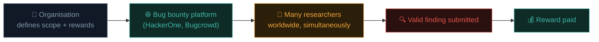

# What is bug bounty hunting?

Path 09 gave you the formal, contracted penetration testing model. Bug bounty is a different, increasingly dominant model for the same underlying goal — and it's where much of the individual, self-directed side of this entire field now lives.

## The core model

A **bug bounty program** is an ongoing, standing invitation from an organisation for **any** researcher (not just contracted testers) to find and responsibly report vulnerabilities in their defined scope, in exchange for a **reward** — typically money, but sometimes recognition/swag for lower-severity findings.

## Bug bounty vs. traditional penetration testing

| Aspect | Penetration test (Path 09) | Bug bounty |
|---|---|---|
| **Duration** | Time-boxed (days-weeks) | Ongoing, indefinite |
| **Testers** | One firm/team, contracted | Many independent researchers, simultaneously |
| **Payment** | Fixed fee regardless of findings | Pay-per-valid-finding, severity-based |
| **Coverage** | Deep, systematic within scope | Broad, opportunistic, driven by researcher interest |
| **Relationship** | Formal contract, NDA, defined engagement | Program terms/policy, often more informal |

Neither model replaces the other — most mature security programs run **both**: periodic formal pentests for systematic, deep coverage, plus an ongoing bug bounty program for continuous, crowdsourced coverage between those formal engagements.

## Why organisations run bug bounty programs

- **Continuous coverage** — code changes constantly; a pentest is a snapshot, bug bounty is ongoing.
- **Diverse perspectives** — thousands of researchers worldwide bring far more varied approaches and creativity than any single contracted team.
- **Pay for results, not time** — you only pay for genuine, valid findings, not billable hours regardless of outcome.
- **A legal, structured channel** for the "grey hat" researcher (Path 09.1) who might otherwise disclose findings less responsibly, or not at all.

## Why individuals pursue bug bounty hunting

- **No formal employment relationship required** — genuinely accessible from anywhere in the world, on your own schedule, directly relevant to Ishfaq's own active practice.
- **Direct, tangible proof of skill** — a public track record of valid, disclosed findings is often more persuasive to employers than certifications alone.
- **Real financial upside** — top bounty hunters earn substantial income; even part-time, consistent participation can meaningfully supplement other income.
- **Genuinely enjoyable for many** — the "detective work" of finding a real, valid bug in a live system many others have already looked at has a distinct appeal beyond structured lab exercises.

## The major platforms

- **[HackerOne](https://hackerone.com/)** — one of the largest platforms, hosting programs for major tech companies, government agencies, and everything in between. Its public **Hacktivity** feed (referenced back in Path 07.4) is an excellent, freely browsable source of real, disclosed reports for learning.
- **[Bugcrowd](https://www.bugcrowd.com/)** — another major platform with a similarly broad range of programs.
- **[Intigriti](https://www.intigriti.com/)** — a strong, growing European-based platform.
- **[YesWeHack](https://www.yeswehack.com/)** — another significant international platform.
- **Direct/independent programs** — many large companies (Google, Microsoft, Meta, Apple, and countless others) run their own programs directly, outside the major platforms, often with their own dedicated portals and disclosure policies.

## Severity and reward structures

Most programs use a scale directly related to Path 06.2/09.7's CVSS concepts:

| Severity | Typical reward range | Example finding |
|---|---|---|
| **Critical** | $2,000–$50,000+ | Remote code execution, full account takeover at scale |
| **High** | $500–$5,000 | SQLi, significant IDOR affecting sensitive data |
| **Medium** | $100–$1,000 | Reflected XSS, less severe access-control issues |
| **Low** | $50–$300 (or swag/recognition) | Minor information disclosure, missing security headers |

Ranges vary **enormously** by program — a Fortune 500 tech company's critical-severity reward might dwarf a smaller startup's entire program budget. Always check the specific program's published reward table rather than assuming these figures apply universally.

## A realistic picture — managing expectations

Bug bounty hunting has genuine earning potential, but the field is also **highly competitive** and the popular narrative of "quit your job and make six figures hunting bugs" represents a small minority of participants, not the median experience. Realistic expectations for someone starting out:

- Most beginners find **zero or very few** valid bugs in their first weeks/months — this is completely normal, not a sign you're doing something wrong.
- **Duplicate submissions** (someone else found and reported the same bug first) are extremely common, even for genuinely skilled hunters — programs typically only pay the *first* valid report of a given issue.
- **Consistency and specialisation** (Path 10.6/10.7 will cover this) matter far more than raw hours spent — targeted, methodical hunting significantly outperforms broad, unfocused effort.
- Many successful hunters treat it as a **skill-building and portfolio-building activity first**, with financial reward as a genuinely welcome but secondary outcome, especially early on.

## The legal and ethical framework, reinforced

Recall Path 09.1's authorization principle — bug bounty programs provide **exactly** this authorization, but strictly bounded by each program's specific **scope and policy** document (the direct analogue of Path 09.2's Rules of Engagement). Testing anything outside a program's explicitly published scope is not authorized, even on the same company's infrastructure, and can expose you to real legal risk despite good intentions.

## 🧪 Lab — Explore real bug bounty programs

1. Create a free account on [HackerOne](https://hackerone.com/) or [Bugcrowd](https://www.bugcrowd.com/).
2. Browse the public program directory — look at 5 different programs' **scope** and **reward table** pages.
3. On HackerOne, browse the **Hacktivity** feed (filter for disclosed reports) and read 3 full reports end-to-end.
4. For each report you read, identify: what vulnerability class (map it back to the OWASP Top 10 from Path 07.1), what severity, and how clearly the four-part reporting structure from Path 09.7 was followed.

This is genuinely one of the best uses of time for anyone starting in this field — real, disclosed reports teach patterns no course alone fully replicates.

:::challenge Test yourself
Two researchers independently discover and report the exact same SQL injection vulnerability on the same program, four hours apart. What typically happens regarding payment for the second report?

Show answer
Most programs operate on a <strong>"first valid report wins"</strong> basis — the second researcher's report is typically marked as a <strong>duplicate</strong> and does not receive payment, even though their finding was independently discovered and equally valid technically. This is a well-known, sometimes frustrating reality of the field, and part of why speed/consistency in hunting genuinely matters, alongside pure technical skill.

:::

## Key terms

- **Bug bounty program** — an ongoing, standing invitation for researchers to find and report vulnerabilities for reward.
- **Scope / policy** — the program's defined boundaries, the bug bounty analogue of a pentest's RoE.
- **Hacktivity** — HackerOne's public feed of disclosed vulnerability reports.
- **Duplicate** — a report of an issue already found and reported by someone else, typically unpaid.

## Recap

- Bug bounty is an ongoing, crowdsourced complement to (not replacement for) traditional penetration testing.
- Organisations benefit from continuous coverage and diverse researcher perspectives; researchers benefit from flexibility, skill-building, and financial upside.
- Major platforms (HackerOne, Bugcrowd, Intigriti, YesWeHack) host thousands of programs with published scope and reward structures.
- Realistic expectations matter — duplicates are common, and consistency/specialisation outperforms raw effort.
- A program's published scope is the exact legal authorization boundary — testing outside it is not authorized, regardless of target ownership.

???refs
- [HackerOne — Hacktivity](https://hackerone.com/hacktivity) — real, disclosed reports for learning.
- [Bugcrowd — University](https://www.bugcrowd.com/hackers/bugcrowd-university/) — free structured bug bounty learning content.
- [OWASP — Vulnerability Disclosure Cheat Sheet](https://cheatsheetseries.owasp.org/cheatsheets/Vulnerability_Disclosure_Cheat_Sheet.html)
- [Bugcrowd — Vulnerability Rating Taxonomy](https://bugcrowd.com/vulnerability-rating-taxonomy) — a widely-referenced severity classification standard.
???

**Next up →** [Choosing programs & scope](#/lesson/10-bug-bounty/choose-programs)
