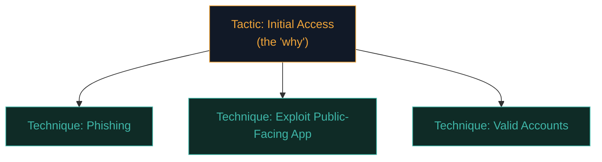

# Attackers & the kill chain

Real attacks aren't a single dramatic moment — they're a sequence of stages, each with its own techniques and its own defensive opportunities. Understanding this sequence is one of the most valuable mental models in all of security.

## The Cyber Kill Chain

Developed by Lockheed Martin, this is the classic 7-stage model of how an intrusion unfolds:

```mermaid
flowchart LR
    R[1. Reconnaissance] --> W[2. Weaponization]
    W --> D[3. Delivery]
    D --> E[4. Exploitation]
    E --> I[5. Installation]
    I --> C[6. Command & Control]
    C --> Ac[7. Actions on Objectives]

    style R fill:#111927,color:#3FB6A8,stroke:#3FB6A8
    style W fill:#111927,color:#3FB6A8,stroke:#3FB6A8
    style D fill:#2b1f0a,color:#EFA43A,stroke:#EFA43A
    style E fill:#2b1010,color:#E05548,stroke:#E05548
    style I fill:#2b1010,color:#E05548,stroke:#E05548
    style C fill:#2b1010,color:#E05548,stroke:#E05548
    style Ac fill:#2b1010,color:#E05548,stroke:#E05548
```

1. **Reconnaissance** — the attacker researches the target: employee names on LinkedIn, technologies in use, exposed services, public breach data. (This is exactly what Path 11 and Path 15 teach you to do — ethically, with permission.)
2. **Weaponization** — the attacker builds or acquires their tool: a malicious document, a crafted exploit, a phishing kit.
3. **Delivery** — the weapon reaches the target: an email attachment, a malicious link, a USB drop, a compromised website.
4. **Exploitation** — the vulnerability is actually triggered: the macro runs, the exploit fires, the victim enters their password on a fake page.
5. **Installation** — the attacker establishes persistence: a backdoor, a scheduled task, a new admin account.
6. **Command & Control (C2)** — the compromised system phones home, giving the attacker remote control.
7. **Actions on Objectives** — the attacker does what they came for: steal data, deploy ransomware, pivot to other systems, sabotage.

**The defensive insight:** breaking the chain at *any single link* stops the whole attack. This is why defence-in-depth (Path 10.7) matters so much — you don't need one perfect control, you need enough friction at enough stages.

## MITRE ATT&CK — the modern, detailed successor

The Kill Chain is a great mental model, but real defenders today mostly use **MITRE ATT&CK** — a much more detailed, continuously-updated knowledge base of real-world attacker techniques, organised by **tactic** (the "why") and **technique** (the "how").

ATT&CK's tactics (roughly matching and expanding on the Kill Chain): Reconnaissance, Resource Development, Initial Access, Execution, Persistence, Privilege Escalation, Defense Evasion, Credential Access, Discovery, Lateral Movement, Collection, Command and Control, Exfiltration, Impact.

Every real technique has a page with detection ideas, mitigations, and real-world examples of which threat groups use it. Professionals reference ATT&CK IDs like `T1566` (Phishing) constantly in reports and tooling — you'll see it throughout your career.

## The attacker's actual toolkit, by stage

| Stage | Common real techniques |
|---|---|
| Reconnaissance | OSINT (Path 14), Shodan/Censys searches, LinkedIn scraping, WHOIS, DNS enumeration |
| Weaponization | Malicious macros, exploit kits, phishing kits, malware builders |
| Delivery | Phishing email, malvertising, watering-hole attacks, USB drops, supply-chain compromise |
| Exploitation | Software vulnerabilities, misconfigurations, social engineering, credential stuffing |
| Installation | Web shells, scheduled tasks, registry run keys, new services |
| C2 | Beaconing over HTTP/DNS, using legitimate cloud services to blend in ("living off the land") |
| Actions on Objectives | Data exfiltration, ransomware deployment, destruction, further lateral movement |

## Attacker motivations, revisited

From Path 10.2, but worth reinforcing here with the kill chain lens: motivation shapes *which stages get the most investment*. A financially-motivated criminal group races through recon to get to ransomware deployment fast. A nation-state APT might spend *months* in the "installation" and "C2" stages, staying quiet, expanding access, before ever touching their real objective.

## "Living off the land" — a key modern concept

Modern attackers increasingly avoid dropping obvious malware, instead using tools *already present* on the system (PowerShell, WMI, legitimate admin tools) to blend into normal activity and evade detection. This is called **LOLBins** (Living Off the Land Binaries) — you'll meet this concept again in Path 16 (privilege escalation uses many of the same "already there" tools).

## The Unified Kill Chain — bridging both models

A more recent model worth knowing about, the **Unified Kill Chain**, was built specifically to address a real weakness in the original 7-stage model: the Lockheed Martin chain treats an intrusion as one straight line, but real breaches — especially the patient, sophisticated ones — loop back through reconnaissance, exploitation, and lateral movement *repeatedly* as the attacker expands their foothold across a network. The Unified Kill Chain models this as 18 phases across three broader groups (In, Through, Out), explicitly capturing the "attacker moves from one compromised machine deeper into the network, then repeats earlier stages against the new target" pattern that Path 16's lateral movement material covers hands-on. You don't need to memorise all 18 phases — the point worth internalising is that real intrusions are rarely as linear as the simplified 7-stage diagram suggests.

## Detection opportunities at every stage

The kill chain isn't just useful for understanding attacks — it's a direct planning tool for defenders, and this is where **threat hunting** (Path 16's dedicated lesson) gets its structure. Instead of waiting passively for an alert, a threat hunter picks a kill-chain stage and actively searches for its telltale signs: unusual outbound beaconing traffic (C2 stage), a new scheduled task created outside change-management hours (installation stage), or an account suddenly authenticating from a country it's never used before (initial access). Mapping *where* in the chain a given detection rule lives is exactly how mature security teams identify their blind spots — if every detection rule you have covers "delivery" and "exploitation" but nothing covers "C2" or "actions on objectives," an attacker who slips past the early stages will move freely afterward.

## Where you fit in as a beginner

You're learning this model for two reasons:

1. **As a future penetration tester (Path 14) or bug bounty hunter (Path 15)**, you'll simulate stages 1–4 (with permission) to help organisations find weaknesses before real attackers do.
2. **As a future defender/AppSec engineer**, you'll build controls that specifically target breaking the chain — email filtering (delivery), patching (exploitation), EDR (installation/C2), network segmentation (lateral movement), and monitoring (detection at every stage).

Every future path in this course maps onto a piece of this chain.

## 🧪 Lab — Map a real breach report

Search for a recent, well-documented breach (try "Verizon DBIR" for aggregate data, or search a specific incident like "Colonial Pipeline attack" or "MOVEit breach"). For the incident you find, try to identify:

1. What was the likely delivery method?
2. What was exploited?
3. What was the attacker's apparent objective (ransomware, data theft, disruption)?
4. Which single stage, if blocked, would have stopped the whole chain?

This kind of "attack reconstruction" thinking is exactly what incident responders and threat intelligence analysts do professionally.

:::challenge Test yourself
An organisation has excellent email filtering (blocking most phishing) but very weak internal network segmentation. Using the kill chain, which later stage becomes especially dangerous if an attacker *does* get through?

Show answer
<strong>Lateral movement / Actions on Objectives.</strong> If delivery/exploitation succeeds despite the filtering, weak segmentation means the attacker can move freely to other systems once inside — turning one compromised machine into a much bigger breach.

:::

## Key terms

- **Cyber Kill Chain** — the 7-stage model of an intrusion (Lockheed Martin).
- **MITRE ATT&CK** — the detailed, real-world tactic/technique knowledge base.
- **C2 (Command & Control)** — the attacker's remote-control channel into a compromised system.
- **LOLBins** — using legitimate built-in tools to avoid detection.
- **Lateral movement** — moving from one compromised system to others.

## Recap

- Real attacks unfold in stages: recon → weaponize → deliver → exploit → install → C2 → objectives.
- Breaking the chain at any stage stops the whole attack — the basis of defence-in-depth.
- MITRE ATT&CK is the modern, detailed reference professionals use daily.
- Attacker motivation shapes which stages get the most time and effort.
- This model underlies both offensive (Paths 14/10) and defensive security work.

???refs
- [Lockheed Martin — Cyber Kill Chain](https://www.lockheedmartin.com/en-us/capabilities/cyber/cyber-kill-chain.html) — the original model.
- [MITRE ATT&CK](https://attack.mitre.org/) — the essential modern reference, bookmark this.
- [Verizon Data Breach Investigations Report (DBIR)](https://www.verizon.com/business/resources/reports/dbir/) — annual, data-driven breach analysis.
- [MITRE ATT&CK — Living off the Land](https://attack.mitre.org/techniques/T1218/) — example LOLBin technique page.
???

**Next up →** [Insider Threats](#/lesson/10-fundamentals/insider-threats)
