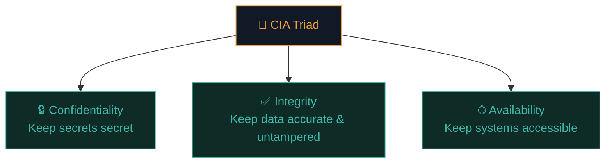
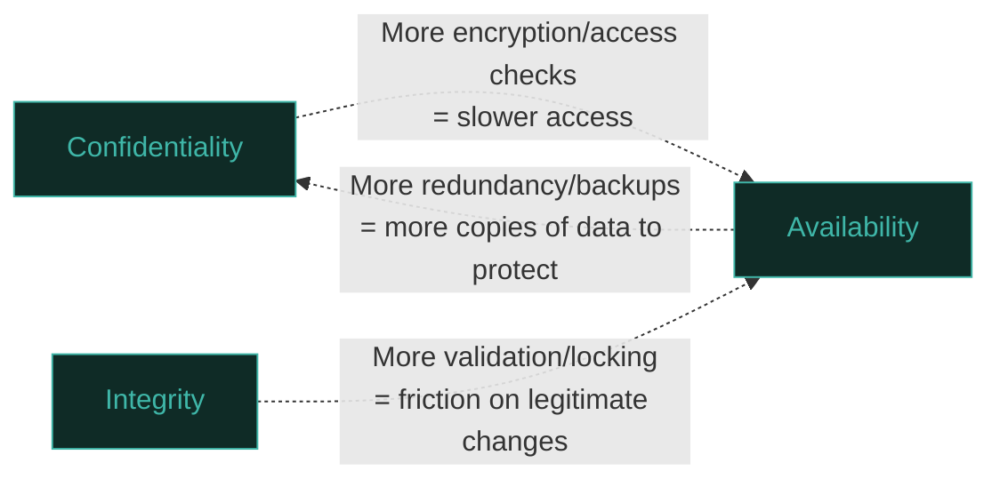

# The CIA Triad

Every security concept you'll ever learn — every vulnerability, every control, every risk conversation — traces back to three words: **Confidentiality, Integrity, Availability**. This is the foundational model of the entire field.

## The three pillars

### Confidentiality

**Only authorised people can see the data.** The classic "keeping secrets" pillar.

- *Protects against:* eavesdropping, data breaches, unauthorised access.
- *Controls:* encryption, access controls, authentication.
- *Real example:* Your medical records shouldn't be readable by a random hospital employee who has no reason to look at them.
- *Broken example:* An attacker steals a database of unencrypted passwords.

### Integrity

**Data is accurate and hasn't been tampered with — by accident or on purpose.**

- *Protects against:* unauthorised modification, corruption, tampering.
- *Controls:* hashing, digital signatures, checksums, version control, access controls.
- *Real example:* When you download software, the publisher's hash lets you verify the file wasn't modified in transit (you did exactly this in Path 03!).
- *Broken example:* An attacker changes the destination account number in a pending bank transfer.

### Availability

**Authorised people can access the data/system when they need to.**

- *Protects against:* outages, denial-of-service, ransomware, hardware failure.
- *Controls:* redundancy, backups, DDoS protection, disaster recovery plans.
- *Real example:* A hospital's patient record system needs to be up during an emergency — a few minutes of downtime can be life-threatening.
- *Broken example:* A DDoS attack takes an e-commerce site offline during its biggest sale of the year.

## Why this model, and not something fancier?

It's simple enough to reason with quickly, yet it captures almost every security decision you'll make:

- Choosing to encrypt a database → protecting **confidentiality**.
- Adding a checksum to a file transfer → protecting **integrity**.
- Building redundant servers across regions → protecting **availability**.

When something goes wrong, you can classify it in seconds: *"Was data exposed (C), altered (I), or made unavailable (A)?"* — and often it's more than one at once.

## The tension between the three

Here's the part beginners miss: **these three pillars often pull against each other.**

- Lock a system down hard for confidentiality (multi-factor auth, strict firewalls) and you risk hurting availability (legitimate users locked out, slower access).
- Maximise availability (public access, no friction) and you often hurt confidentiality.
- Heavy integrity checks (approval workflows, signing) can slow down legitimate operations.

Security work is constantly about finding the right **balance** for the specific system and its risk profile — not maximising all three blindly. A public news website prioritises availability and cares less about confidentiality (the content is meant to be public). A defence contractor's classified database prioritises confidentiality above nearly everything else, accepting that access will be slow and cumbersome.

## Mapping real incidents to the triad

| Incident | Primarily breaks |
|---|---|
| Hacker steals a customer database | Confidentiality |
| Attacker modifies grades in a school system | Integrity |
| Ransomware encrypts all files, demands payment | Availability (and often Confidentiality if they also steal data first) |
| Website defaced with attacker's message | Integrity (and often Availability if it also crashes) |
| DDoS attack floods a bank's servers | Availability |
| Employee accidentally emails a spreadsheet to the wrong person | Confidentiality |
| SQL injection lets an attacker delete records | Integrity + Availability |

Notice many real incidents hit **more than one pillar at once** — ransomware is the classic example, hitting both C and A simultaneously.

## Extended models — DAD and the Parkerian Hexad

Some frameworks flip CIA around to talk about the *attacker's* goals instead of the defender's — this is sometimes called **DAD**:

- **Disclosure** — the attacker's version of breaking confidentiality.
- **Alteration** — the attacker's version of breaking integrity.
- **Destruction** (or Denial) — the attacker's version of breaking availability.

There's also the more detailed **Parkerian Hexad**, which adds three more properties: **Possession/Control**, **Authenticity**, and **Utility**. You don't need to memorise it, but knowing it exists shows you the CIA triad is a simplification, not the final word — useful for job interviews where someone asks "what's beyond CIA?"

## Non-repudiation — the property people forget

Closely related to, but distinct from, the CIA triad's three pillars is **non-repudiation**: the guarantee that someone who performed an action can't later credibly deny having done it. A digital signature (covered properly in Path 06's cryptography material) is the classic mechanism — if a document is signed with someone's private key, they can't plausibly claim "that wasn't me," because only their key could have produced that signature. Non-repudiation matters most in situations with real accountability stakes: financial transactions, contract signing, audit logs of who accessed what. It's easy to see why it doesn't fit neatly into C, I, or A — it's less about protecting the data itself and more about being able to *prove*, after the fact, who did what.

## CIA in the cloud — the shared responsibility angle

Path 08's cloud security material introduces the **shared responsibility model**: in a cloud environment, the cloud provider (AWS, Azure, GCP) and the customer each own different slices of C-I-A. The provider typically guarantees the *availability* of the underlying infrastructure (their data centres, their network), while the customer remains fully responsible for *confidentiality* of their own data (did they leave an S3 bucket public?) and often *integrity* of their own application logic. A huge fraction of real cloud security incidents trace back to someone misunderstanding this split — assuming the provider handles a piece of the triad that was actually the customer's job all along.

## 🧪 Lab — Classify real headlines

Search the web for three recent security incidents (use the terms "data breach 2026", "ransomware attack 2026", "DDoS attack 2026"). For each one, write down:

1. Which pillar(s) of the CIA triad were broken?
2. What control, if it had existed or worked properly, might have prevented it?

This is exactly the kind of thinking you'll do constantly as a security professional — mapping a messy real-world event back onto the model.

:::challenge Test yourself
An attacker doesn't steal or change any data — they simply flood a company's servers with traffic until the website goes down for six hours. Which pillar of the CIA triad is primarily violated?

Show answer
<strong>Availability.</strong> No data was disclosed (Confidentiality) or altered (Integrity) — the system was simply made inaccessible to legitimate users.

:::

## Key terms

- **CIA Triad** — Confidentiality, Integrity, Availability.
- **Confidentiality** — only authorised access.
- **Integrity** — data is accurate and untampered.
- **Availability** — systems accessible when needed.
- **DAD** — the attacker's-eye mirror of CIA (Disclosure, Alteration, Destruction).
- **Parkerian Hexad** — an extended six-property model.

## Recap

- Nearly every security concept maps back to Confidentiality, Integrity, or Availability.
- The three pillars often trade off against each other — security is about balance, not maximising all three.
- Real incidents frequently break more than one pillar at once.
- This model is your fastest tool for quickly classifying any security event.

???refs
- [NIST — Glossary: CIA Triad](https://csrc.nist.gov/glossary/term/cia_triad) — the official US government definition.
- [Kaspersky — The CIA Triad explained](https://www.kaspersky.com/resource-center/definitions/the-cia-triad)
- [Parkerian Hexad — overview](https://en.wikipedia.org/wiki/Parkerian_Hexad)
???

**Next up →** [Defense in depth](#/lesson/10-fundamentals/defense-in-depth-basics)
