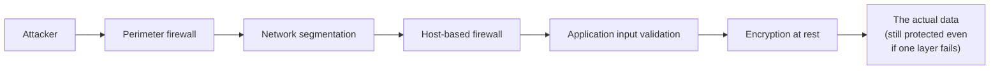

# Defense in depth

The CIA triad told you *what* security protects. This lesson introduces the strategy for actually protecting it: **defense in depth** — a concept you'll see referenced constantly for the rest of this course, now formally introduced with its own name and reasoning.

## The core idea: no single control is ever enough

**Defense in depth** means layering multiple, independent security controls so that if one fails — and every single control eventually can fail, whether through a bug, a misconfiguration, or a genuinely novel attack technique — the others still stand between an attacker and the actual asset being protected.

## A concrete example, drawing on lessons you've already seen

Think back to Path 05's Content Security Policy lesson: even if an application has an actual XSS vulnerability (one layer failing), a properly configured CSP can still prevent the injected script from executing (a second, independent layer catching what the first missed). Neither layer alone is a complete defense — the actual input validation that would have prevented the XSS in the first place still matters — but together, they mean one single mistake doesn't automatically become a full compromise.

## The castle analogy, made concrete

A medieval castle didn't rely on just one wall — it layered a moat, an outer wall, an inner wall, and a keep, each providing a fallback if an earlier layer was breached. Modern defense in depth follows the same logic, just with firewalls, access controls, monitoring, and encryption instead of stone and water.

## Why this principle explains so much of this course's structure

Nearly every path in this course adds a distinct layer to the same overall picture: network segmentation (Path 02, Path 24), strong authentication (Path 00), input validation (Path 05, Path 11), monitoring and logging (Path 08, Path 03), and encryption (Path 06) are all *independent* layers, each catching different failure modes. This is exactly why no single path in this course claims to be "the" solution to security — the entire structure of this curriculum mirrors the defense-in-depth principle itself.

:::challenge Test yourself
Why is relying on a single, even very strong, security control (say, an excellent firewall) considered poor practice, even if that one control genuinely works well?

Show answer
Every security control, no matter how strong, has some way it can fail — a firewall can be misconfigured, bypassed through a legitimate but abused channel, or rendered irrelevant by an attack that doesn't need to cross it at all (an insider threat, a phishing-compromised credential used through the front door). Relying on a single control means that one specific failure mode becomes a complete compromise with nothing else standing in the way. Defense in depth accepts that any individual layer might fail and asks a different question: even if this specific control fails, what else is still standing between the attacker and the actual asset? This is exactly why a genuinely mature security posture is measured by how many independent layers exist, not by how strong any single layer is.

:::

## Key terms

- **Defense in depth** — layering multiple independent security controls so a single failure doesn't lead directly to full compromise.

## Recap

- Defense in depth means no single control is ever trusted alone — layered, independent controls catch different failure modes.
- The CSP-versus-XSS example from Path 05 is a concrete illustration: a failure at one layer (the injection vulnerability) doesn't automatically mean the attack succeeds, if a later layer (CSP) catches it.
- This entire course is structured around the same principle — no single path is "the" answer to security, and that's intentional.

**Next up →** [Threats, vulnerabilities & risk](#/lesson/10-fundamentals/threats-risk)
