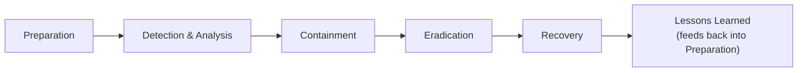

# Incident Response Basics

You've now covered prevention (protect-yourself) and detection concepts (security controls) throughout this path. This lesson introduces what happens next: **incident response** — the structured process for handling a security incident once one actually occurs, previewed here before Path 16's full, hands-on incident-response material.

## Why "prevention will eventually fail" is the right starting assumption

Every path in this course has emphasized layered, defense-in-depth thinking specifically because no single control, and no combination of controls, provides perfect prevention indefinitely. A mature security program plans for the moment prevention fails, not just for preventing failure — which is exactly what incident response actually is.

## The incident response lifecycle, at a glance

- **Preparation** — having a plan, trained people, and the right tools *before* an incident happens — genuinely the phase that determines how well every later phase goes
- **Detection & Analysis** — noticing something happened and figuring out what it actually is, drawing directly on the logging and monitoring concepts from Path 08
- **Containment** — stopping the incident from spreading further, exactly the "isolate first" instinct Path 07's compromise-recognition lesson established
- **Eradication** — actually removing the root cause (a malicious file, a compromised account, an exploited vulnerability)
- **Recovery** — safely restoring normal operations, verified and tested before fully trusting the system again
- **Lessons Learned** — a genuinely often-skipped but critical final step, feeding what was learned back into better preparation for next time

## Why "isolate first, investigate second" keeps appearing throughout this course

Path 07's Windows compromise-recognition lesson and Path 03's Linux logging lesson both independently arrived at the same instinct: disconnect a suspected-compromised system from the network before doing anything else. This is the **containment** phase of the incident-response lifecycle, applied at the individual-machine level — this lesson names the broader framework those earlier, specific pieces of advice were always part of.

## Why having a written plan matters, even for a small organization

:::tip A plan you've never used is still better than no plan at all
An incident is, by definition, a high-stress, time-pressured situation — exactly the wrong moment to be inventing a response process from scratch. Even a simple, written plan (who to contact, what to isolate first, who has authority to make key decisions) meaningfully improves outcomes compared to improvising entirely under pressure, directly connecting to Path 24's common-pitfalls lesson emphasis on structured rather than ad-hoc security practice.
:::

:::challenge Test yourself
Why is "Lessons Learned" considered a genuinely important phase of incident response, rather than an optional formality after the real work is already done?

Show answer
Every real incident reveals something about an organization's actual security posture that wasn't fully visible beforehand — a detection gap that let the incident go unnoticed longer than it should have, a containment step that took too long, a preparation gap that made response harder than necessary. Skipping the Lessons Learned phase means an organization pays the full cost of experiencing an incident without capturing the corresponding benefit of actually improving for next time — the exact same incident, or a very similar one, becomes meaningfully more likely to recur in a similar way. This is precisely why the lifecycle diagram in this lesson shows Lessons Learned feeding back into Preparation: incident response isn't a one-time linear process, it's a cycle that should make each future incident easier to handle than the last.

:::

## Key terms

- **Incident response lifecycle** — the structured process (preparation, detection/analysis, containment, eradication, recovery, lessons learned) for handling a security incident.
- **Containment** — the incident-response phase focused on stopping an incident from spreading further.

## Recap

- Incident response assumes prevention will eventually fail, and prepares for that moment rather than only trying to prevent it.
- The six-phase lifecycle — preparation, detection/analysis, containment, eradication, recovery, lessons learned — is the structured framework behind the "isolate first" instinct this course has taught in several earlier, specific contexts.
- Lessons Learned is a genuinely important, often-skipped final phase, turning each incident into improved preparation for the next one rather than a one-time, non-recurring cost.

**Next up →** [Business Continuity & Disaster Recovery](#/lesson/10-fundamentals/business-continuity-disaster-recovery)
