# Malware types explained

"Malware" gets used as one big scary word, but it's really a family of distinct categories, each with its own behaviour, spreading mechanism, and defence. Knowing the taxonomy helps you reason precisely instead of vaguely.

## The malware family tree

```mermaid
flowchart TB
    M["🦠 Malware<br/>(malicious software)"]
    M --> Virus["Virus<br/>needs a host file, self-replicates when run"]
    M --> Worm["Worm<br/>self-replicates over networks, no host needed"]
    M --> Trojan["Trojan<br/>disguised as legitimate software"]
    M --> Ransom["Ransomware<br/>encrypts data, demands payment"]
    M --> Spy["Spyware<br/>secretly monitors/exfiltrates"]
    M --> Adware["Adware<br/>forces unwanted ads"]
    M --> Root["Rootkit<br/>hides its own presence deep in the OS"]
    M --> Bot["Bot / Botnet malware<br/>joins remote-controlled army"]
    M --> Key["Keylogger<br/>records every keystroke"]
    M --> Wiper["Wiper<br/>destroys data, no ransom demand"]

    style M fill:#111927,color:#EFA43A,stroke:#EFA43A
    style Virus fill:#2b1010,color:#E05548,stroke:#E05548
    style Worm fill:#2b1010,color:#E05548,stroke:#E05548
    style Trojan fill:#2b1010,color:#E05548,stroke:#E05548
    style Ransom fill:#2b1010,color:#E05548,stroke:#E05548
    style Spy fill:#2b1010,color:#E05548,stroke:#E05548
    style Adware fill:#2b1010,color:#E05548,stroke:#E05548
    style Root fill:#2b1010,color:#E05548,stroke:#E05548
    style Bot fill:#2b1010,color:#E05548,stroke:#E05548
    style Key fill:#2b1010,color:#E05548,stroke:#E05548
    style Wiper fill:#2b1010,color:#E05548,stroke:#E05548
```

## The main categories, explained

### Virus

Attaches itself to a legitimate file or program. It only spreads when a human runs the infected file — like a biological virus needing a host cell. Classic 1990s-era malware; still exists but less dominant than it used to be.

### Worm

Self-replicates **without** needing a host file or human action — it actively spreads across networks by exploiting vulnerabilities. The infamous **WannaCry** ransomware spread as a worm using a Windows SMB vulnerability, infecting hundreds of thousands of machines in hours with zero clicks required.

### Trojan (Trojan Horse)

Disguises itself as something legitimate or desirable — a cracked game, a "free" tool, a fake invoice attachment. Named for the obvious reason. Doesn't self-replicate; relies on tricking a human into running it.

### Ransomware

Encrypts the victim's files (or entire disk) and demands payment for the decryption key. Often combined with **double extortion** — stealing data *before* encrypting, then threatening to leak it too even if the ransom is paid. One of the most financially devastating malware categories of the last decade.

### Spyware

Quietly monitors user activity — keystrokes, browsing habits, screenshots, camera/mic access — and exfiltrates it. Often bundled with "free" software or delivered via phishing.

### Adware

Forces unwanted advertisements onto a system. Often more annoying than dangerous, but can be a vector for more serious payloads and frequently degrades system performance and privacy.

### Rootkit

Operates at a deep level of the OS (kernel-level, sometimes even below the OS in firmware) specifically to **hide its own existence** — from antivirus, from the task manager, from the user. Extremely hard to detect and remove; often requires a full OS reinstall.

### Botnet malware

Turns the infected machine into a "bot" that's part of a larger remotely-controlled network (**botnet**), used for DDoS attacks, spam campaigns, or cryptomining, all without the owner's knowledge. The **Mirai** botnet famously enslaved insecure IoT devices (cameras, routers) to launch massive DDoS attacks.

### Keylogger

Specifically records every keystroke, often to steal passwords and credit card numbers as they're typed. Can be pure software or, rarely, a physical hardware device plugged inline with a keyboard.

### Wiper

Designed purely to **destroy** data with no intention of a ransom or financial gain — often used in politically-motivated or nation-state attacks for pure sabotage (e.g., **NotPetya**, which was disguised as ransomware but was actually a wiper with no real recovery mechanism).

## How malware actually gets in — delivery methods

Tying back to the kill chain (previous lesson):

- **Phishing emails** with malicious attachments or links — still the #1 delivery method by volume.
- **Drive-by downloads** — visiting a compromised website silently triggers a download.
- **Malvertising** — malicious code hidden in seemingly-legitimate online ads.
- **USB drops** — infected drives left in parking lots, hoping someone plugs one in.
- **Supply-chain compromise** — malware inserted into legitimate software updates (the **trivy-action** and **SolarWinds** incidents are real examples of this exact pattern).
- **Exploiting unpatched vulnerabilities** — worms in particular thrive here.

## How antivirus/EDR actually detects malware

Two broad approaches, both still used today:

- **Signature-based detection** — matches files against a database of known-malicious hashes/patterns. Fast and reliable for known threats; useless against brand-new ("zero-day") malware.
- **Behavioural/heuristic detection** — watches what a program *does* (does it try to encrypt hundreds of files rapidly? Does it try to disable security tools?) rather than what it *is*. Catches novel malware but can produce more false positives.

Modern **EDR (Endpoint Detection and Response)** tools combine both, plus cloud-based reputation checks and machine learning models, and — critically — give defenders the ability to investigate and respond, not just block.

## RATs and backdoors — the attacker's remote hands

Two more categories worth naming precisely, since they show up constantly once you're reading real incident reports: a **RAT (Remote Access Trojan)** gives an attacker full interactive remote control of an infected machine — file browsing, webcam access, keystroke capture, the works — functioning much like a legitimate remote-desktop tool, except installed without consent and hidden from the user. A **backdoor** is any deliberately-installed method of bypassing normal authentication to regain access later — sometimes a standalone piece of malware, sometimes a single line quietly added into otherwise-legitimate code (a pattern Path 17's malware analysis material examines in detail when reverse-engineering samples). The distinction that matters: a RAT is usually the attacker's *tool*, while a backdoor is the *access mechanism* they leave behind — a sophisticated intrusion often uses both, a RAT for hands-on activity and a separate, quieter backdoor as an insurance policy in case the RAT gets discovered and removed.

## Malware analysis — static vs dynamic

When a defender encounters a suspicious file, there are two broad approaches to figuring out what it does, both covered hands-on in Path 17. **Static analysis** examines the file *without running it* — inspecting its strings, imported functions, and disassembled code to infer behaviour safely. **Dynamic analysis** actually *executes* the sample, but only inside a tightly isolated, disposable environment (a sandbox or an air-gapped virtual machine) specifically built so nothing the malware does can escape and cause real damage, while every network call, file write, and registry change it makes is logged and observed. Real malware analysts use both together: static analysis first to get a quick, safe read on what a sample *might* do, then dynamic analysis to confirm exactly what it *actually does* under controlled conditions.

## Fileless malware — a modern twist

Some modern malware never touches disk as a traditional file at all — it lives entirely in memory, using legitimate system tools (PowerShell, WMI) to execute. This is the "living off the land" idea from the previous lesson, applied specifically to malware, and it's much harder for traditional signature-based antivirus to catch.

## 🧪 Lab — Analyse a malware family (safely, via reading)

Rather than run real malware (dangerous, and covered safely in Path 16's isolated malware analysis lesson), do a **research exercise**:

1. Pick one: WannaCry, NotPetya, Mirai, Emotet, or a ransomware group active in the last year.
2. Research (via reputable sources like the vendor write-ups linked below) and answer:
   - What category(ies) of malware is it?
   - How did it spread (delivery + exploitation)?
   - What was its objective?
   - What single security control would have had the biggest impact in stopping it?

This kind of malware-family research is a genuinely useful skill for threat intelligence and SOC analyst roles.

:::challenge Test yourself
A piece of malware spreads automatically across a corporate network by exploiting an unpatched vulnerability, with zero user interaction required. Virus or worm?

Show answer
<strong>Worm.</strong> Viruses require a human to run an infected host file; worms self-propagate across networks without any user action, exactly as described.

:::

## Key terms

- **Virus / Worm / Trojan** — the three classic categories, distinguished by how they spread.
- **Ransomware / Wiper** — encrypt-for-payment vs pure destruction.
- **Rootkit** — hides its own presence deep in the OS.
- **Botnet** — a network of compromised machines under remote control.
- **EDR** — modern endpoint detection and response tooling.
- **Fileless malware** — malware that runs in memory using legitimate tools.

## Recap

- Malware is a family of distinct categories, not one monolithic threat.
- Viruses need a host and human action; worms self-propagate; trojans disguise themselves.
- Ransomware and wipers both destroy availability but for different goals (money vs sabotage).
- Modern detection combines signature-based and behavioural approaches.
- Fileless, "living off the land" techniques are an increasingly common evasion strategy.

???refs
- [CISA — Understanding malware](https://www.cisa.gov/topics/cyber-threats-and-advisories/malware-phishing-and-ransomware) — official US government guidance.
- [Malwarebytes Labs — Threat categories](https://www.malwarebytes.com/malware) — accessible, well-illustrated explanations.
- [MITRE ATT&CK — Software](https://attack.mitre.org/software/) — real malware families mapped to techniques.
- [CISA — WannaCry advisory](https://www.cisa.gov/news-events/cybersecurity-advisories/aa17-132a) — a real, detailed case study.
???

**Next up →** [Passwords & hashing](#/lesson/10-fundamentals/passwords-hashing)
