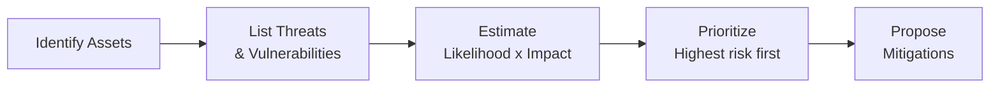

# Risk Assessment Lab

Risk assessment is how security professionals decide *what to actually worry about*, out of an effectively infinite list of things that could theoretically go wrong. This lab has you produce a real, structured risk register — the exact deliverable format used across the industry.

## Exercise

1. **Pick a scenario.** Something you can genuinely reason about in detail: your home network, a small business you're familiar with, or even this very course's website. Avoid anything too abstract — specificity is what makes risk assessment useful rather than generic.
2. **Identify assets.** List what actually needs protecting: data (personal files, customer records, credentials), systems (your router, a web server, a laptop), and people (whoever could be socially engineered, or whose access could be abused). Being concrete here matters — "data" is too vague; "customer payment records stored in the database" is useful.
3. **List threats and vulnerabilities for each asset**, using the vocabulary from the main lesson: a **threat** is a potential cause of harm (an attacker, a natural disaster, human error); a **vulnerability** is the specific weakness that threat could exploit (an unpatched service, a weak password policy, an unlocked server room).
4. **Estimate likelihood and impact.** For each threat/vulnerability pair, rate likelihood (Low/Medium/High — how plausible is this, realistically, for your specific scenario?) and impact (Low/Medium/High — how bad would it actually be if it happened?). Multiplying these two roughly (even informally) is the core logic behind the risk equation from the main lesson: **Risk ≈ Likelihood × Impact**.
5. **Suggest mitigations.** For each identified risk, propose one concrete, realistic control — not "improve security" in the abstract, but something specific and actionable: "enable automatic OS updates," "require MFA for admin accounts," "move backups to a separate physical location."

6. **Classify each risk's disposition.** For every row in your register, decide explicitly which of the four risk-response strategies from the main lesson applies — mitigate, accept, transfer, or avoid — and write a one-sentence justification. Forcing yourself to pick one of these four, rather than leaving it vague, is exactly the discipline that separates a real risk assessment from a worried list of concerns.
7. **Revisit after one "what if."** Pick your single highest-rated risk and imagine the mitigation you proposed simply isn't available (too expensive, technically impossible, or blocked by someone else). What's your next-best fallback? This mirrors a genuinely common real-world situation — the ideal fix isn't always on the table, and a good risk assessor always has a second option in mind.

:::tip Prioritization is the actual point
A risk register with 30 items and no prioritization is nearly useless in practice — real organizations have limited time and budget, so the entire value of this exercise is being able to say "these three risks matter far more than the other twenty-seven, fix these first." Always sort your finished list by risk level before presenting it.
:::

:::challenge Produce a one-page risk register
Create a simple table: **Asset | Threat | Vulnerability | Likelihood | Impact | Risk Level | Mitigation** — fill it in with at least 6 realistic rows for your chosen scenario, sorted from highest to lowest overall risk. This exact format, in slightly more formal language, is what real risk assessments look like in professional security work.
:::

## Key takeaway

Risk assessment isn't about eliminating every conceivable threat — that's neither possible nor a good use of limited resources. It's a structured way to decide what genuinely deserves attention first, which is exactly the reasoning that underlies every prioritization decision a real security team makes.

**Next up →** [Social Engineering Lab](#/lesson/10-fundamentals/social-engineering-lab)
