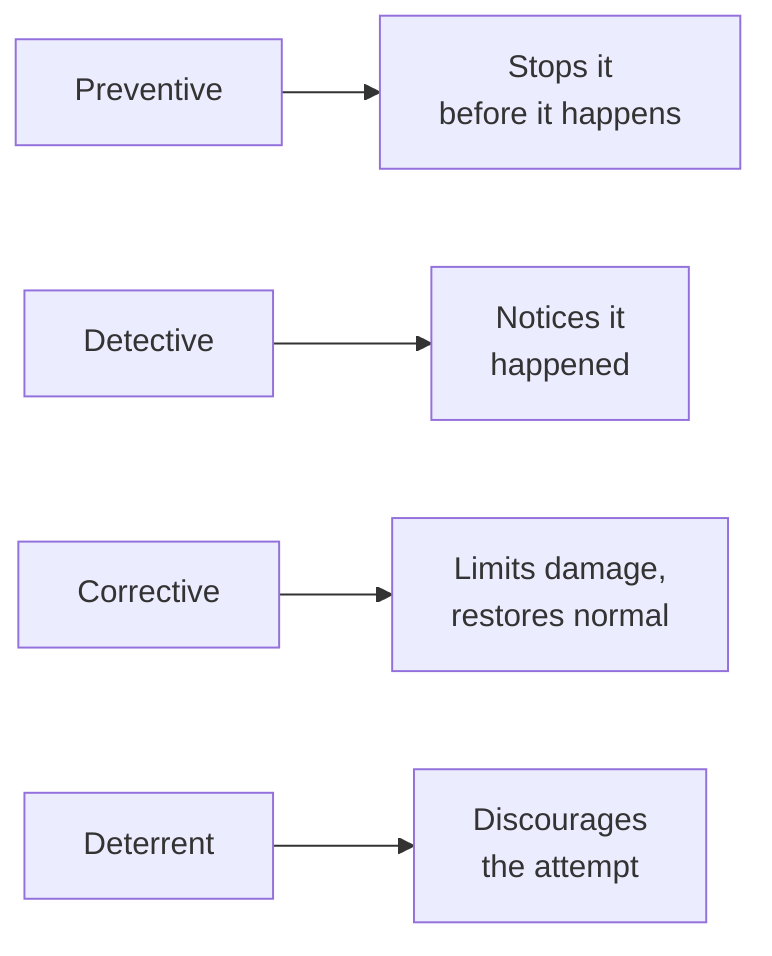

# Types of security controls

The threats-risk lesson gave you the vocabulary for what security manages. This lesson categorizes the actual tools used to manage it — a classification system you'll see referenced constantly in frameworks, job postings, and real security assessments.

## The four functional categories

- **Preventive** — stops an incident before it happens (a firewall blocking unauthorized traffic, MFA preventing account takeover from a stolen password alone)
- **Detective** — identifies that something happened, ideally quickly (logging and monitoring from Path 08, an intrusion detection system, the recognizing-compromise habits from Path 07)
- **Corrective** — limits damage and restores normal operation after an incident (backups and recovery from Path 00 and Path 07, an incident response plan)
- **Deterrent** — discourages an attack from being attempted at all (visible security cameras, a warning banner on a login page, published legal consequences)

## Why categorizing controls this way is genuinely useful

A mature security program deliberately includes controls from *every* category, not just preventive ones — a genuinely common beginner mistake is over-investing in prevention while under-investing in detection, leaving an organization with no way to notice when (not if) a preventive control eventually fails. This directly extends the previous lesson's defense-in-depth principle: different control types catch different failure points along the same attack timeline.

## A second useful classification: technical, administrative, physical

Beyond the functional categories above, controls are also classified by *what kind of thing* they actually are:

- **Technical controls** — implemented through technology (firewalls, encryption, access control lists)
- **Administrative controls** — policies, procedures, and training (a security policy document, mandatory security awareness training, background checks before hiring)
- **Physical controls** — protecting the actual physical environment (locked server rooms, badge access, security cameras — covered fully in the physical-security lesson later in this path)

## Mapping a real example across both classifications

Take **MFA** (from Path 00): it's a **preventive**, **technical** control. A **security awareness training program** teaching employees to recognize phishing is a **preventive**, **administrative** control. Both prevent incidents, but through completely different mechanisms — technology versus human behavior — which is exactly why a mature program needs both, not just the technical half.

:::challenge Test yourself
An organization has excellent firewalls, strong encryption, and MFA everywhere — but no logging, no monitoring, and no incident response plan. Using this lesson's framework, what's the specific gap in their control strategy?

Show answer
This organization has heavily invested in <strong>preventive</strong> controls but has essentially no <strong>detective</strong> or <strong>corrective</strong> controls at all. Every preventive control, no matter how strong, can eventually fail or be bypassed — and without detective controls (logging, monitoring), this organization would have no way to even notice that a breach occurred, let alone respond to it. Without corrective controls (an incident response plan, tested backups), they'd also have no structured way to limit damage or recover once an incident is finally discovered, however that discovery happens. This is exactly the "over-invest in prevention, under-invest in detection" pattern this lesson warned is a common and genuinely dangerous real-world mistake — strong locks on every door mean little if nobody notices when one gets picked anyway.

:::

## Key terms

- **Preventive / detective / corrective / deterrent controls** — the four functional categories describing what a security control actually does along an incident's timeline.
- **Technical / administrative / physical controls** — the classification describing what kind of mechanism a control actually is.

## Recap

- Security controls are classified by function (preventive, detective, corrective, deterrent) and by type (technical, administrative, physical).
- A mature security program deliberately includes controls from every functional category, not just preventive ones — over-investing in prevention alone is a common, genuinely dangerous mistake.
- The same real-world control (like MFA or security training) can be classified along both dimensions simultaneously, and understanding both helps identify genuine gaps in a security strategy.

**Next up →** [Vulnerability Management Basics](#/lesson/10-fundamentals/vulnerability-management-basics)
