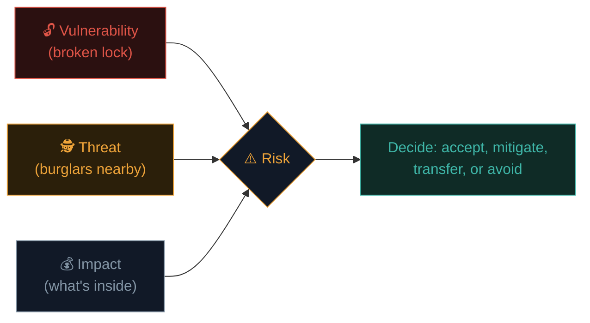
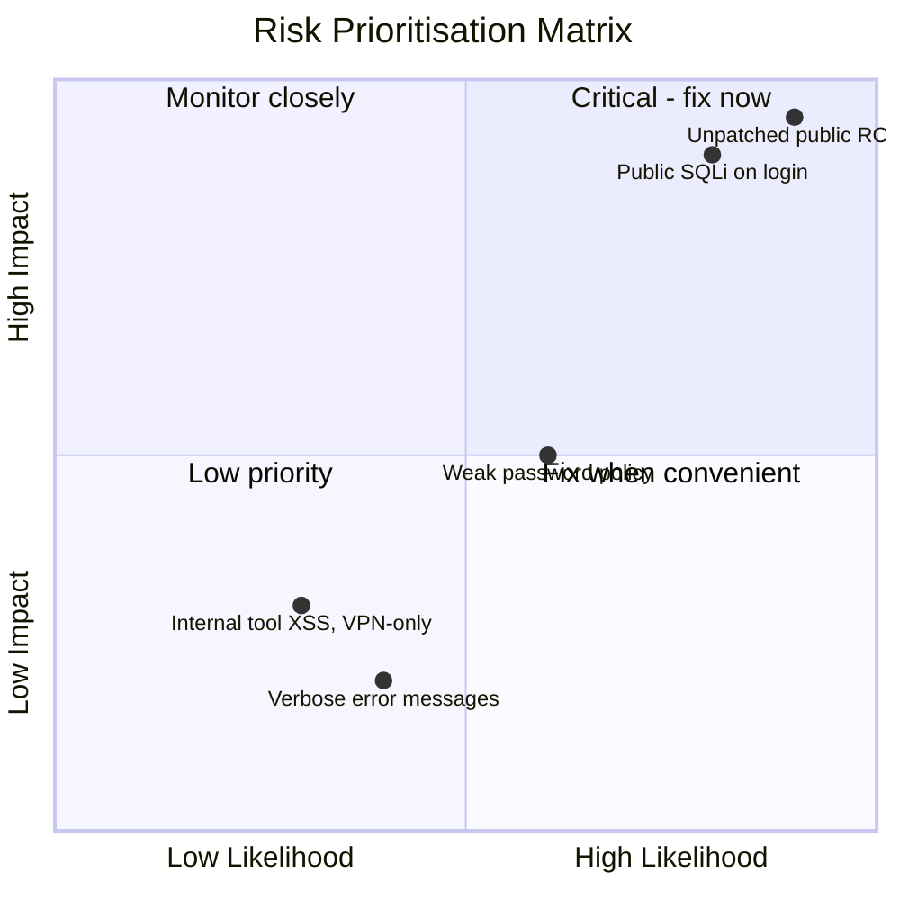

# Threats, vulnerabilities & risk

Three words that get used interchangeably by beginners — and mean precisely different things to professionals. Getting this right will make every future conversation with a security team, every report you write, and every CVE you read make far more sense.

## The three definitions

- **Vulnerability** — a weakness. A flaw that *could* be exploited. Exists whether or not anyone ever finds it.
- **Threat** — someone or something that *could* exploit a vulnerability. A potential danger.
- **Risk** — the *likelihood and impact* if a threat actually exploits a vulnerability. The thing you actually manage.

The classic formula:

```
Risk = Threat × Vulnerability × Impact
```

If any one factor is zero, the risk is zero. A vulnerability with no plausible threat is low risk. A determined threat with no exploitable vulnerability is also low risk.

## A concrete analogy

Imagine your house:

- **Vulnerability:** your back door lock is broken.
- **Threat:** burglars operate in your neighbourhood.
- **Risk:** the actual chance of a break-in and how bad it would be (what's inside, insurance, etc.)

If you live somewhere with zero burglars (no threat), the broken lock (vulnerability) is a much lower risk than if you live somewhere burglary is common. Same vulnerability, wildly different risk depending on the threat landscape.



## In software terms

- **Vulnerability:** a specific bug — say, an SQL injection flaw in a login form.
- **Threat:** any attacker (script kiddie, criminal group, nation-state, curious teenager) capable of finding and exploiting it.
- **Risk:** how likely someone will find and exploit that specific bug, and what damage results (customer data stolen? Full database wiped? Just an error message shown?).

The same vulnerability can carry very different risk depending on context:

| Same bug (SQLi) | Different context | Resulting risk |
|---|---|---|
| Internal tool, VPN-only, no sensitive data | Low threat exposure, low impact | **Low risk** |
| Public-facing e-commerce checkout, holds credit cards | High threat exposure (internet-wide), high impact | **Critical risk** |

This is why security teams don't fix every vulnerability with equal urgency — they **prioritise by risk**, not by vulnerability count alone.

## Threat actors — who are we actually worried about?

| Threat actor | Motivation | Typical sophistication |
|---|---|---|
| **Script kiddie** | Curiosity, bragging rights | Low — uses existing tools |
| **Hacktivist** | Ideological/political | Low–medium |
| **Cybercriminal** | Financial gain | Medium–high, organised |
| **Insider threat** | Grudge, financial gain, coercion | Varies — but has legitimate access already |
| **Nation-state (APT)** | Espionage, sabotage, geopolitical | Very high — custom tools, patience, funding |
| **Competitor** | Industrial espionage | Varies |

Different threat actors target different things. A hobby blog worries about script kiddies and bots; a defence contractor worries about nation-states.

## Attack surface — where vulnerabilities can live

Your **attack surface** is every point where an attacker could potentially interact with your systems:

- Public websites and APIs
- Employee email (phishing)
- VPN and remote access
- Third-party vendors and supply chain
- Physical access to offices
- Cloud storage buckets
- Mobile apps
- IoT devices

The bigger and more complex a system, the bigger its attack surface — and the more places vulnerabilities can hide. A core job of security engineering is **reducing** attack surface wherever possible (turning off unused services, removing unnecessary permissions, decommissioning old systems).

## Likelihood and impact — the two risk knobs

Professionals often score risk on two axes:



Something both **likely** and **high impact** (top-right) gets fixed first. Something **unlikely** and **low impact** (bottom-left) might reasonably wait, or even be formally accepted.

## The four ways to handle a risk

Once you've identified a risk, you have exactly four options:

1. **Mitigate** — reduce the likelihood or impact (patch the bug, add a firewall rule).
2. **Accept** — decide the risk is low enough to live with (common for low-impact, low-likelihood issues, or when a fix is prohibitively expensive).
3. **Transfer** — shift the risk elsewhere (cyber insurance, outsourcing to a vendor with SLAs).
4. **Avoid** — eliminate the risk entirely by removing the underlying feature/system (decommission a legacy app instead of patching it forever).

Every professional risk conversation ends in one of these four buckets — and "we'll fix it eventually" isn't one of them; it's usually a disguised (and often accidental) form of "accept."

## CVE, CVSS, and how vulnerabilities get scored publicly

- **CVE (Common Vulnerabilities and Exposures)** — a unique public ID for a known vulnerability, like `CVE-2021-44228` (the infamous Log4Shell). A shared naming scheme so everyone's talking about the same bug.
- **CVSS (Common Vulnerability Scoring System)** — a 0–10 severity score based on factors like attack complexity, privileges required, and impact. Higher = worse.
- **CWE (Common Weakness Enumeration)** — categorises the *type* of bug (e.g., CWE-89 is SQL Injection) rather than a specific instance.

You'll see all three constantly once you start reading security advisories, in Path 11 onward.

## Inherent risk vs residual risk

Two terms that come up in every real risk conversation once controls enter the picture: **inherent risk** is how risky something would be with *no controls at all* — the raw, unmitigated exposure. **Residual risk** is what's left *after* applying your chosen controls (a firewall, MFA, encryption, staff training). No control ever drives risk fully to zero — there's always some residual amount, which is exactly why "accept" is a legitimate formal category rather than an admission of failure. A mature security program doesn't chase an impossible zero-residual-risk goal; it deliberately drives residual risk down to a level leadership has explicitly agreed to live with, and documents that decision.

## Qualitative vs quantitative risk assessment

Risk can be scored two different ways, and knowing which one you're looking at matters. **Qualitative** assessment uses labels like Low/Medium/High/Critical (exactly what the risk matrix above does) — fast, intuitive, and the most common approach for day-to-day prioritisation. **Quantitative** assessment instead assigns real numbers, often in dollars — for example, estimating that a specific breach scenario has a 5% annual likelihood and would cost $2 million, giving an **Annualized Loss Expectancy (ALE)** of $100,000. Quantitative numbers are far more persuasive in a boardroom when arguing for security budget, but they require real data and assumptions that are often shakier than the precise-looking number suggests. Path 20's career-prep material touches on why being able to speak both languages — technical severity *and* business dollar-impact — is a genuinely valuable skill for security professionals trying to get budget approved.

## 🧪 Lab — Do a mini risk assessment

Pick something you personally own — your phone, your home Wi-Fi, or a social media account. For it, write down:

1. **Two plausible vulnerabilities** (e.g., "weak Wi-Fi password", "no 2FA on account").
2. **Who's the realistic threat actor** for each (opportunistic neighbour? Random internet attacker? Ex-partner?).
3. **Impact if exploited** — what's actually at stake?
4. **Which of the four risk responses** would you choose for each, and why?

This exact exercise — scaled up — is what security teams do continuously for entire organisations.

:::challenge Test yourself
A company has a serious vulnerability in an internal admin tool, but that tool is only reachable from inside a locked, badge-access-only office, with no remote access at all. Is the risk automatically zero?

<details><summary>Show answer</summary>No — reduced, not zero. The vulnerability still exists, and the threat isn't eliminated (a malicious employee, a visitor with temporary badge access, or a compromised internal machine could still reach it). The <em>likelihood</em> is much lower because the attack surface is restricted, but "no remote access" doesn't mean "no risk." This is exactly the kind of nuance a good risk assessment captures instead of assuming a hard zero.</details>
:::

## Key terms

- **Vulnerability** — a weakness that could be exploited.
- **Threat** — someone/something capable of exploiting a vulnerability.
- **Risk** — the combined likelihood and impact of a threat exploiting a vulnerability.
- **Attack surface** — every possible point of interaction an attacker could use.
- **CVE / CVSS / CWE** — public identifiers and scoring for known vulnerabilities.
- **Mitigate / Accept / Transfer / Avoid** — the four risk-response strategies.

## Recap

- Vulnerability = weakness. Threat = who could exploit it. Risk = likelihood × impact.
- The same vulnerability can be low or critical risk depending on context.
- Different threat actors have different motivations and sophistication.
- Risk is handled via mitigate, accept, transfer, or avoid — never just "ignore."
- CVE/CVSS/CWE give the industry a shared language for known vulnerabilities.

???refs
- [NIST Risk Management Framework](https://csrc.nist.gov/projects/risk-management) — the authoritative US framework.
- [MITRE CVE Program](https://www.cve.org/) — the official CVE database and process.
- [FIRST — CVSS specification](https://www.first.org/cvss/) — how severity scores are actually calculated.
- [MITRE CWE](https://cwe.mitre.org/) — the weakness classification system.
???

**Next up →** [Types of security controls](#/lesson/10-fundamentals/security-controls-types)
