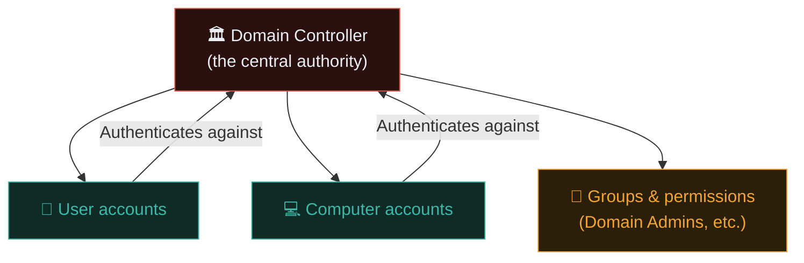
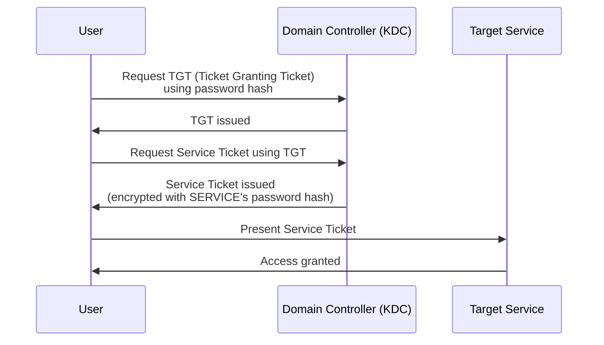
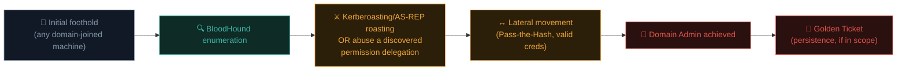

# Active Directory attacks

**Active Directory (AD)** manages identity and access for the vast majority of corporate Windows networks worldwide. Understanding AD attacks is one of the highest-value skills in professional penetration testing — and directly the subject matter of Ishfaq's own recent CPENT practical exam (AD compromise chains).

## What Active Directory actually is

AD is Microsoft's directory service — a centralised database of users, computers, groups, and permissions across an entire organisation's Windows network. Instead of every server maintaining its own separate list of users, they all trust a central **Domain Controller (DC)** for authentication and authorization decisions.



The ultimate goal in most AD-focused engagements: escalate from an initial low-privilege foothold on **any single domain-joined machine** all the way to **Domain Admin** — full control over the entire network.

## Kerberos — the authentication protocol underpinning AD

AD uses **Kerberos** for authentication, involving **tickets** rather than passwords being sent repeatedly:



Understanding this flow is essential because several major AD attacks directly target specific steps in it.

## Initial enumeration — mapping the domain

```bash
# BloodHound — the essential AD attack-path visualisation tool:
# Collect data with a collector (SharpHound on Windows, or bloodhound-python from Linux):
bloodhound-python -u username -p password -d example.local -c all -ns <dc-ip>

# Load the collected data into BloodHound's GUI to visualise attack paths
# from your current foothold to Domain Admin
```

**BloodHound** is transformative for AD engagements — it converts raw AD permission data into a **graph**, visually highlighting the shortest attack path from any starting point to Domain Admin, accounting for nested group memberships and permission delegations that would be extremely tedious to trace manually.

```bash
# Basic manual enumeration alternative (no BloodHound):
# Using tools like ldapsearch or PowerView (a PowerShell AD recon toolkit):
ldapsearch -x -H ldap://dc-ip -D "user@example.local" -w password -b "dc=example,dc=local"
```

## Kerberoasting — a classic, high-value attack

Any AD user can request a **service ticket** for any service account that has a Service Principal Name (SPN) registered — and that ticket is encrypted using the **service account's own password hash**. If that service account has a **weak password**, the attacker can crack it entirely offline, with zero further interaction needed.

```bash
# Using Impacket's GetUserSPNs.py (from a Linux attacking machine):
GetUserSPNs.py example.local/username:password -dc-ip <dc-ip> -request

# Crack the extracted ticket hash offline (recall Path 06.5/09.5's password cracking):
hashcat -m 13100 kerberoast-hashes.txt /usr/share/seclists/Passwords/rockyou.txt
```

Service accounts are notoriously prone to weak, rarely-changed passwords (often set once at creation and never rotated, since they're not tied to a human's memory/login habits) — making Kerberoasting one of the single most consistently effective real-world AD attacks.

## AS-REP Roasting — the pre-authentication bypass variant

If a user account has **Kerberos pre-authentication disabled** (a specific, sometimes accidentally-set account property), an attacker can request an authentication ticket for that account **without knowing its password at all**, then crack the returned ticket offline — the same offline-cracking principle as Kerberoasting, but requiring no prior credentials whatsoever.

```bash
GetNPUsers.py example.local/ -usersfile users.txt -dc-ip <dc-ip> -format hashcat
hashcat -m 18200 asrep-hashes.txt /usr/share/seclists/Passwords/rockyou.txt
```

## Pass-the-Hash — using stolen hashes directly, without cracking

Recall Path 06.5's hashing lesson — Windows NTLM authentication has a notable historical weakness: you don't always need the **plaintext** password, just the **NTLM hash** itself, which can be used directly to authenticate:

```bash
# Using Impacket's psexec.py with a stolen NTLM hash (no cracking needed!):
psexec.py -hashes :NTLM_HASH_HERE example.local/administrator@target-ip
```

This is exactly why credential-dumping tools (like Mimikatz, historically) that extract NTLM hashes from a compromised machine's memory are so dangerous — the attacker doesn't need to crack anything at all to move laterally using a stolen hash directly.

## Golden Ticket and Silver Ticket attacks

Once an attacker compromises the **KRBTGT account's** password hash (the special account that signs all Kerberos tickets domain-wide), they can forge a **Golden Ticket** — a fully valid-looking Kerberos TGT for *any* user, including Domain Admin, that remains valid until the KRBTGT password is rotated (which many organisations do rarely, if ever). A **Silver Ticket** is a more limited variant, forging a valid *service* ticket for one specific service rather than domain-wide access.

```bash
# Using Impacket's ticketer.py to forge a Golden Ticket (requires KRBTGT hash,
# typically obtained via a prior full domain compromise — this is a
# post-compromise persistence/re-access technique, not an initial foothold):
ticketer.py -nthash KRBTGT_HASH -domain-sid S-1-5-21-... -domain example.local Administrator
```

This is why KRBTGT password rotation (ideally done **twice**, since AD retains the previous password for a grace period) is a critical incident response step (Path 11.7) after any suspected AD compromise — without it, an attacker retains persistent, essentially undetectable domain-wide access indefinitely.

## DCSync — abusing legitimate replication permissions

A distinct, particularly stealthy attack worth understanding on its own: Domain Controllers legitimately replicate password data between each other as part of normal AD operation, using a permission called **Replicating Directory Changes**. If an attacker compromises an account holding that permission (often accidentally over-delegated to a service account or an application admin who never needed it), they can impersonate a Domain Controller and simply *ask* the real DC to replicate password hashes for any account — including the KRBTGT account itself, or the domain administrator directly:

```bash
# Using Impacket's secretsdump.py to perform a DCSync attack:
secretsdump.py example.local/username:password@dc-ip -just-dc
```

What makes DCSync especially dangerous is that it requires no code execution on the Domain Controller at all — the attacker simply uses a legitimate AD replication protocol from any machine with the right permission, meaning it can be far quieter than exploiting a service or planting a ticket. Monitoring for this specific pattern (any non-Domain-Controller account issuing directory replication requests) is a genuinely high-value SIEM detection rule precisely because a legitimate reason for that pattern almost never exists.

## The general AD attack chain, assembled



This exact chain — foothold, BloodHound enumeration, Kerberoasting or delegation abuse, lateral movement, Domain Admin — is precisely the kind of scenario tested in advanced certifications like CPENT, and represents the realistic anatomy of a huge fraction of actual corporate ransomware incidents (the kill chain from Path 06.3, now fully fleshed out in an AD-specific context).

## The defender's view

- **Enforce strong service account passwords** — long, random, ideally using Group Managed Service Accounts (gMSA) that rotate automatically, directly defeating Kerberoasting.
- **Enable Kerberos pre-authentication** for all accounts (disabling it should require explicit, rare justification).
- **Monitor for Kerberoasting/AS-REP roasting patterns** in SIEM correlation rules (Path 08.5) — unusual volumes of service ticket requests are a detectable signature.
- **Rotate the KRBTGT password regularly**, and always **twice** immediately after any suspected compromise.
- **Apply the principle of least privilege** to group memberships and delegated permissions — BloodHound is equally valuable defensively, letting security teams find and close their own excessive attack paths before an attacker does.
- **Disable NTLM where possible**, preferring Kerberos exclusively, to reduce Pass-the-Hash exposure.

## 🧪 Lab — AD attack practice

Building a full AD lab requires more infrastructure than a single VM — consider:

- **TryHackMe's "Attacktive Directory" and AD-focused learning paths** — free, guided, hosted AD environments specifically built for this practice.
- **HackTheBox's Active Directory-tagged machines** — progressively harder, realistic AD attack chains.
- **GOAD (Game Of Active Directory)** — a free, deployable, deliberately vulnerable multi-machine AD lab you can run entirely in your own virtualised environment (a natural extension of Path 03.7's VM skills, at a larger scale).

Work through BloodHound data collection and visualisation on any of these platforms, then attempt Kerberoasting against any service accounts you discover, following the exact command patterns in this lesson.

:::challenge Test yourself
Why is Kerberoasting considered such a consistently effective real-world attack, even against organisations with otherwise reasonably strong security practices?

<details><summary>Show answer</summary>Service accounts are frequently created once, assigned a password at setup, and then <strong>never rotated</strong> or monitored the way human user passwords typically are (through policies, expiry reminders, or awareness training). Since <em>any</em> authenticated domain user can request a service ticket for <em>any</em> account with a registered SPN — requiring zero special privileges — and that ticket can be cracked entirely <strong>offline</strong> (no risk of triggering account lockout from repeated failed login attempts), a single weak service account password anywhere in a large organisation is often enough to compromise it, regardless of how strong human user passwords are elsewhere.</details>
:::

## Key terms

- **Active Directory (AD) / Domain Controller (DC)** — Microsoft's centralised directory and identity service for Windows networks.
- **Kerberos / TGT / Service Ticket** — the ticket-based authentication protocol underlying AD.
- **BloodHound** — the essential AD attack-path graph visualisation tool.
- **Kerberoasting / AS-REP Roasting** — offline password-cracking attacks against service/user account Kerberos tickets.
- **Pass-the-Hash** — authenticating using a stolen NTLM hash directly, without cracking it.
- **Golden Ticket / Silver Ticket** — forged Kerberos tickets granting domain-wide or service-specific persistent access.

## Recap

- Active Directory centralises identity for most corporate Windows networks, making it a primary target in real engagements.
- BloodHound visualises attack paths from any foothold to Domain Admin, accounting for complex nested permissions.
- Kerberoasting and AS-REP Roasting exploit weak service/user account passwords via offline-crackable Kerberos tickets.
- Pass-the-Hash enables lateral movement using stolen NTLM hashes without ever cracking the underlying password.
- Golden/Silver Ticket forgery, once KRBTGT is compromised, provides persistent domain-wide access requiring password rotation to remediate.

???refs
- [BloodHound official documentation](https://bloodhound.readthedocs.io/) — comprehensive setup and usage guide.
- [Impacket](https://github.com/fortra/impacket) — the essential toolkit for GetUserSPNs, GetNPUsers, psexec, ticketer, and more.
- [HackTricks — Active Directory Methodology](https://book.hacktricks.xyz/windows-hardening/active-directory-methodology) — extremely thorough, continuously-updated reference.
- [GOAD (Game Of Active Directory)](https://github.com/Orange-Cyberdefense/GOAD) — a free, deployable vulnerable AD lab environment.
???

**Next up →** [Cloud security fundamentals](#/lesson/11-advanced/cloud-security)
