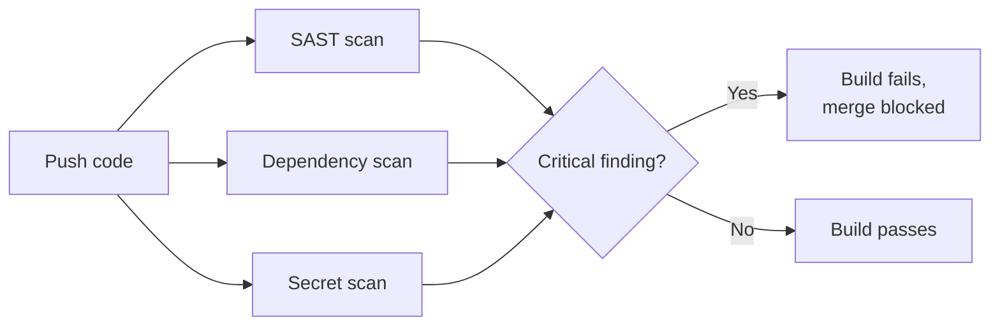

# DevSecOps Lab

"Shift left" is one of the most repeated phrases in modern security — this lab makes it concrete by having you actually build a small CI/CD pipeline that catches security issues automatically, before code ever reaches production.

## Lab focus

You'll use **GitHub Actions**, since it's free, requires no separate infrastructure, and runs directly against a repo you push to — a realistic, minimal version of what a real DevSecOps pipeline does.

## Tasks

1. **Create a small test repository** with a simple app (even a tiny Python or Node script is enough) and a few intentionally sloppy patterns to catch later — a hardcoded (fake, non-working) API key as a string, and an outdated dependency with a known vulnerability.
2. **Add SAST (Static Application Security Testing) scanning.** Add a GitHub Actions workflow step running **[Semgrep](https://semgrep.dev/)** (free, open-source, and has a ready-made GitHub Action) against your code:
   ```yaml
   - name: Run Semgrep
     uses: returntocorp/semgrep-action@v1
     with:
       config: p/security-audit
   ```
   Push a commit and check the Actions tab — Semgrep should flag common insecure patterns automatically.
3. **Add dependency scanning.** Enable **Dependabot** (built into GitHub, free, zero extra config beyond a `.github/dependabot.yml` file) or add a **[Trivy](https://github.com/aquasecurity/trivy)** scan step to your workflow to catch known-vulnerable dependency versions.
4. **Add secret scanning.** GitHub has free, automatic secret scanning built in for public repos — check your repo's **Security** tab after pushing your intentionally-fake hardcoded key, and confirm it gets flagged. For private repos or deeper coverage, tools like **[Gitleaks](https://github.com/gitleaks/gitleaks)** can be added as an explicit workflow step.
5. **Add a security gate.** Configure your workflow so a high-severity Semgrep or Trivy finding actually **fails the build** (a non-zero exit code from the scanning step is usually enough), not just reports a warning that gets ignored.



:::tip Why the gate matters more than the scan itself
A scanner that only produces a report nobody reads changes nothing. The actual security value comes from the **gate** — making it structurally impossible to merge code with a known-critical issue, the same way a failing unit test blocks a merge. This is the real difference between "we have a security scanner" and genuine DevSecOps practice.
:::

:::challenge Build the full pipeline
Combine all three scan types (SAST, dependency, secrets) into a single workflow file that runs on every pull request, and configure at least one of them to actually block the merge on a high-severity finding. Push a deliberately vulnerable change and confirm the pipeline catches and blocks it.
:::

## Key takeaway

DevSecOps isn't a separate team bolted onto engineering — it's security checks embedded directly into the same automated pipeline that already runs tests and deployments, catching issues at the cheapest possible point to fix them: before merge, not after a breach.

**Next up →** [Digital Forensics & IR Lab](#/lesson/11-advanced/dfir-lab)
