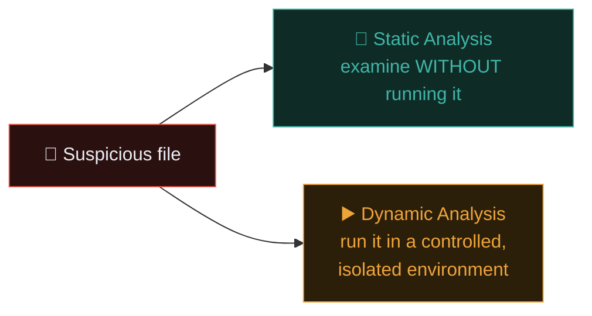
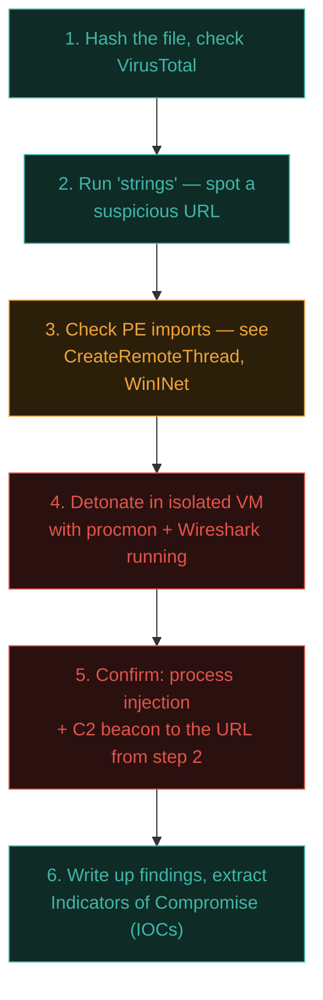

# Malware analysis basics

Path 06.4 taught malware categories conceptually. This lesson introduces the actual **discipline of analysing malware safely** — understanding what a suspicious file does without becoming its next victim.

## The two fundamental approaches



Professional malware analysis nearly always combines both — static analysis first (safer, faster, gives initial hypotheses), then dynamic analysis to confirm behaviour (more revealing, but requires strict isolation).

## Absolute safety rules before touching any real malware

:::danger NEVER ANALYSE MALWARE ON YOUR REAL MACHINE
This is one of the most important safety rules in this entire course. Malware analysis must happen in a **fully isolated environment** — a dedicated VM, disconnected from your host network (recall Path 03.7's Host-only networking, taken even further here), ideally on a machine you're prepared to wipe entirely if something goes wrong. Never analyse suspicious files on your daily-use computer, and never on a network connected to anything you care about.
:::

- Use a dedicated analysis VM, **snapshotted** before every analysis session (recall Path 03.7's snapshot lesson) so you can instantly revert to a clean state.
- Disable shared folders, clipboard sharing, and drag-and-drop between host and guest.
- Use **Host-only or fully isolated** networking — never bridge a malware analysis VM onto your real network.
- Consider a purpose-built, disposable analysis environment specifically designed for this (see the sandbox tools below) rather than always using your own VM.

## Static analysis — examining without executing

### File identification and hashing

```bash
# Identify file type regardless of extension (malware often disguises itself):
file suspicious.exe

# Calculate hashes for reputation lookups (recall Path 03.6's hashing lesson):
sha256sum suspicious.exe
md5sum suspicious.exe
```

```bash
# Check the hash against VirusTotal — aggregates 70+ antivirus engines'
# verdicts on a given file hash, without needing to upload/run it yourself:
# (via their web interface, or API for automation)
curl -s "https://www.virustotal.com/api/v3/files/HASH_HERE" \
  -H "x-apikey: YOUR_API_KEY"
```

**VirusTotal** is often the very first step — checking a file's hash against dozens of established antivirus engines instantly tells you if this is a known, already-analysed threat, without any risk at all.

### Strings analysis — a surprisingly effective first look

```bash
# Extract all readable text strings from a binary — often reveals
# URLs, IP addresses, file paths, error messages, or even plaintext
# configuration that hints strongly at functionality:
strings suspicious.exe | less
strings suspicious.exe | grep -i "http"
strings suspicious.exe | grep -E "[0-9]{1,3}\.[0-9]{1,3}\.[0-9]{1,3}\.[0-9]{1,3}"
```

Even unsophisticated malware often contains readable strings — a hardcoded command-and-control domain, a ransom note template, or debug messages left in by the malware author — making this simple technique disproportionately valuable for a first-pass assessment.

### PE (Portable Executable) header analysis — for Windows binaries

```bash
# Examine a Windows executable's structure without running it:
pip install pefile --break-system-packages
python3 -c "
import pefile
pe = pefile.PE('suspicious.exe')
print('Compile timestamp:', pe.FILE_HEADER.TimeDateStamp)
for entry in pe.DIRECTORY_ENTRY_IMPORT:
    print(f'Imports from {entry.dll.decode()}:')
    for imp in entry.imports:
        print(f'  {imp.name.decode() if imp.name else \"ordinal\"}')"
```

The **imported functions** a binary declares are hugely revealing — imports like `CreateRemoteThread`, `VirtualAllocEx`, and `WriteProcessMemory` together strongly suggest process injection behaviour; imports related to registry manipulation suggest persistence mechanisms; network-related imports (`WinINet`, `WSAStartup`) suggest command-and-control communication.

### Disassembly — going deeper

```bash
# Ghidra (free, NSA-developed) and IDA Free are the standard tools for
# actually disassembling and reverse-engineering binary logic:
ghidra
```

Full disassembly and reverse engineering is a deep specialisation in its own right — this lesson gives you the essential entry points; genuine proficiency here typically represents months to years of dedicated focus, often its own distinct career specialisation (malware reverse engineer / analyst).

### Detecting packing and obfuscation

Real-world malware authors routinely **pack** their binaries — compressing and encrypting the actual malicious code so that static string/import analysis reveals almost nothing useful until the packed code unpacks itself in memory at runtime. A telltale sign worth checking for specifically: a suspiciously small number of readable strings relative to a binary's file size, an unusually short and generic list of imports (real functionality is often dynamically resolved at runtime specifically to hide it from static import analysis), or a high **entropy** score (a measure of randomness) across most of the file's sections — compressed or encrypted data looks statistically close to random noise, while normal executable code does not:

```bash
# A quick entropy check across a binary's sections often reveals packing:
python3 -c "
import pefile, math
from collections import Counter
pe = pefile.PE('suspicious.exe')
for section in pe.sections:
    data = section.get_data()
    if data:
        counts = Counter(data)
        entropy = -sum((c/len(data)) * math.log2(c/len(data)) for c in counts.values())
        print(f'{section.Name.decode().strip()}: entropy={entropy:.2f}')
"
```

A section with entropy above roughly 7.0 (out of a maximum 8.0) is a strong signal of packing or encryption. When static analysis is this limited, dynamic analysis (below) becomes essential — you let the packed code unpack and run in your isolated environment, then capture the genuine behaviour it was hiding.

## Dynamic analysis — observing behaviour safely

### Monitoring system changes

Within your isolated VM, tools that record exactly what a running process does:

```bash
# On Windows analysis VMs, Sysinternals tools are the standard:
# Process Monitor (procmon) — records every file, registry, and process
# operation system-wide in real time
# Process Explorer — a much more detailed Task Manager replacement

# On Linux analysis VMs:
strace -f -o trace-output.txt ./suspicious-binary
```

Running the sample while `procmon`/`strace` records everything lets you observe **exactly** what files it creates/modifies, what registry keys it touches, and what network connections it attempts — all without needing to reverse-engineer the binary's actual code logic.

### Network traffic capture during execution

Directly applying Path 08.3's Wireshark skills:

```bash
# Start a Wireshark/tcpdump capture on your isolated analysis network
# BEFORE executing the sample:
sudo tcpdump -i any -w malware-traffic.pcap

# Execute the sample, let it run for a reasonable period, then stop
# the capture and analyse:
wireshark malware-traffic.pcap
```

This directly reveals command-and-control domains/IPs, exfiltration attempts, and any additional payload downloads — often the single most actionable output of dynamic analysis, directly feeding into blocklists and detection rules (Path 08.5's IDS/SIEM concepts).

### Automated sandboxes — the practical, scalable approach

For routine analysis, dedicated **malware sandboxes** automate this entire dynamic analysis process safely:

- **Any.run** — an interactive, browser-based sandbox with real-time visibility into execution.
- **Cuckoo Sandbox** — a free, open-source, self-hostable automated analysis sandbox.
- **Joe Sandbox** — a comprehensive commercial option with deep behavioural reporting.

These tools execute the sample in their own fully isolated, disposable environment and produce a structured report (network connections, file/registry changes, screenshots) — genuinely the practical, scalable approach for most day-to-day analysis needs, reserving fully manual analysis for cases the automated report doesn't sufficiently explain.

## A worked mini-example, tying it together



The final output — **Indicators of Compromise (IOCs)**: file hashes, C2 domains/IPs, registry keys, mutex names — is exactly what feeds into SIEM detection rules (Path 08.5) and threat intelligence sharing, closing the loop from "found a suspicious file" to "the whole organisation (or industry) can now detect this specific threat."

## 🧪 Lab — Safe malware analysis practice

Using deliberately-provided, legal malware samples (never download random files claiming to be malware from untrusted sources):

1. Visit [MalwareBazaar](https://bazaar.abuse.ch/) — a legitimate, safety-conscious repository of real malware samples specifically shared for research and detection purposes (samples are typically password-protected zips to prevent accidental execution).
2. In your **fully isolated** analysis VM (snapshotted first!), download one sample.
3. Run `file` and `strings` against it — what do you notice?
4. Check its hash against VirusTotal — what do existing antivirus engines already know about it?
5. If comfortable and your VM is properly isolated, detonate it with `procmon`/`strace` and a Wireshark capture running, then review what actually happened.
6. Revert your VM snapshot immediately afterward, regardless of outcome.

:::challenge Test yourself
Why is checking a suspicious file's hash against VirusTotal considered a genuinely safe first step, even before any isolated-VM analysis?

<details><summary>Show answer</summary>Hashing and querying VirusTotal <strong>never executes the file at all</strong> — you're simply computing a mathematical fingerprint of the file's existing bytes and checking whether that specific fingerprint is already known to any of the 70+ antivirus engines VirusTotal aggregates. This carries zero risk of infection since the file itself never runs, making it an ideal, safe first step before committing to any riskier static or dynamic analysis technique.</details>
:::

## Key terms

- **Static / dynamic analysis** — examining a file without executing it vs observing its actual runtime behaviour.
- **VirusTotal** — a service aggregating antivirus engine verdicts for a given file hash, without requiring execution.
- **Strings analysis** — extracting readable text from a binary, often revealing URLs, paths, or configuration.
- **Sandbox** — an isolated, often automated environment for safely observing malware execution.
- **IOC (Indicator of Compromise)** — a specific artifact (hash, domain, registry key) usable to detect a given threat elsewhere.

## Recap

- Malware analysis must always happen in a fully isolated, snapshotted environment — never on a real, network-connected machine.
- Static analysis (hashing, VirusTotal, strings, PE imports) is safe, fast, and often surprisingly revealing on its own.
- Dynamic analysis (procmon/strace plus Wireshark during controlled execution) confirms actual behaviour and network indicators.
- Automated sandboxes (Any.run, Cuckoo) provide a scalable, practical approach for most routine analysis needs.
- The end goal is extracting IOCs that feed directly into SIEM detection rules and broader threat intelligence sharing.

???refs
- [MalwareBazaar](https://bazaar.abuse.ch/) — a legitimate, research-focused malware sample repository.
- [VirusTotal](https://www.virustotal.com/) — the standard file/hash reputation aggregation service.
- [Ghidra](https://ghidra-sre.org/) — the free, NSA-developed disassembly and reverse engineering suite.
- [SANS FOR610 — Reverse-Engineering Malware](https://www.sans.org/cyber-security-courses/reverse-engineering-malware-malware-analysis-tools-techniques/) — the industry-standard training course in this specialisation.
???

**Next up →** [Digital forensics & incident response](#/lesson/11-advanced/dfir)
