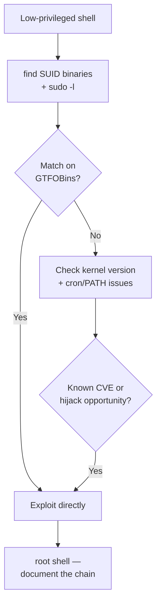

# Practical Linux Privilege Escalation Lab

The main **Linux privilege escalation** lesson covered the theory — GTFOBins, SUID binaries, capabilities. This lab is where you actually execute a full escalation chain end-to-end against a real (legal) vulnerable target, tying it together with the exact technique this course's dedicated CTF section also practices.

## Recommended lab

**Metasploitable 2** — a free, deliberately vulnerable Linux VM built specifically for practicing exactly this kind of exercise, widely used across the industry as a standard training target. Download it, run it in VirtualBox on host-only networking (Path 03 covers this setup), and get a low-privileged shell onto it using any technique from Path 09's exploitation lesson.

Alternatively, build your own vulnerable Docker container with an intentionally weak SUID binary or sudo rule configured yourself — this is actually a great exercise in its own right, since building the vulnerability teaches you as much as exploiting it.

## Key techniques to practice

1. **SUID binaries.** Once you have a low-privileged shell, hunt for SUID binaries:
   ```bash
   find / -perm -4000 -type f 2>/dev/null
   ```
   Compare every result against [GTFOBins](https://gtfobins.github.io/) to check whether that specific binary has a documented privilege escalation technique — exactly the workflow from this course's CTF Zone's Linux privesc challenge, now against a real multi-step target instead of a single isolated puzzle.
2. **Sudo misconfigurations.** Run `sudo -l` and check every listed binary against GTFOBins the same way. Metasploitable 2 and similar training VMs frequently have at least one exploitable entry here.
3. **Kernel exploits.** Check the kernel version (`uname -a`) and search for known CVEs against that specific version (`searchsploit linux kernel <version>`). This is a "last resort" technique in real assessments (kernel exploits can crash a system) but is worth understanding — older training VMs like Metasploitable 2 are specifically useful here because they run intentionally outdated kernels.
4. **PATH hijacking.** Check if any script run with elevated privileges calls a command without a full path (e.g., `service` instead of `/usr/sbin/service`) — if you can place a malicious binary earlier in the `$PATH` that gets resolved first, you can hijack that call. `cat` a few `cron` jobs or startup scripts (if readable) to hunt for this pattern.



:::warn Only on systems you own or have explicit permission to test
Metasploitable 2 and your own Docker containers are safe, legal targets built specifically for this. Never attempt any of these techniques against a system you don't have explicit written authorization to test — the golden rule from Path 01 applies here as strictly as anywhere else in this course.
:::

:::challenge Document the full chain
Escalate from your initial low-privileged shell all the way to `root`, and write up **every step you took** — not just the final winning technique, but the dead ends too. Real reports (and real learning) benefit from showing the full investigative path, not just the answer.
:::

## Key takeaway

Real privilege escalation is rarely one dramatic exploit — it's systematic enumeration (SUID, sudo, kernel version, cron jobs, PATH) checked methodically against known technique databases like GTFOBins, until one match opens the door. The "boring" enumeration step is where most of the actual work happens.

**Next up →** [Purple Teaming Lab](#/lesson/11-advanced/purple-teaming-lab)
