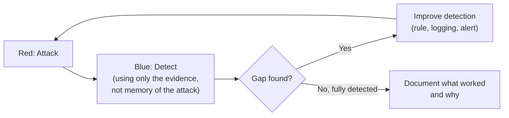

# Purple Teaming Lab

**Purple teaming** isn't a separate discipline from red and blue — it's the deliberate practice of running both simultaneously, using each attack as a live test of your own detection capability. This lab has you run one complete cycle yourself, playing both roles.

## Lab approach

You'll need a target you can both attack and monitor — a vulnerable VM (Metasploitable 2, or one of your own deliberately misconfigured setups from earlier labs in this path) with basic logging enabled, plus a way to review those logs afterward (even a simple `grep` through `/var/log/auth.log` is a legitimate starting point; a free tool like the ELK stack or Wazuh is a strong next step if you want to go further).

## Tasks

1. **Attack (red hat on).** Pick one technique you've practiced elsewhere in this course — an SSH brute-force attempt (Path 08's Wi-Fi/MITM material or the CTF Zone's forensics challenge both reference this exact attack pattern), a web exploit against a vulnerable app, or a privilege escalation chain from the previous lab. Execute it fully against your own lab target.
2. **Detect (blue hat on).** Now switch roles entirely. Without relying on your memory of exactly what you just did, go back to the logs and evidence *as if you were a SOC analyst seeing this incident cold* — could you have actually spotted this attack from the logs alone? What specific log lines, timestamps, or patterns would a detection rule need to key on?
3. **Find the detection gap.** Almost always, your first pass reveals something the logs *don't* capture well, or a detail that would be easy to miss buried in noise. Write down exactly what's missing — maybe the logging level was too low, maybe there's no alert threshold configured, maybe the relevant log source isn't being collected at all.
4. **Improve the control.** Based on the gap you found, make one concrete improvement — write a simple detection rule (even a `grep`/`awk` script counting failed logins per source IP within a time window is a legitimate, real starting point that mirrors what a SIEM correlation rule does under the hood), or adjust a logging configuration to capture what was missing.
5. **Repeat with a second technique.** Pick a different attack type and run the same attack → detect → gap → improve cycle again — the second pass is usually faster and sharper because you already know what to look for.

:::tip This exact loop is a real, named methodology
What you just practiced is a compressed version of real **purple team engagements**, which some organizations run as formal, ongoing programs specifically because this attack-detect-improve loop is far more effective at hardening detection than a one-off red team engagement followed by a report nobody acts on.
:::

:::challenge Write the purple team report
Document one complete cycle in full: the attack technique used, what the logs showed (or didn't), the specific detection gap identified, and the exact improvement made (the actual rule or config change). Include a before/after — did your improved detection actually catch the *second* technique you tried, or reveal it needs further tuning?
:::

## Key takeaway

The value of purple teaming isn't the attack, and it isn't the detection — it's the **feedback loop between them**. Red team findings that never inform blue team improvements, and blue team rules that are never tested against a real attack, both waste most of their potential value in isolation.

**Next up →** [Threat Hunting Lab](#/lesson/11-advanced/threat-hunting-lab)
