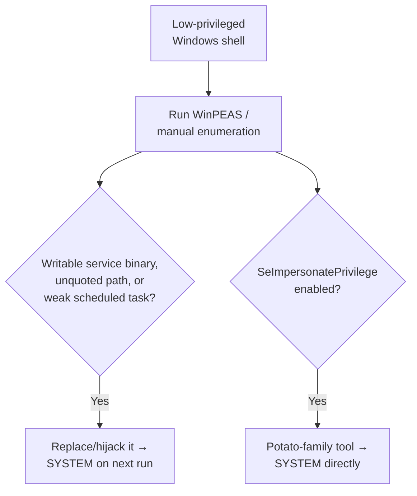

# Windows Privilege Escalation Lab

This final lab of Path 11 mirrors the earlier Linux privesc lab, but for Windows — a genuinely different attack surface (services, tokens, the registry) worth practicing separately, since Windows environments dominate most corporate networks.

## Recommended lab

Use a **TryHackMe or Hack The Box Windows privilege escalation room** (both platforms have several beginner-friendly ones specifically built for this, often named things like "Windows PrivEsc" or similar) — these provide a legal, ready-to-go vulnerable Windows target with none of the setup overhead of building your own. Alternatively, build your own vulnerable Windows VM (a free Windows evaluation ISO from Microsoft plus a deliberately misconfigured service is a legitimate, if more time-consuming, option).

## Key areas to practice

1. **Unquoted service paths.** If a Windows service's executable path contains spaces and isn't wrapped in quotes (e.g., `C:\Program Files\My App\service.exe` written unquoted), Windows will try each space-separated segment as a potential executable in order — meaning a writable `C:\Program.exe` could get executed instead of the intended service. Enumerate services and their paths:
   ```powershell
   wmic service get name,pathname,startmode | findstr /i /v "C:\Windows"
   ```
   Look for any unquoted path containing spaces.
2. **Weak service permissions.** Even with a properly quoted path, if the service's binary file (or the service configuration itself) is writable by your low-privileged user, you can replace it with a malicious payload that runs with the service's (often SYSTEM-level) privileges the next time it starts. Tools like **[WinPEAS](https://github.com/peass-ng/PEASS-ng)** (the Windows equivalent of LinPEAS, referenced in the Linux privesc lesson) automate this entire enumeration process.
3. **Token impersonation (Potato attacks).** A family of well-documented techniques (RoguePotato, JuicyPotato, PrintSpoofer, and others) abuse specific Windows service account privileges (`SeImpersonatePrivilege` in particular) to escalate from a service account to full SYSTEM. Check for this privilege with `whoami /priv` — if present and enabled, a Potato-family tool is very likely a fast path to SYSTEM.
4. **Scheduled tasks and autoruns.** Enumerate scheduled tasks (`schtasks /query /fo LIST /v`) and startup items for anything running with elevated privileges that points to a file or script your low-privileged user can modify — the same "writable + runs elevated" pattern as weak service permissions, just via a different mechanism.
5. **DLL hijacking.** If a privileged application loads a DLL from a directory your low-privileged user can write to (and Windows' DLL search order looks there before the legitimate system directory), placing a malicious DLL with the expected name can get your code executed with that application's privileges the next time it runs.



:::tip Automate the enumeration, understand the exploitation
Running WinPEAS is the fast way to *find* candidates across all of these categories at once — but make sure you understand *why* each flagged item is exploitable well enough to explain it without the tool, exactly as this lab's manual commands demonstrate. Interviewers (Path 13) and real engagements both expect this depth, not just "I ran a tool."
:::

:::challenge Document three different escalation paths
Using your practice target, successfully escalate privileges using **at least three different techniques** from the list above, documenting each: the specific misconfiguration found, the exact commands/tool used, and the resulting privilege level gained.
:::

## Key takeaway

Windows privilege escalation, like its Linux counterpart, comes down to **systematic enumeration against a known checklist** — services, tokens, scheduled tasks, DLL search order — rather than any single dramatic exploit. This lab, combined with the earlier Linux privesc lab, gives you a working methodology for privilege escalation on both major operating systems.

**Explore more →** [Path 12 — AI & AI Security](#/lesson/12-ai-security) · [CTF Zone](#/lesson/14-ctf-challenges)
