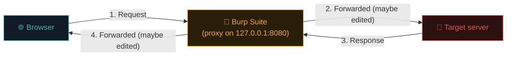
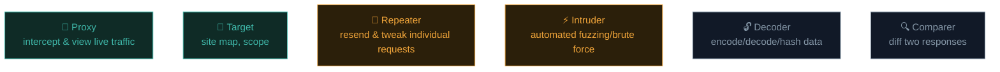

# Set up Burp Suite

Burp Suite is the single most important tool in web security testing. It's a proxy that sits between your browser and the target, letting you see, intercept, and modify every request — the professional version of the DevTools Network panel you already know from Path 05.

## What Burp actually is

Burp is a **local HTTP proxy**: your browser sends requests to Burp instead of directly to the internet, Burp forwards them (optionally after you've inspected or edited them), and does the same in reverse for responses.



This one architectural idea — putting yourself in the middle — is the foundation of almost all manual web testing.

## Community vs Professional edition

Kali ships with **Burp Suite Community Edition** pre-installed — free, fully capable for learning, with two limitations vs Pro: no automated active vulnerability **Scanner**, and **Intruder** is heavily rate-limited. Everything in this course works fine on Community; when you're ready for professional work, Pro (paid) removes those limits and adds more automation.

## Step 1 — Launch Burp

```bash
# In Kali:
burpsuite
```

Or find it in the Applications menu under "03 - Web Application Analysis." On first launch, choose **Temporary project** (fine for learning) and **Use Burp defaults** for configuration.

## Step 2 — Configure your browser to use Burp as a proxy

Burp listens on `127.0.0.1:8080` by default. Point Firefox at it:

1. Firefox → **Settings → Network Settings → Manual proxy configuration**.
2. HTTP Proxy: `127.0.0.1`, Port: `8080`. Check **"Also use this proxy for HTTPS."**
3. No proxy for: leave blank (or add exceptions later if needed).

:::tip USE A SEPARATE FIREFOX PROFILE FOR TESTING
Run `firefox -P` to create a dedicated "pentesting" profile with the proxy configured, separate from your everyday browsing profile. Keeps your normal browsing fast (no proxy) and your testing setup clean and reusable.
:::

## Step 3 — Install Burp's CA certificate (for HTTPS)

Because Burp sits in the middle of an HTTPS connection, it needs to present its own certificate to your browser (otherwise your browser would correctly flag it as a suspicious man-in-the-middle — which, technically, it is, just one you've deliberately set up).

1. With the proxy configured, visit `http://burp` in your browser.
2. Click **CA Certificate** to download it.
3. Firefox → **Settings → Privacy & Security → Certificates → View Certificates → Import** → select the downloaded file → check **"Trust this CA to identify websites."**

Now Burp can transparently inspect HTTPS traffic between your browser and any target — this is exactly how legitimate security testing tools do it, and exactly why installing *unknown* root certificates from untrusted sources is dangerous (it grants exactly this level of visibility).

## Step 4 — The core tabs



- **Proxy** — the live intercept view. Turn "Intercept" on to pause every request for manual review/edit before it's sent; turn it off to just passively log traffic while you browse normally.
- **Target → Site map** — automatically builds a tree of every URL you've visited through the proxy, great for understanding a site's structure.
- **Repeater** — send a specific request there (right-click → "Send to Repeater"), then edit and resend it repeatedly, tweaking parameters and instantly seeing the response. This becomes your primary workspace for manual bug-hunting.
- **Intruder** — automate sending many variations of a request (e.g., trying a wordlist of usernames, or every value 1-1000 in an ID parameter) and compare responses at scale.
- **Decoder** — quickly encode/decode Base64, URL-encoding, hex, and compute hashes — handy for understanding obfuscated parameters.
- **Comparer** — diff two responses side by side, useful for spotting subtle differences (e.g., between a valid and invalid login attempt).

## Step 5 — Your first intercepted request

1. In Burp's **Proxy** tab, click **Intercept is on**.
2. In your configured browser, visit `http://testphp.vulnweb.com` (a legal public practice target).
3. Watch the request pause in Burp before it's forwarded. Look at the method, headers, cookies.
4. Click **Forward** to let it through, or edit any field first, then Forward.
5. Turn **Intercept off** and just browse normally — check **Proxy → HTTP history** to see everything logged passively.

That HTTP history log is where you'll spend a lot of time — every single request your browser made, all inspectable after the fact.

## Step 6 — Repeater in action

1. In **Proxy → HTTP history**, find any GET request.
2. Right-click → **Send to Repeater**.
3. Switch to the **Repeater** tab. You'll see the raw request on the left.
4. Change something — a parameter value, a header — and click **Send**.
5. Compare the response on the right to what you got originally.

This exact loop — intercept, send to Repeater, tweak, observe the response — is the fundamental rhythm of manual web application testing, and you'll use it in every remaining lesson of this path.

## Scope — keeping yourself organised (and safe)

For real engagements, always set **Target → Scope** to explicitly include only your authorised target(s). This prevents Burp's various tools from accidentally sending traffic to out-of-scope domains — both a professionalism issue and, in some configurations, a legal one.

```
Target → Scope settings → Add → *.testphp.vulnweb.com
```

Then enable **"Show only in-scope items"** in Target and HTTP history views to declutter your workspace.

## Extending Burp — the BApp Store

Burp's functionality isn't fixed — the **Extensions** tab includes a built-in marketplace called the **BApp Store**, offering free community-built add-ons that plug directly into Burp's UI. A few worth knowing by name once you're comfortable with the basics: **Logger++** gives a far more searchable, filterable version of HTTP history than the built-in log; **Autorize** automates authorization testing by replaying every request with a lower-privilege session's cookies to catch IDOR-style bugs automatically; **JS Link Finder** scans loaded JavaScript files for hardcoded endpoint URLs, directly complementing the manual "search minified JS for strings" technique from Path 05's DevTools lesson. Most Community Edition users eventually install at least a couple of these — they don't require Pro, just a few clicks in the Extensions tab.

## Match and Replace — automating small repeated edits

A genuinely underused Burp feature: **Proxy → Options → Match and Replace** lets you define a rule that automatically finds a pattern in every request or response passing through Burp and silently substitutes something else — no manual editing required each time. A common beginner use case: automatically swapping a session cookie's value on every outgoing request so you don't have to paste it in manually after every login, or stripping a security header from every response to test how a page behaves without it. It's a small feature, but it turns a repetitive manual edit into a one-time setup, freeing your attention for the actual testing.

## Alternatives worth knowing

- **OWASP ZAP** — free, open-source, similar proxy-based approach, popular in CI/CD pipelines for automated DAST (common in professional SAST/DAST integration work).
- **Caido** — a newer, modern Rust-based alternative gaining popularity.
- **mitmproxy** — a Python-scriptable proxy, popular for custom automation.

Burp remains the industry standard for manual testing; learning it deeply transfers well to any of these alternatives.

## 🧪 Lab — Full Burp warm-up

1. Complete the proxy + CA certificate setup above.
2. Browse `http://testphp.vulnweb.com` fully with Intercept off, letting HTTP history log everything.
3. Check **Target → Site map** — explore the tree Burp built automatically from your browsing.
4. Pick 3 different requests (a GET, a POST if the site has a login/search form, and an image request) and send each to Repeater. Resend each unmodified first, confirm you get the same response back.
5. In Decoder, paste any Base64-looking string you spot in a cookie or parameter and decode it.

You now have a fully working professional web-testing setup — everything from here builds directly on it.

:::challenge Test yourself
Why does Burp need you to manually install its CA certificate for HTTPS traffic to be inspectable, rather than just working automatically?

<details><summary>Show answer</summary>HTTPS is specifically designed to detect and prevent exactly this kind of interception (a "man in the middle") from anyone who <em>hasn't</em> been explicitly trusted. By manually importing Burp's certificate, you're telling your browser "I trust this specific proxy to see my HTTPS traffic" — a deliberate, informed choice you make for testing, which is precisely why installing unknown certificates from untrusted sources elsewhere is dangerous.</details>
:::

## Key terms

- **Proxy** — an intermediary that requests pass through before reaching their destination.
- **Intercept** — pausing a request in Burp before forwarding it.
- **Repeater** — Burp's tool for resending and tweaking individual requests.
- **Intruder** — Burp's tool for automated request fuzzing.
- **Scope** — the explicit set of domains you've authorised Burp's tools to target.

## Recap

- Burp Suite is a local proxy that sits between your browser and the target, letting you inspect and modify every request.
- Configure your browser's proxy settings and import Burp's CA certificate to inspect HTTPS.
- Proxy/HTTP history logs everything; Repeater is where you manually tweak and resend requests.
- Always set explicit Scope before testing real targets.

???refs
- [PortSwigger — Burp Suite documentation](https://portswigger.net/burp/documentation) — the official, comprehensive docs.
- [PortSwigger Web Security Academy](https://portswigger.net/web-security) — free, hands-on labs for every vulnerability class, built by the makers of Burp. You will use this constantly for the rest of this path.
- [testphp.vulnweb.com](http://testphp.vulnweb.com/) — Acunetix's legal public practice target.
- [OWASP ZAP](https://www.zaproxy.org/) — the leading free/open-source alternative.
???

**Next up →** [Web reconnaissance](#/lesson/11-web-security/web-recon)
