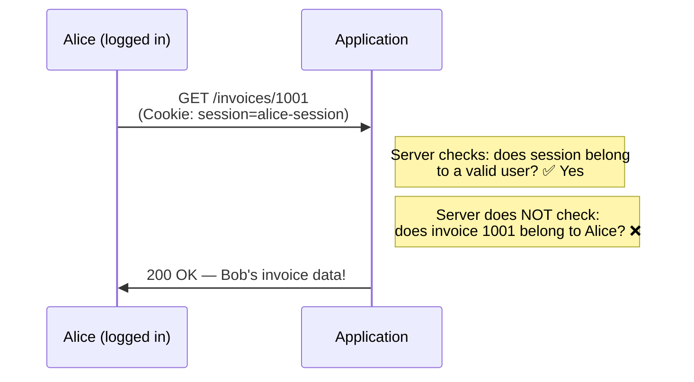

# IDOR — Broken Access Control

You met the concept in Path 05.7 and Path 11.1 — now let's find, exploit, and fix it hands-on. **IDOR** is consistently one of the most commonly found bugs in real bug bounty programs, and it's often the very first vulnerability class beginners successfully find on their own.

## What IDOR actually is

**IDOR** = Insecure Direct Object Reference. It happens when an application uses a direct, guessable/predictable reference (like a database ID) to access an object — and fails to verify that the *requesting user* is actually authorised to access *that specific object*.



The authentication is completely fine (Alice really is logged in as Alice) — the failure is purely in **authorization**: nobody checked whether invoice 1001 actually belongs to Alice before returning it.

## The classic pattern

```http
GET /api/user/profile?id=1024 HTTP/1.1
Cookie: session=alice-session-abc123
```

If changing `id=1024` to `id=1025` returns *Bob's* profile instead of an "access denied," that's IDOR.

## Where IDOR hides

It's not always a URL parameter. Look everywhere an object is referenced:

- **URL path/query:** `/invoices/1001`, `?user_id=42`
- **Request body (JSON):** `{"account_id": 55, "amount": 100}`
- **Hidden form fields:** `<input type="hidden" name="order_id" value="789">`
- **Headers:** custom headers sometimes carry IDs too
- **API responses that leak IDs:** even if the UI doesn't show them, the underlying API JSON often does — remember Path 05.5's "excessive data exposure"

## Finding IDOR with Burp

1. Log in as one test account (or use two accounts if the app supports it).
2. Browse to a page showing *your own* data (profile, an order, a document).
3. Send that request to **Repeater**.
4. Identify the ID parameter (URL, body, or otherwise).
5. **Change the ID** to a different, plausible value — try IDs near yours, or another test account's known ID.
6. Observe the response: does it return someone else's data? An error? An empty result?

```python
#!/usr/bin/env python3
"""
idor-sweep.py — Sweep a range of IDs against an authenticated endpoint
to spot IDOR (only ever run against systems you own or are authorised to test).
"""
import requests

BASE = "http://testphp.vulnweb.com/api/user"  # example — adapt to real target
HEADERS = {"Cookie": "session=YOUR_TEST_SESSION"}

for uid in range(1, 20):
    r = requests.get(f"{BASE}?id={uid}", headers=HEADERS, timeout=5)
    print(f"id={uid}: {r.status_code}, {len(r.text)} bytes")
```

A sudden pattern of "200 OK with real-looking data" across many IDs you shouldn't have access to is the signature of IDOR.

## The two flavours

- **Horizontal privilege escalation** — accessing another user's data at the **same** privilege level (Alice reading Bob's invoice — both regular users).
- **Vertical privilege escalation** — accessing functionality meant for a **higher** privilege level (a regular user reaching an admin-only endpoint by guessing/finding its URL).

Both stem from the same root cause: missing per-object or per-action authorization checks.

## IDOR in modern APIs — BOLA

Recall from Path 05.5: in API-specific contexts, this exact bug is called **BOLA** (Broken Object Level Authorization) — the #1 category in the OWASP API Security Top 10. Same underlying flaw, API-flavoured name.

## Why IDOR is so common

- Developers often (reasonably) trust their own ORM/database layer to "just work," forgetting that fetching by ID still needs an explicit ownership check.
- It's invisible in normal testing — the app works *perfectly* for the developer testing with their own account; the bug only appears when you deliberately try someone else's ID.
- Modern apps have dozens to hundreds of API endpoints, each needing its own authorization check — easy to miss one.

## How to properly fix IDOR (the defender's view)

```python
# VULNERABLE — no ownership check:
@app.route("/api/invoices/<int:invoice_id>")
def get_invoice(invoice_id):
    invoice = db.get_invoice(invoice_id)
    return jsonify(invoice)

# FIXED — explicit ownership check on every access:
@app.route("/api/invoices/<int:invoice_id>")
def get_invoice(invoice_id):
    invoice = db.get_invoice(invoice_id)
    if invoice.owner_id != current_user.id:
        abort(403)   # Forbidden
    return jsonify(invoice)
```

Broader defensive strategies:

- **Never trust client-supplied IDs alone** — always cross-check against the authenticated user's own permissions server-side.
- **Use unpredictable identifiers** (UUIDs instead of sequential integers) as defence-in-depth — this doesn't fix the underlying authorization gap, but it does make blind guessing much harder, buying time and reducing casual discovery.
- **Centralise authorization logic** — a shared, tested "can this user access this object?" function used consistently, rather than ad-hoc checks scattered (and sometimes forgotten) across every endpoint.
- **Deny by default** — require an explicit authorization check to pass, rather than allowing access unless explicitly denied.

## Mass assignment — IDOR's close cousin

Worth distinguishing here since the two are easy to conflate: IDOR is about accessing *someone else's* object by changing an ID; **mass assignment** (referenced back in Path 05.5's API bug table) is about *modifying fields you shouldn't be able to touch on your own object*. If a `PATCH /api/profile` endpoint naively accepts and applies every field in the submitted JSON body straight to the database record, an attacker can add an unexpected field — `{"bio": "hi", "role": "admin"}` — and if the server doesn't explicitly whitelist which fields a normal user is allowed to change, that extra `role` field gets silently applied too. The fix pattern is the same underlying discipline as IDOR's fix: never trust the client's full input; explicitly whitelist what's actually allowed to change, rather than blacklisting what isn't.

## Automating IDOR discovery with Autorize

Manually testing every endpoint with a second account gets tedious fast on a large app — this is exactly what the **Autorize** Burp extension (mentioned in Path 11.2's BApp Store section) automates: you log in with two accounts of different privilege levels, and Autorize automatically replays every request your higher-privilege session makes using the lower-privilege session's cookies instead, flagging any response that still returns real data instead of an access-denied error. Running a tool like this passively in the background while you browse an application normally is a genuinely efficient way to surface IDOR and BOLA issues across dozens of endpoints without hand-testing each one individually.

## 🧪 Lab — PortSwigger's free IDOR labs

The single best hands-on resource for this exact topic:

1. Go to [PortSwigger Web Security Academy — Access control vulnerabilities](https://portswigger.net/web-security/access-control).
2. Create a free account.
3. Work through the **"IDOR" and "Broken access control"** labs — they're interactive, hosted, legal targets built exactly for this purpose, with step-by-step guided solutions if you get stuck.
4. Use Burp (configured in Path 11.2) to intercept, modify, and replay requests inside each lab.

These labs are how most professional web testers actually learned this material — genuinely worth the time.

:::challenge Test yourself
An app shows only your own orders in its UI, and the "Order ID" is never visible on screen. Is it safe from IDOR?

<details><summary>Show answer</summary>Not necessarily. Even if the <em>UI</em> never displays the raw ID, the underlying <strong>API request</strong> the JavaScript makes behind the scenes very likely still includes it (in the URL, body, or a hidden field) — recall Path 05.6's DevTools Network panel. An attacker inspects the actual HTTP traffic, not just what's rendered on screen, and can still attempt to change that ID directly. "Not shown in the UI" is not the same as "not exploitable."</details>
:::

## Key terms

- **IDOR** — Insecure Direct Object Reference; missing per-object authorization check.
- **BOLA** — the API-specific name for the same underlying bug (OWASP API Top 10 #1).
- **Horizontal / vertical privilege escalation** — same-level vs higher-level unauthorized access.
- **Deny by default** — requiring explicit authorization rather than assuming access unless denied.

## Recap

- IDOR happens when an app checks *who you are* but not *whether you're allowed to access this specific object*.
- It hides in URLs, JSON bodies, hidden fields, and headers — not just visible parameters.
- Sweeping nearby IDs with Burp Repeater or a small script is the classic discovery technique.
- Fixing it requires explicit, server-side ownership checks on every sensitive endpoint — never trust the client's word for which object it wants.

???refs
- [PortSwigger — Access control vulnerabilities](https://portswigger.net/web-security/access-control) — the definitive free hands-on resource.
- [OWASP — Insecure Direct Object References](https://owasp.org/www-community/attacks/Insecure_Direct_Object_Reference) — the classic writeup.
- [OWASP API Security Top 10 — BOLA](https://owasp.org/API-Security/editions/2023/en/0xa1-broken-object-level-authorization/)
- [HackerOne — IDOR reports (Hacktivity)](https://hackerone.com/hacktivity?querystring=IDOR) — real, disclosed IDOR bug bounty reports for study.
???

**Next up →** [CSRF — Cross-Site Request Forgery](#/lesson/11-web-security/csrf-attacks)
