# OWASP Top 10 overview

Welcome to applied web security. Before diving into individual bug classes, meet the document that organises the entire field: the **OWASP Top 10**.

## What OWASP is

**OWASP** (Open Worldwide Application Security Project) is a non-profit community producing free, vendor-neutral security resources — tools, documentation, and standards used across the entire industry. The **OWASP Top 10** is their most famous output: a periodically-updated ranking of the most critical web application security risks, based on real-world data contributed by security firms worldwide.

It isn't a top-10 of "bugs" exactly — it's a top-10 of **risk categories**, each covering a cluster of related vulnerability types.

## OWASP Top 10:2025 — the current edition

The 2025 edition is the current web-application Top 10. Learn the risk behind each category; the number is a label, not a severity score for an individual bug.

| 2025 category | What to look for |
| --- | --- |
| A01 Broken Access Control | Missing authorization on objects and actions; SSRF is included here in 2025. |
| A02 Security Misconfiguration | Unsafe defaults, exposed services, missing hardening, and configuration drift. |
| A03 Software Supply Chain Failures | Compromised or untrusted dependencies, builds, and distribution paths. |
| A04 Cryptographic Failures | Weak, missing, or misused protection of sensitive data. |
| A05 Injection | Untrusted data interpreted as a command or query. |
| A06 Insecure Design | Missing controls in the design of a workflow or system. |
| A07 Authentication Failures | Weak identity proof, sessions, MFA, or account recovery. |
| A08 Software or Data Integrity Failures | Trusting software or data artifacts without validating integrity. |
| A09 Security Logging & Alerting Failures | Missing evidence or alerts that would trigger a response. |
| A10 Mishandling of Exceptional Conditions | Error paths that fail open, leak data, or leave an unsafe state. |

**What changed from 2021?** Security Misconfiguration rose from A05 to A02. Vulnerable and Outdated Components expanded into Software Supply Chain Failures (A03), covering dependencies and the systems that build and distribute them. SSRF is no longer its own A10 category; OWASP includes it under Broken Access Control. Mishandling of Exceptional Conditions is the new A10. Authentication and logging categories were renamed to emphasize the failure mode. The 2021 list below remains useful when reading older reports.

## Historical reference: OWASP Top 10:2021

```mermaid
flowchart TB
    A1["A01: Broken Access Control"]
    A2["A02: Cryptographic Failures"]
    A3["A03: Injection"]
    A4["A04: Insecure Design"]
    A5["A05: Security Misconfiguration"]
    A6["A06: Vulnerable & Outdated Components"]
    A7["A07: Identification & Authentication Failures"]
    A8["A08: Software & Data Integrity Failures"]
    A9["A09: Security Logging & Monitoring Failures"]
    A10["A10: Server-Side Request Forgery (SSRF)"]

    style A1 fill:#2b1010,color:#E05548,stroke:#E05548
    style A2 fill:#2b1010,color:#E05548,stroke:#E05548
    style A3 fill:#2b1010,color:#E05548,stroke:#E05548
    style A4 fill:#2b1f0a,color:#EFA43A,stroke:#EFA43A
    style A5 fill:#2b1f0a,color:#EFA43A,stroke:#EFA43A
    style A6 fill:#2b1f0a,color:#EFA43A,stroke:#EFA43A
    style A7 fill:#2b1010,color:#E05548,stroke:#E05548
    style A8 fill:#2b1f0a,color:#EFA43A,stroke:#EFA43A
    style A9 fill:#111927,color:#8496A6,stroke:#8496A6
    style A10 fill:#2b1010,color:#E05548,stroke:#E05548
```

### A01: Broken Access Control — #1 in both editions

The most common issue found in real testing. This is the umbrella for **IDOR** (Path 11.4), missing function-level authorization, and privilege escalation via the web. Essentially: the app fails to properly enforce *"is this user allowed to do this specific thing?"* — exactly the authorization concept from Path 05.7.

### A02: Cryptographic Failures

Previously called "Sensitive Data Exposure" — renamed to focus on the *root cause*: missing encryption, weak algorithms, improper key management. Covers everything from unencrypted data in transit to the MD5-for-passwords mistake from Path 10.5.

### A03: Injection

Includes **SQL injection** (Path 11.6), **command injection** (Path 11.7), and cross-site scripting (technically its own category historically, folded in here in 2021). The common thread: untrusted input is interpreted as *code* rather than *data* by some downstream interpreter.

### A04: Insecure Design

A newer category (2021) recognising that some vulnerabilities stem from **missing security controls at the design stage**, not just implementation bugs. E.g., a password-reset flow with no rate limiting by design, regardless of how well the code is written.

### A05: Security Misconfiguration

Default credentials left in place, unnecessary features enabled, verbose error messages leaking stack traces, missing security headers, outdated software with known defaults. Extremely common and often trivially found.

### A06: Vulnerable and Outdated Components

Using libraries/frameworks with known CVEs. This is why **SCA (Software Composition Analysis)** tooling exists — scanning dependency trees for known-vulnerable packages is core AppSec work.

### A07: Identification and Authentication Failures

Weak password policies, missing MFA, session fixation, predictable session tokens, credential stuffing without protection — the authentication half of Path 10.5 and 05.4, now viewed as an application-layer risk category.

### A08: Software and Data Integrity Failures

Trusting data or code without verifying its integrity — insecure deserialization, unsigned/unverified auto-updates, and **CI/CD pipeline compromises** (directly related to real incidents like the `trivy-action` supply-chain compromise from earlier professional context).

### A09: Security Logging and Monitoring Failures

Not detecting or being unable to investigate a breach because logs weren't kept, weren't monitored, or didn't capture the right events. This is why breach detection so often takes **months** in real incidents — the evidence existed but nobody was watching.

### A10: Server-Side Request Forgery (SSRF)

A newer standalone category (previously bundled elsewhere): tricking a server into making requests *on the attacker's behalf* — often to internal-only systems the attacker couldn't otherwise reach. Covered in depth in Path 11.8.

## Why this list changes over time

The Top 10 has been refreshed periodically (including 2013, 2017, 2021, and 2025) using contributed testing data and community review. Categories can be merged, renamed, or reprioritised as software and attack paths change. A category's position is a guide to broad risk, not a replacement for testing or for prioritising a particular finding in its business context.

## Using the editions together

When an older report says **A06:2021 Vulnerable and Outdated Components**, map it to the broader **A03:2025 Software Supply Chain Failures** and ask whether the build, registry, maintainer, or release channel is part of the risk. When a 2021 report says **A10 SSRF**, look under **A01:2025 Broken Access Control** while still describing the exact SSRF weakness. The OWASP API Security Top 10 and OWASP guidance for LLM applications are separate projects; their categories should not be mixed into this web-app list.

## How to actually use the Top 10 in practice

- **As a beginner:** it's your syllabus. Each category points to a cluster of concrete, learnable bugs (which the rest of this path covers hands-on).
- **As a pentester:** it's a useful *checklist* to ensure broad coverage, though real engagements go well beyond just these ten categories.
- **As a defender/AppSec engineer**: it's a shared vocabulary for prioritising fixes, mapping SAST/DAST findings to recognisable risk categories, and communicating with non-security stakeholders about *why* something matters.
- **As a bug bounty hunter:** most public program scopes and vulnerability disclosure processes implicitly reference these categories.

## The companion projects worth knowing

OWASP produces much more than just the Top 10:

- **OWASP ASVS (Application Security Verification Standard)** — a much more detailed, testable checklist for verifying application security, often used for formal audits.
- **OWASP Testing Guide** — step-by-step methodology for testing each vulnerability category.
- **OWASP Cheat Sheet Series** — practical, focused guidance on specific topics (you've already been linked several of these throughout this course).
- **OWASP ZAP** — a free, open-source web app security scanner, a great complement to Burp Suite (next lesson).
- **OWASP API Security Top 10** — the API-specific parallel list, mentioned back in Path 05.5.

## 🧪 Lab — Map what you already know

Before moving further into this path, go back through Paths 01–06 and, for each **2025** category above, write down **one concept you've already learned** that connects to it. For example:

- A04 (Cryptographic Failures) → "Path 10.5: MD5/SHA-1 are wrong for passwords."
- A07 (Auth Failures) → "Path 05.4: session cookies need HttpOnly/Secure/SameSite."

If you can connect at least 6 of the 10 categories to something you already know, you're in great shape for the rest of this path — you're not starting from zero, you're organising what you already have.

:::challenge Test yourself
Which category is A03 in the 2025 edition, and how is it broader than A06 in 2021?

Show answer
<strong>Software Supply Chain Failures</strong> — it expands beyond vulnerable or outdated libraries to include compromised dependencies, build systems, and distribution infrastructure.

:::

## Key terms

- **OWASP** — the non-profit behind the Top 10 and many other free security resources.
- **OWASP Top 10** — the ranked list of the most critical web app security risk categories.
- **ASVS / Testing Guide / Cheat Sheet Series** — OWASP's deeper, more detailed companion resources.
- **SCA (Software Composition Analysis)** — tooling for finding known-vulnerable dependencies (A06).

## Recap

- The OWASP Top 10 organises web application risk into ten shared categories.
- A01 (Broken Access Control) remains first in the 2025 edition.
- Injection, misconfig, and outdated components remain persistently common across editions.
- The list evolves based on real aggregated data, not opinion.
- It serves as a syllabus for learners, a checklist for testers, and a vocabulary for defenders.

???refs
- [OWASP Top 10:2025](https://top10.owasp.org/2025/0x00_2025-Introduction/) — current categories and change notes.
- [OWASP Top 10:2021](https://owasp.org/Top10/2021/) — historical comparison.
- [OWASP ASVS](https://owasp.org/www-project-application-security-verification-standard/) — the detailed verification standard.
- [OWASP Cheat Sheet Series](https://cheatsheetseries.owasp.org/) — practical guidance, topic by topic.
- [OWASP API Security Top 10](https://owasp.org/API-Security/editions/2023/en/0x11-t10/) — the API-specific parallel.
???

**Next up →** [Set up Burp Suite](#/lesson/11-web-security/burp-setup)
