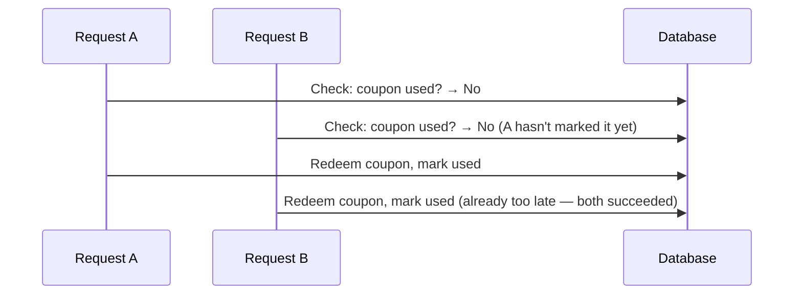

# Race Conditions in Web Applications

The business-logic lesson mentioned coupon replay as a race-condition-driven example. This lesson explains exactly what a race condition actually is, and why timing itself — not any malicious input — is the entire attack.

## What a race condition actually is

A **race condition** occurs when an application's correctness depends on operations happening in a specific order, but the application doesn't actually enforce that order — creating a window where two things can happen "at the same time" in a way the developer never intended.

## The classic check-then-act flaw

Most web race conditions follow the same underlying pattern: **check**, then **act**, with a gap between the two steps:

```
1. CHECK: "Has this coupon already been used?" → No
2. ACT: "Redeem the coupon, mark it as used"
```

If an attacker sends many identical requests simultaneously, several of them can pass step 1 (the check) *before any of them completes step 2* (marking it as used) — each request independently sees "not yet used" during its own check, and all of them proceed to redeem the coupon, even though it should only have been usable once.



## Where race conditions show up in the real world

- **Coupon/discount redemption** — exactly the Path 19 example, redeeming a single-use code multiple times
- **Financial transactions** — a withdrawal or transfer where the balance check and the balance deduction aren't handled atomically, potentially allowing a withdrawal beyond the actual available balance
- **Rate limiting bypass** — Path 21's rate-limit-bypass lab and Path 19's own rate-limit CTF challenge both touch on timing-related bypass techniques, closely related to this same underlying category
- **Account creation abuse** — creating multiple accounts that should be limited to one per email, if the uniqueness check and the account-creation step aren't handled atomically

## The defense: atomic operations and proper locking

- **Database-level atomicity** — using a single atomic operation (a database transaction, or an atomic "decrement if greater than zero" operation) instead of a separate check followed by a separate act, eliminating the gap entirely
- **Locking** — explicitly locking a resource during the check-and-act sequence, preventing a second concurrent request from reading a stale, pre-update state
- **Idempotency keys** — a unique identifier for a specific intended action, letting the server recognize and reject a duplicate, simultaneously-submitted request as the same action already being processed rather than a legitimately separate one

:::challenge Test yourself
Why doesn't simply adding a "has this coupon been used?" check prevent the race-condition vulnerability described in this lesson, if that check already exists?
<details><summary>Show answer</summary>The check itself isn't the problem — the problem is the <em>gap in time</em> between the check completing and the corresponding update (marking the coupon as used) actually being committed. If multiple identical requests arrive within that gap, each one independently performs its own check <em>before</em> any of them has finished updating the database, meaning each check genuinely, correctly returns "not yet used" at the moment it runs — the check isn't lying, it's just running against stale information because the update from a concurrent, simultaneous request hasn't landed yet. The fix isn't a better or more frequent check — it's eliminating the gap entirely, by making the check-and-update a single atomic operation that no other concurrent request can interleave with, which is exactly what database transactions and proper locking are designed to guarantee.</details>
:::

## Key terms

- **Race condition** — a flaw where correctness depends on operation ordering the application doesn't actually enforce.
- **Check-then-act flaw** — the classic race-condition pattern, where a gap between a check and its corresponding action allows concurrent requests to both pass the check before either completes the action.
- **Atomic operation** — an operation guaranteed to complete as a single, indivisible unit, with no possibility of another operation interleaving partway through.

## Recap

- Race conditions exploit the timing gap in a check-then-act pattern, letting concurrent requests each pass a check before any of them completes the corresponding update.
- Coupon redemption, financial transactions, rate limiting, and account creation are all real-world areas where this pattern commonly appears.
- Atomic database operations, explicit locking, and idempotency keys are the standard defenses, each eliminating the timing gap rather than trying to check more carefully or more often.

**Next up →** [Command injection & file upload flaws](#/lesson/11-web-security/cmd-and-upload)
