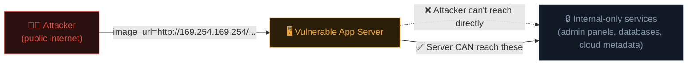

# SSRF & authentication flaws

Two more categories from the OWASP Top 10 (Path 11.1): **SSRF** (A10) — a bug where the *server itself* becomes the attacker's proxy — and **authentication failures** (A07), the flaws that undermine the entire premise of "logging in" securely.

## Server-Side Request Forgery (SSRF)

### The core idea

**SSRF** happens when an application takes user input and uses it to make an HTTP request *from the server itself* — without properly restricting where that request can go. The attacker essentially borrows the server's own network position and trust to reach places they couldn't reach directly.

```python
# VULNERABLE — server fetches whatever URL the user supplies:
url = request.args.get("image_url")
response = requests.get(url)
return response.content
```

This looks like an innocent "fetch an image from a URL to display" feature. But the server is making the request, from **inside** the company's network — somewhere the attacker, sitting outside on the public internet, cannot reach directly.

### Why this is so dangerous — reaching internal-only systems



Classic SSRF targets:

- **Cloud metadata endpoints** — `http://169.254.169.254/` on AWS/GCP/Azure often exposes temporary cloud credentials, instance metadata, and sometimes even IAM role tokens, with **zero authentication required**, precisely because it's assumed only the instance itself would ever query it. SSRF breaks that assumption entirely — one of the most impactful SSRF outcomes in real breaches (a real, well-documented example: the 2019 Capital One breach originated from exactly this pattern).
- **Internal admin panels** — `http://localhost/admin`, `http://10.0.0.5:8080/` — services never meant to be internet-facing, reachable only because the *server* is inside the trusted network perimeter.
- **Internal APIs and databases** — services with no authentication because they "trust" all internal traffic by network position alone.
- **Port scanning the internal network** — timing differences between "connection refused" and "timeout" responses let an attacker map out what's running internally, entirely through the vulnerable server as a proxy.

### Finding SSRF

Look for any feature where the server fetches a URL on the user's behalf: "import from URL," image/avatar fetchers, webhook configuration, PDF generation from a URL, link preview generators, RSS/feed readers.

```
image_url=http://169.254.169.254/latest/meta-data/
image_url=http://localhost:8080/admin
image_url=http://127.0.0.1:22          (banner grab via error timing)
image_url=file:///etc/passwd            (some libraries also honour file:// !)
```

### Bypassing weak SSRF filters

Developers often try to blocklist `localhost` and `127.0.0.1` — attackers routinely bypass this with:

```
http://0.0.0.0/
http://127.1/                    (shortened IP form)
http://[::1]/                    (IPv6 loopback)
http://2130706433/                (decimal representation of 127.0.0.1)
http://0x7f.0x0.0x0.0x1/          (hex representation)
http://attacker.com/redirect-to-internal   (open redirect chained into SSRF)
```

This is exactly why **blocklists are structurally weak** (echoing the SQLi/command injection lessons) — the *correct* defence is an allowlist of explicitly permitted destinations, not a blocklist of known-bad ones.

### Defences

- **Allowlist** specific, expected destination hosts/domains — never rely on blocklisting "known bad" addresses.
- Disable unnecessary URL schemes (`file://`, `gopher://`, `dict://`) in whatever HTTP client library is fetching the URL.
- **Network-level segmentation** — the app server simply shouldn't have network access to sensitive internal services it has no legitimate reason to reach (defence in depth, independent of the application code).
- For cloud environments, use **IMDSv2** (AWS's token-based metadata service protocol) which specifically requires an extra header, structurally defeating the simplest SSRF-to-metadata attack pattern.

## Authentication failures

Recall Path 10.5 (passwords/hashing) and Path 05.4 (sessions) — this OWASP category is where those concepts become concrete, testable web application bugs.

### Common real-world authentication flaws

- **No rate limiting on login** — allows unlimited password-guessing (brute force) or **credential stuffing** (trying breached username/password pairs from other sites, per Path 10.5).
- **Weak password reset flows** — predictable reset tokens, tokens that don't expire, or reset links leaking via the `Referer` header to third-party analytics scripts.
- **Username enumeration** — a login form that says "invalid password" for a real username but "user does not exist" for a fake one, letting an attacker silently confirm which emails/usernames have accounts (useful for later, targeted attacks) even without ever guessing a correct password.
- **Missing MFA, or MFA that can be bypassed** — e.g., an MFA check that's enforced only in the UI's JavaScript flow, but the underlying API endpoint that actually logs the user in doesn't itself verify the MFA step was completed (a direct echo of the client-vs-server trust lesson).
- **Session fixation and predictable session tokens** (Path 05.4) — weak randomness in session ID generation makes tokens guessable.
- **JWT-specific flaws** — accepting `alg: none` (removing signature verification entirely), accepting a JWT signed with a weak/guessable secret, or confusing the intended signing algorithm (e.g., an `RS256`-to-`HS256` confusion attack, tricking the server into verifying a forged token using its own public key as if it were a shared secret).

### Testing for username enumeration

```bash
curl -s -d "username=admin&password=wrong" https://target/login
curl -s -d "username=definitely_not_a_real_user_xyz&password=wrong" https://target/login
# Compare response bodies, status codes, AND response timing closely
```

If responses differ in **any** observable way — message text, status code, or even subtle timing differences — that's exploitable username enumeration.

### Testing JWTs

```bash
# Decode a JWT's header and payload (never the signature) at jwt.io,
# or manually in Python:
python3 -c "
import base64, json
token = 'eyJhbGciOiJIUzI1NiJ9.eyJ1c2VyIjoiYWxpY2UifQ.signature'
header, payload, sig = token.split('.')
print(json.loads(base64.urlsafe_b64decode(header + '==')))
print(json.loads(base64.urlsafe_b64decode(payload + '==')))
"
```

Then test the classic **`alg: none`** attack — modify the header to declare no signature algorithm at all, strip the signature, and see if the server foolishly accepts it as valid anyway.

## Blind SSRF — no response body, still exploitable

Just as blind SQLi and blind XSS have no directly visible output, **blind SSRF** occurs when the vulnerable server makes the attacker-controlled request but never returns the response content back to the attacker in any form — the "import from URL" feature above might just silently succeed or fail with no data shown. Detection here relies on the same out-of-band callback pattern from the command injection lesson: point the vulnerable parameter at an attacker-controlled server (or a Burp Collaborator domain) and watch for an inbound HTTP or DNS request, which alone confirms the server made the fetch even though nothing about the response was ever visible. Blind SSRF is still often fully exploitable for internal port scanning and cloud metadata access — the attacker just has to infer results from *whether a request happened and how long it took*, rather than reading a response body directly.

## Credential stuffing vs brute force — a precise distinction worth having

These two terms get used interchangeably by beginners, but they describe different attacks with different defences. **Brute force** tries many *guessed* password candidates (from a wordlist or systematic generation) against one or a few accounts, hoping one guess happens to be correct — rate limiting and account lockouts are the primary defence. **Credential stuffing** instead tries password pairs *already known to be real*, leaked from a completely unrelated breach, betting purely on password reuse across sites — because each individual attempt uses a real, previously-valid credential rather than a guess, it often defeats simple rate limiting by spreading attempts across a botnet of different IPs, and the actual defence is different too: MFA, breach-monitoring services like Have I Been Pwned (Path 10.5), and blocking known-compromised passwords at signup time, rather than just slowing down guess attempts.

## 🧪 Lab — PortSwigger SSRF & authentication labs

1. [PortSwigger — SSRF labs](https://portswigger.net/web-security/ssrf) — practise reaching internal-only services and cloud metadata endpoints in a safe, legal, hosted environment.
2. [PortSwigger — Authentication labs](https://portswigger.net/web-security/authentication) — practise username enumeration, broken brute-force protection, and multi-factor bypass techniques.
3. [PortSwigger — JWT attacks labs](https://portswigger.net/web-security/jwt) — practise the `alg: none` and algorithm confusion attacks described above.

## 🎉 You've finished the core vulnerability lessons of Path 11

You've now covered every major OWASP Top 10 category hands-on: access control/IDOR, injection (XSS, SQLi, command injection), file upload flaws, SSRF, and authentication failures. One lesson remains to tie it all together into a practical roadmap.

:::challenge Test yourself
An app blocks any `image_url` input containing the literal string `localhost` or `127.0.0.1` to prevent SSRF. Name one bypass technique from this lesson that would defeat this specific filter.

<details><summary>Show answer</summary>Several work: <code>http://127.1/</code> (shortened form), <code>http://[::1]/</code> (IPv6 loopback), <code>http://2130706433/</code> (decimal IP representation), or <code>http://0x7f.0x0.0x0.0x1/</code> (hex representation) — all resolve to the same loopback address while containing neither blocked string, demonstrating exactly why blocklisting specific strings is structurally weaker than allowlisting permitted destinations.</details>
:::

## Key terms

- **SSRF** — tricking a server into making requests on the attacker's behalf, reaching internal-only systems.
- **Cloud metadata endpoint** — an internal-only service (e.g., `169.254.169.254`) exposing instance credentials, a classic high-impact SSRF target.
- **Username enumeration** — inferring valid accounts from differing login responses.
- **JWT `alg: none` / algorithm confusion** — classic JWT signature-verification bypass techniques.

## Recap

- SSRF exploits the server's own trusted network position to reach internal-only systems the attacker can't access directly.
- Blocklisting known-bad addresses is structurally weak; allowlisting expected destinations is the real fix.
- Authentication failures span weak rate limiting, enumeration, broken reset flows, and JWT-specific flaws.
- PortSwigger's free labs are the best hands-on practice for every technique in this lesson.

???refs
- [PortSwigger — SSRF](https://portswigger.net/web-security/ssrf) — free hands-on labs.
- [PortSwigger — Authentication](https://portswigger.net/web-security/authentication) — free hands-on labs.
- [PortSwigger — JWT attacks](https://portswigger.net/web-security/jwt) — free hands-on labs.
- [OWASP SSRF Prevention Cheat Sheet](https://cheatsheetseries.owasp.org/cheatsheets/Server_Side_Request_Forgery_Prevention_Cheat_Sheet.html)
- [AWS — IMDSv2 documentation](https://docs.aws.amazon.com/AWSEC2/latest/UserGuide/configuring-instance-metadata-service.html) — the real-world SSRF-to-metadata mitigation.
???

**Next up →** [Your web security roadmap](#/lesson/11-web-security/web-roadmap)
