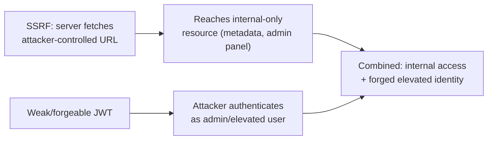

# SSRF & JWT Lab

This lab combines two of the modern web's most consequential attack classes — Server-Side Request Forgery and JWT abuse — into one exercise, mirroring how real applications often expose both simultaneously.

## Lab setup

Use **PortSwigger's Web Security Academy** — it hosts free, purpose-built labs specifically covering both SSRF and JWT vulnerabilities, letting you practice each against a realistic (if intentionally flawed) application rather than an isolated puzzle.

## Tasks

1. **Exploit an SSRF vulnerability to reach internal resources.** Find a feature that makes a server-side request based on user input (a "fetch preview image from URL" feature, a webhook URL field, a PDF-export-from-URL tool) and redirect it somewhere it shouldn't reach:
   ```
   Normal use:      url=https://example.com/image.jpg
   SSRF attempt:     url=http://localhost/admin
   Cloud metadata:   url=http://169.254.169.254/latest/meta-data/
   ```
   The cloud metadata endpoint (referenced in Path 16's cloud security lesson and its lab) is a particularly high-value SSRF target — on a misconfigured cloud instance, it can return temporary cloud credentials directly, turning a "the server fetched a URL" bug into full cloud account compromise.
2. **Analyze and tamper with a JWT token.** Capture a session token from the same lab application and decode it (Path 11's JWT lab covers the full toolkit) — check specifically whether it uses `alg: none`, or whether it's signed with a weak, guessable secret.
3. **Bypass authentication using a modified JWT.** Using whichever weakness you find in Task 2, forge or crack a token that grants elevated access (admin role, different user identity), and use it to access something your original account shouldn't be able to reach.
4. **Connect the two.** In many real-world findings, a chain like this is exactly how a "low severity" SSRF and a "medium severity" weak JWT secret combine into something far more serious than either issue alone — for instance, using SSRF to reach an internal admin panel that trusts requests based purely on network origin, then using a forged JWT to authenticate to it. Consider (even if the lab doesn't literally support it) how these two findings *could* chain together in a real application.



5. **Test whether SSRF protections are bypassable via redirect.** If the target validates the initial URL against a blocklist but then follows HTTP redirects, host (or simulate) a redirect from an allowed-looking URL to an internal address — `http://allowed-domain.com/redirect?to=http://169.254.169.254/` — and check whether the server's HTTP client follows the redirect without re-validating the final destination. This exact gap (validate once, then blindly follow redirects) is one of the most common real-world SSRF filter bypasses, since developers often remember to check the *input* URL but forget the client library will happily follow a `302` anywhere afterward.

:::tip Real bug bounty reports increasingly reward chains
Individual low/medium severity findings are common and often pay modestly. A well-documented *chain* connecting two separate, individually modest findings into a genuinely serious combined impact is exactly the kind of report that tends to earn the highest bounties and the most attention — Path 15's business logic & chains lesson covers this pattern directly.
:::

:::challenge Exploit both and document the chain
Successfully exploit both an SSRF and a JWT vulnerability in your lab environment, and write up the full path: what the SSRF reached, what the JWT weakness allowed, and — even if only theoretically in this specific lab — how the two could combine into something more severe than either alone.
:::

## Key takeaway

Real-world impact frequently comes from combining vulnerabilities, not from any single flaw in isolation — this is exactly why experienced testers keep every finding in mind while continuing to test, rather than treating each vulnerability as a fully separate, closed investigation.

**Next up →** [XSS Practical Lab](#/lesson/11-web-security/xss-practical-lab)
