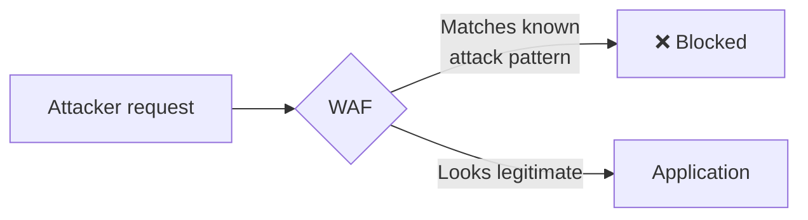

# Web Application Firewalls (WAFs)

You've now covered a wide range of web vulnerability classes in real technical depth. This lesson covers a tool many organizations deploy as an additional protective layer against all of them at once — and, just as importantly, why it's never a substitute for actually fixing the underlying vulnerabilities.

## What a WAF actually does

Path 02's network-firewalls lesson covered filtering traffic based on network-level rules (IP addresses, ports). A **Web Application Firewall (WAF)** operates one layer up — inspecting the actual *content* of HTTP requests, looking for patterns resembling known attack techniques (SQL injection syntax, XSS payloads, path traversal sequences) and blocking requests that match, before they ever reach the actual application.

## Why a WAF is a genuine, valuable defense-in-depth layer

Directly connecting to Path 10's defense-in-depth lesson: a WAF provides real, immediate protection against a huge volume of unsophisticated, automated attack traffic — the same "fishing with a giant net" pattern Path 01 described — without requiring every single application behind it to have flawless input validation. This is genuinely valuable, especially for organizations running many applications, some of which may have unknown or not-yet-fixed vulnerabilities.

## Why a WAF is never a substitute for fixing the actual vulnerability

:::danger A WAF is a mitigation, not a fix
A WAF works by pattern-matching against *known* attack signatures — it has no actual understanding of the application's own logic or code, meaning it can only block attacks it recognizes the shape of. This creates two genuine, recurring gaps: **false negatives** (a sufficiently creative or novel payload the WAF's rules don't recognize sails straight through), and **false positives** (a WAF blocking genuinely legitimate traffic that happens to superficially resemble an attack pattern, breaking real functionality). Relying on a WAF instead of fixing the underlying vulnerability is exactly the kind of misplaced trust this entire course has warned against — the vulnerability still exists, waiting for the one payload the WAF's rules don't happen to catch.
:::

## WAF bypass techniques, briefly

Real-world security testing routinely finds ways past WAF protection, precisely because pattern-matching has inherent limits:

- **Encoding variations** — the same encoding tricks the path-traversal lesson covered (URL encoding, double encoding) can sometimes slip a payload past a WAF's literal pattern-matching
- **Case variation and whitespace tricks** — `SeLeCt` instead of `SELECT`, or unusual whitespace/comment placement within a SQL injection payload, can sometimes evade signature-based detection
- **HTTP parameter pollution** — sending the same parameter multiple times, exploiting inconsistent handling between how the WAF interprets the request and how the actual application interprets it

## Where WAFs genuinely fit in a real security program

A WAF is a legitimate, valuable **detective and preventive control** (from Path 10's control-types lesson) — reducing exposure to known, automated attack patterns while the actual, underlying fixes get properly developed and deployed, and providing an additional layer even after those fixes ship. It's one layer in a defense-in-depth strategy, never the entire strategy on its own.

:::challenge Test yourself
Why can a WAF block 99% of attempted SQL injection attacks against an application, while the application itself remains genuinely vulnerable to SQL injection?

Show answer
A WAF works by recognizing patterns that resemble known attack techniques — it has no actual insight into the application's own code or how it constructs database queries, meaning it can only block payloads whose shape matches a rule it already knows about. The underlying vulnerability (the application building SQL queries by directly concatenating unsanitized user input, rather than using parameterized queries) never actually gets fixed by the WAF's presence — it's simply that most naive, common attack attempts happen to match a recognizable pattern the WAF blocks. A sufficiently novel, carefully obfuscated, or creatively encoded payload that doesn't match any of the WAF's known signatures can still reach the application and exploit the exact same underlying flaw that's been sitting there unfixed the entire time — which is exactly why this lesson insists a WAF is a mitigation layer, never a substitute for actually fixing the vulnerability at its source.

:::

## Key terms

- **Web Application Firewall (WAF)** — a tool inspecting HTTP request content for patterns resembling known attack techniques, blocking matches before they reach the application.
- **False negative (WAF context)** — a genuine attack payload the WAF fails to recognize and blocks.
- **False positive (WAF context)** — legitimate traffic mistakenly blocked because it resembles an attack pattern.

## Recap

- A WAF provides real, valuable defense-in-depth protection by pattern-matching known attack signatures, but it has no understanding of an application's actual logic or code.
- False negatives (missed attacks) and false positives (blocked legitimate traffic) are inherent, unavoidable limitations of a purely pattern-matching approach.
- A WAF is a mitigation layer, never a substitute for fixing the underlying vulnerability — exactly the same "the control helps, but doesn't replace the fix" lesson that applies to CSP and XSS elsewhere in this path.

**Next up →** [Secure Coding for Web Developers](#/lesson/11-web-security/secure-coding-for-web-devs)
