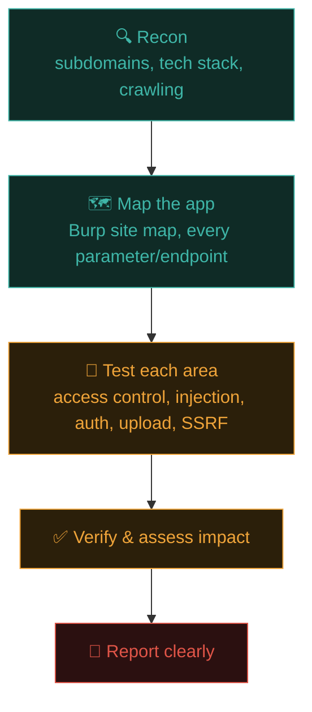
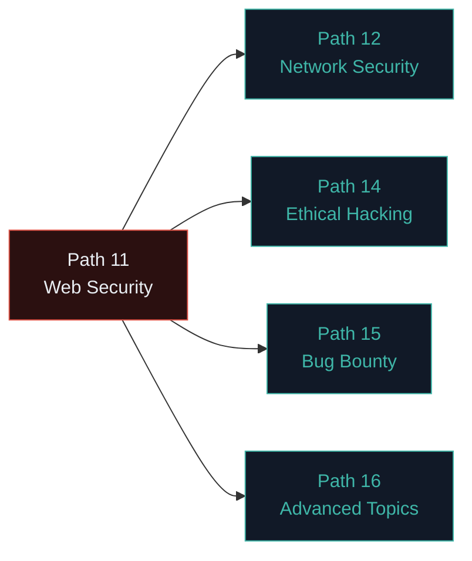

# Your web security roadmap

You've covered the core of practical web application security hands-on. This closing lesson consolidates everything into a repeatable methodology and a clear path for continued growth.

## The complete picture, assembled



This is the same shape whether you're doing a formal penetration test (Path 14), hunting bug bounties (Path 15), or reviewing your own company's application as an AppSec engineer.

## A practical testing checklist

For any web application you're authorised to test, work through:

**Recon & mapping**
- [ ] Subdomains enumerated, live hosts identified
- [ ] Full site map built via Burp (every page, form, and parameter you can find)
- [ ] Technology stack fingerprinted
- [ ] robots.txt, sitemap.xml, and any exposed config/backup files checked

**Access control**
- [ ] Every "your own data" page tested with another account's ID (IDOR)
- [ ] Admin-only functionality tested from a regular user's session
- [ ] Direct API endpoint calls tested, bypassing the UI entirely

**Injection**
- [ ] Every input reflected in output tested for XSS (with context-appropriate payloads)
- [ ] Every parameter touching a likely database query tested for SQLi
- [ ] Any feature plausibly shelling out to the OS tested for command injection

**Uploads & SSRF**
- [ ] File upload features tested with disguised/malicious file types
- [ ] Any "fetch from URL" feature tested against internal addresses and cloud metadata

**Authentication & sessions**
- [ ] Login rate limiting tested
- [ ] Username enumeration tested (differing responses for valid/invalid usernames)
- [ ] Session cookie flags checked (HttpOnly, Secure, SameSite)
- [ ] JWTs (if used) tested for `alg: none` and weak secrets

This checklist maps directly onto the OWASP Top 10 categories from Path 11.1 — you now have a genuinely usable, repeatable methodology, not just a list of facts.

## Vulnerabilities this path didn't cover in depth

Web security is vast — a few important categories worth knowing exist, to research further as you specialise:

- **CSRF (Cross-Site Request Forgery)** — introduced in Path 05.4; worth a deeper dedicated dive as you progress.
- **XXE (XML External Entity injection)** — a SQLi-like injection flaw specific to XML parsers, can lead to file disclosure or SSRF.
- **Insecure deserialization** — untrusted data deserialized into objects, sometimes leading to remote code execution (part of OWASP A08).
- **Business logic flaws** — bugs that aren't a "classic" injection/access-control pattern at all, but abuse of legitimate application logic (e.g., applying a discount code unlimited times, or manipulating a multi-step checkout flow's order).
- **GraphQL-specific issues** — introspection abuse, batching attacks, overly permissive queries (mentioned briefly in Path 05.5).
- **Race conditions** — exploiting timing windows between a check and an action (e.g., redeeming a gift card twice by sending simultaneous requests).

## Writing findings that get fixed, not filed away

A vulnerability report that a developer can't act on quickly is a report that sits in a backlog forever — a genuinely underrated skill separates testers whose findings actually get remediated from those whose reports just accumulate. Beyond the four-part what/where/how/impact structure covered below, the highest-leverage addition is a **concrete, specific remediation suggestion** tailored to the actual bug, not a generic "sanitize user input" — for a SQLi finding, naming the exact parameterised-query pattern from Path 11.6; for stored XSS, naming the specific output-encoding function relevant to the framework in use. Also worth including: a **realistic severity/business-impact framing** in plain language a non-technical stakeholder can grasp ("an attacker could read every customer's payment history" lands far better than "CVSS 8.1"), since the report's real audience is often someone deciding what to prioritise, not just the engineer who'll implement the fix.

## Building your own practice lab

Beyond PortSwigger's hosted labs, running your own vulnerable applications locally deepens understanding significantly:

```bash
# DVWA — Damn Vulnerable Web Application (PHP/MySQL, classic and thorough)
docker run --rm -it -p 8080:80 vulnerables/web-dvwa

# OWASP Juice Shop — modern, deliberately vulnerable JavaScript app
docker run --rm -p 3000:3000 bkimminich/juice-shop

# OWASP WebGoat — structured, guided lessons built into the vulnerable app itself
docker run -p 8080:8080 webgoat/webgoat
```

Remember Path 03.7's networking lesson: run these in an isolated VM/network, never bridged onto your real LAN.

## Tools that round out your toolkit

Beyond Burp and sqlmap, worth exploring as you progress:

- **Nikto** — a fast, automated web server vulnerability scanner (good for a quick initial sweep, high false-positive rate, so always verify manually).
- **Nuclei** — a modern, template-driven vulnerability scanner with thousands of community-contributed detection templates, hugely popular in Path 15's bug bounty automation.
- **ffuf / gobuster** — the directory/parameter fuzzing tools from Path 11.3.
- **Burp extensions** (via the BApp Store) — hundreds of community add-ons extending Burp's capability for specific bug classes.

## How this path connects to what comes next



- **Path 12 (Network Security)** teaches the infrastructure layer beneath the web app — often the entry point in real penetration tests.
- **Path 14 (Ethical Hacking)** formalises the *methodology and legal/professional framing* around everything you've practised here.
- **Path 15 (Bug Bounty)** is the direct, practical application of this entire path against real, in-scope live targets, with a full recon-to-report pipeline.
- **Path 16 (Advanced)** goes deeper into privilege escalation, Active Directory, and cloud security — the *post-compromise* world beyond the initial web foothold.

## 🧪 Lab — Your first full assessment

Pick `testphp.vulnweb.com` or a Docker-hosted DVWA/Juice Shop instance. Using the checklist above, spend a full session doing a genuine, methodical pass — recon, map, test every category, and write down every finding with:

1. **What** the vulnerability is (which OWASP category).
2. **Where** it is (exact URL/parameter).
3. **How** you confirmed it (the exact request/payload).
4. **Impact** — what could an attacker actually do with this.

This exact four-part structure — what, where, how, impact — is the skeleton of every professional vulnerability report you'll ever write, formalised further in Path 14.7.

:::challenge Reflection
Of the six vulnerability classes covered in this path (IDOR, XSS, SQLi, command injection, file upload, SSRF), which one do you find most intuitive so far, and which one do you want to revisit and practise more before moving on?

<details><summary>A thought on this</summary>There's no wrong answer here — but a genuinely useful habit is returning to PortSwigger's labs for whichever category felt least intuitive, <em>before</em> moving to Path 12. A shaky foundation in even one core category will show up repeatedly in later, more advanced paths that build directly on top of these concepts.</details>
:::

## Key terms

- **Business logic flaw** — abuse of legitimate application behaviour rather than a classic injection/access-control bug.
- **Race condition** — exploiting a timing window between a check and an action.
- **Nuclei / Nikto** — automated vulnerability scanners complementing manual Burp-based testing.

## Recap

- A repeatable methodology (recon → map → test → verify → report) applies across every context in the rest of this course.
- The checklist assembled here maps every OWASP Top 10 category to a concrete testing action.
- CSRF, XXE, deserialization, business logic, and race conditions are important categories to explore further beyond this path.
- Local vulnerable app labs (DVWA, Juice Shop, WebGoat) complement PortSwigger's hosted labs for deeper practice.

???refs
- [PortSwigger Web Security Academy](https://portswigger.net/web-security) — the single best free resource; revisit constantly.
- [OWASP Juice Shop](https://owasp.org/www-project-juice-shop/) — modern, thorough vulnerable practice app.
- [DVWA](https://github.com/digininja/DVWA) — the classic PHP-based vulnerable practice app.
- [Nuclei templates](https://github.com/projectdiscovery/nuclei-templates) — thousands of community vulnerability detection templates.
???

## 🎉 You've finished Path 11

You now have a genuinely practical, hands-on understanding of web application security — the OWASP Top 10, Burp Suite, reconnaissance, and six major vulnerability classes with real exploitation and defence detail for each. This is the applied core the rest of the course builds directly on.

**Next up →** [Advanced Burp Suite Lab](#/lesson/11-web-security/burp-advanced-lab)
