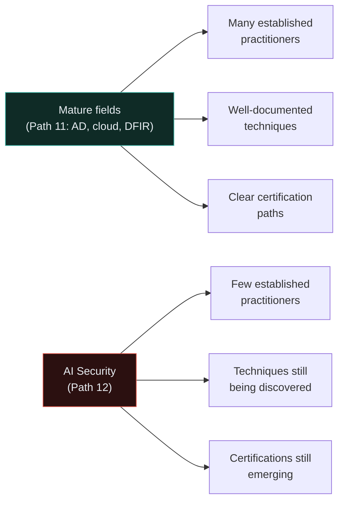
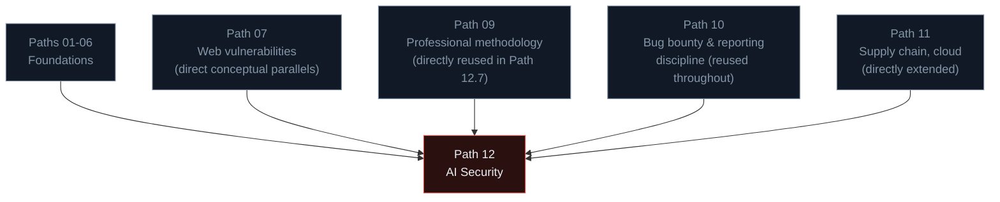

# Building an AI security career

You've reached the final lesson of KashSec Academy. This closing lesson looks at where AI security fits in the broader career landscape you've built across this entire course, and offers genuine, grounded guidance for anyone wanting to specialise here specifically.

## Why AI security is a distinctive career opportunity right now

Recall Path 12.2's framing — this is a genuinely young field. The OWASP LLM Top 10 (Path 12.5) was first published in 2023; the terminology, tooling, and even basic practitioner consensus are actively still forming as organisations rush to deploy LLM-powered features far faster than their security practices are maturing to match. This creates a distinctive window compared to the mature disciplines in Path 11:

Neither state is objectively "better" — mature fields offer clearer career paths and established expectations; young fields offer more room to become a genuinely recognised expert faster, at the cost of less structured guidance along the way.

## The roles this field is actually creating

- **AI Red-teamer / AI Safety Researcher** — directly building on Path 12.7's methodology, systematically probing deployed or pre-release models for safety and security failures. This is precisely the kind of work Ishfaq has been actively doing through platforms like Mercor and Alignerr/OpenClaw, doing LLM red-teaming and model output evaluation.
- **AI/LLM Security Engineer** — building the defensive infrastructure (input/output filtering, instruction hierarchies from Path 12.3, agentic permission systems from Path 12.5's Excessive Agency mitigations) protecting real, deployed AI-integrated products.
- **Prompt Injection / Jailbreak Researcher** — a genuinely specialised sub-niche within AI red-teaming, focused specifically on discovering and responsibly disclosing (Path 12.4's ethics) novel bypass techniques.
- **ML/AI Supply Chain Security** — extending Path 06.4/11.5's supply chain concepts (and directly, Ishfaq's own professional trivy-action incident response background) into the AI-specific pipeline: model provenance, training data integrity, and the broader AI supply chain from Path 12.5's LLM05 category.
- **AI Governance and Policy** — a less purely technical, more cross-functional role translating AI security/safety findings into organisational policy, risk management (Path 06.2's framework, applied here), and regulatory compliance as AI-specific regulation continues to develop globally.

## How this connects to everything else in this course

This is worth sitting with directly: **nothing in Path 12 stands alone.** Every lesson in this final path explicitly built on foundations from every earlier path — the web vulnerability parallels from Path 07, the professional methodology from Path 09, the reporting discipline from Path 10, the supply chain and cloud concepts from Path 11. AI security isn't a separate field requiring you to discard everything you've learned — it's the newest, fastest-growing application of the exact same underlying security thinking this entire course has been building from Path 01 onward.

## Getting started, concretely

- **Practice the hands-on labs from Path 12.3-12.4** — Gandalf and similar structured environments give genuinely legal, safe, immediately-accessible practice.
- **Read continuously** — this field moves fast enough that staying current through blogs, published research, and practitioner writing (Simon Willison's prompt injection series, linked throughout Path 12.3-12.4) matters more here than in more settled fields.
- **Build something** — a small RAG pipeline (Path 12.6's lab), a simple agentic tool with deliberately-scoped permissions (Path 12.5's Excessive Agency lesson applied constructively), or a red-teaming test harness (Path 12.7's lab) — hands-on building deepens understanding faster than reading alone, exactly as this entire course has emphasised from Path 01 onward.
- **Engage with the responsible disclosure ecosystem** — several major AI labs now run bug bounty-style programs specifically for model safety issues, directly extending Path 10's entire methodology into this new domain.
- **Watch MITRE ATLAS and OWASP LLM Top 10 updates** — both frameworks (Path 12.5-12.6) are actively evolving; following their development is itself a way of staying current with the field's evolving consensus.

## A closing thought on staying grounded

Recall Path 12.2's explicit warning against both hype and dismissiveness. As you continue in this field, resist both temptations: don't treat every AI system as reflexively, uniquely dangerous beyond what evidence supports, and don't dismiss genuine, demonstrated risks because "it's just a language model." The same rigorous, evidence-based, methodical thinking this entire course has modelled — from Path 01's legal foundations through Path 11's advanced techniques — applies exactly here too. Test carefully, report responsibly, and let the evidence from your own systematic work (not speculation in either direction) guide your conclusions.

## 🧪 Final lab — Your personal path forward

Drawing on this entire 90-lesson course:

1. Which of the five AI security roles listed above most genuinely interests you, and why?
2. Which single lesson across the **entire** course (not just Path 12) do you think will matter most as you pursue this interest?
3. What's one concrete thing you'll build or practice in the next month, directly informed by this course's hands-on labs?
4. How does this connect to your existing security work — bug bounty practice (Path 10), professional AppSec work, or something else entirely?

:::challenge Final reflection
Looking back across all twelve paths — from Path 01's very first lesson on what cybersecurity even is, through this final lesson on AI security careers — what's the single idea or lesson that you expect to keep coming back to, regardless of which specific specialisation you eventually pursue?

A thought on this, to close the course
There's no single correct answer, but if this course has done its job, a strong candidate is something like: <strong>the recurring pattern of trust boundaries and where they break</strong> — client vs. server (Path 05.3), trusted instructions vs. untrusted data (Path 12.1/12.3), authenticated vs. authorized (Path 07.4), least privilege everywhere it applies (Path 09.6, 11.4, 12.5). This single idea, in slightly different clothing, has appeared in nearly every path of this entire course — networking, web security, network security, ethical hacking, bug bounty, advanced topics, and now AI security. Recognising that pattern, wherever it appears, in whatever new technology comes next after AI, is arguably the single most durable, transferable piece of security thinking this course has tried to build.

:::

## Key terms

- **AI Red-teamer / AI Safety Researcher** — roles directly built on Path 12.7's systematic methodology.
- **AI/LLM Security Engineer** — building defensive infrastructure for deployed AI-integrated products.
- **AI Governance and Policy** — translating technical AI security findings into organisational and regulatory context.

## Recap

- AI security's youth as a field creates genuine opportunity for rapid, recognised specialisation, distinct from the more established paths in Path 11.
- Real roles are emerging across red-teaming, defensive engineering, supply chain security, and governance/policy.
- Every concept in Path 12 builds directly on foundations from every earlier path in this course — AI security is an application of established security thinking, not a wholly separate discipline.
- Staying current requires continuous reading and hands-on practice, given how quickly this specific field is still evolving.
- The recurring trust-boundary pattern, seen throughout this entire course, is the most durable, transferable lesson to carry forward into whatever comes next.

???refs
- [OWASP Top 10 for LLM Applications](https://owasp.org/www-project-top-10-for-large-language-model-applications/) — continue following as this framework evolves.
- [MITRE ATLAS](https://atlas.mitre.org/) — the continuously-updated adversarial ML technique knowledge base.
- [Simon Willison's blog](https://simonwillison.net/) — ongoing, grounded, practitioner-level AI security writing.
- [Anthropic Research](https://www.anthropic.com/research) and [OpenAI Safety](https://openai.com/safety/) — published research from leading AI labs, worth following as the field matures.
???

---

## 🎉🎉🎉 You've completed KashSec Academy — all 12 paths, 90 lessons 🎉🎉🎉

From Path 01's very first question — "what is cybersecurity?" — through networking, Linux, Python, web fundamentals, security fundamentals, web security, network security, ethical hacking methodology, bug bounty hunting, advanced privilege escalation and infrastructure security, and finally AI/LLM security — you've built a genuinely complete, hands-on, professional-grade foundation across the full breadth of modern cybersecurity.

This is not the end of learning — it's the end of the *foundation*. Every path pointed toward real certifications, real bug bounty programs, real career specialisations, and a real, continuing practice. The recon pipelines, the report templates, the privesc checklists, the red-teaming test harnesses you built along the way are yours to keep using, extending, and building on.

Thank you for building this course. Good luck out there — ethically, legally, and with genuine curiosity.

**— KashSec Academy**
