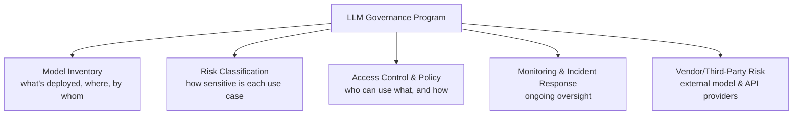

# LLM Governance & Compliance

Everything else in this path focuses on finding and exploiting AI vulnerabilities. This lesson shifts to the organizational side: how a company actually manages AI risk *at scale*, across many models, teams, and products — the discipline that turns individual security findings into durable, repeatable protection.

## Why governance matters beyond individual red teaming

A single red team engagement (Path 12's AI red teaming lesson) finds issues in *one* system at *one* point in time. Most organizations today are deploying LLMs across many products, teams, and vendors simultaneously — often without central visibility into which teams are using which models, with what data, and what controls. Governance is the structure that prevents "we found and fixed this issue in Product A" from leaving Product B, using the same vulnerable pattern, completely unaddressed.

## Model inventory and risk classification

You can't govern what you don't know exists. A **model inventory** tracks every LLM in use across an organization: which product uses it, what data flows through it, whether it's a first-party fine-tuned model or a third-party API, and who owns it internally. Once inventoried, each use case gets a **risk classification** — a customer-facing chatbot handling payment questions carries dramatically different risk than an internal tool summarizing meeting notes, and governance controls should scale proportionally rather than applying one-size-fits-all rules everywhere.

## Access control and usage policies

Beyond the technical access controls covered in Path 12's securing-LLM-apps lesson, governance defines the *organizational* policy layer: which teams are authorized to deploy customer-facing AI features at all, what data classifications are permitted to be sent to which models (a first-party model hosted in-house may be approved for sensitive data; a third-party API might not be), and what review/approval gate a new AI feature must pass through before launch.

## Data handling and privacy requirements

LLMs introduce genuinely new data handling questions beyond traditional software: does a third-party model provider retain and potentially train on the data you send it? Does your jurisdiction's privacy law (GDPR, and its equivalents worldwide) require specific disclosures when AI processes personal data? Can a user meaningfully exercise a "right to deletion" if their data was used in model fine-tuning, given how hard it is to surgically remove specific training examples' influence from an already-trained model? These aren't hypothetical — they're active, unresolved tensions between traditional privacy regulation (written before LLMs existed) and how modern AI systems actually work.

## Monitoring for misuse and drift

Governance doesn't end at launch. Ongoing monitoring should track: unusual usage patterns potentially indicating abuse (echoing the anomaly-detection principles from Path 11's threat hunting lab, applied to AI systems), **model drift** (a model's real-world behavior gradually diverging from what was originally tested and approved, as underlying data or usage patterns shift over time), and repeated attempted jailbreaks or prompt injections — useful both defensively and as ongoing red-teaming signal about which attack patterns are actually being tried against your systems in the wild.

## Vendor and third-party LLM risk

Most organizations don't train their own models from scratch — they call third-party APIs (OpenAI, Anthropic, and others) or embed open-source models from external sources. This introduces standard third-party/supply-chain risk questions (echoed in Path 12's supply chain attacks lesson): what's the vendor's own security posture, data retention policy, and incident history? What happens to your data and your users if that vendor has a breach?

:::tip Start small, start now
A full governance program can feel overwhelming to build from scratch. The practical starting point most organizations actually use: a simple spreadsheet inventorying every LLM currently in use, its data flows, and its current controls — genuinely useful even in its crudest form, and the foundation everything else in this lesson builds on.
:::

:::challenge Build a governance checklist
Create a basic governance checklist an organization could use before deploying a new LLM-powered feature — cover at minimum: risk classification, data handling review, access control requirements, and a monitoring plan. Keep it practical and specific enough that a real product team could actually follow it, not just abstract principles.
:::

## Key terms

- **Model inventory** — a centralized record of every LLM deployed across an organization and its associated data flows.
- **Model drift** — a model's real-world behavior gradually diverging from its originally tested/approved state.
- **Third-party/vendor risk** — security and compliance risk introduced by relying on an external AI provider.

## Recap

- Governance scales security findings from a single system to an entire organization's AI footprint, through inventory, risk classification, and consistent policy.
- Data handling and privacy questions around LLMs actively strain traditional regulatory frameworks not originally written with AI in mind.
- Ongoing monitoring (misuse, drift, and repeated attack patterns) matters as much as pre-launch review.
- Third-party LLM providers introduce genuine supply-chain-style risk requiring the same scrutiny as any other vendor relationship.

???refs
- [NIST AI Risk Management Framework](https://www.nist.gov/itl/ai-risk-management-framework) — a free, widely referenced framework for structuring exactly this kind of program.
- [OWASP AI Security and Privacy Guide](https://owasp.org/www-project-ai-security-and-privacy-guide/) — practical, free guidance covering governance alongside technical controls.
???

**Next up →** [LLM Red Teaming Playbooks](#/lesson/12-ai-security/llm-red-teaming-playbooks)
