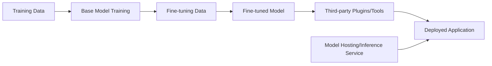

# LLM Supply Chain Attacks

Every other lesson in this path largely assumes the model itself is trustworthy and focuses on how it's manipulated at runtime. This lesson questions that assumption directly: what if the model — or the data and components that built it — was compromised before you ever sent it a single prompt?

## The AI supply chain, mapped

Every stage in this chain is a potential compromise point — and this is directly the AI-specific version of the general software supply chain risk referenced throughout this course (Path 12's OWASP LLM Top 10 lesson already flags this category briefly; this lesson goes deeper).

## Poisoned training and fine-tuning data

Path 12's poisoning & adversarial ML lesson already covered the mechanics of data poisoning as an attack technique. The *supply chain* angle specifically concerns **where that data comes from**: models trained or fine-tuned on large-scale scraped internet data, crowdsourced datasets, or third-party data vendors all inherit whatever was quietly embedded in that data by anyone with the ability to influence it upstream — including, in documented research demonstrations, deliberately planted poisoned examples designed to survive into the final trained model's behavior.

## Malicious model weights

Pre-trained and fine-tuned model files are increasingly distributed through public hubs (similar in spirit to how npm/PyPI distribute code packages) — and, exactly like a malicious npm package, a model file itself can be tampered with. Certain model file formats have historically supported embedded executable code that runs on load (a direct parallel to a malicious software dependency), and even without that specific mechanism, there's no inherent guarantee that a downloaded model's actual behavior matches its advertised description without independent verification.

## Compromised or malicious plugins and tools

Once an LLM is wired into an **agentic** system (Path 12's agentic AI risks lesson), every tool/plugin it's granted access to becomes part of its effective trust boundary. A compromised or intentionally malicious third-party plugin can act on the agent's behalf with whatever access that plugin has been granted — independent of any prompt injection or jailbreak at all, since the compromise lives in trusted, already-integrated code rather than in adversarial input.

## Insecure dependencies and frameworks

LLM applications are still, underneath the AI-specific layer, regular software — built on Python libraries, JavaScript frameworks, and orchestration tools (LangChain and similar), all of which carry the exact same dependency-vulnerability risk covered in Path 11's DevSecOps lab. A vulnerable dependency in the *orchestration layer* around a perfectly secure model can still fully compromise the application.

## Compromised hosting/inference infrastructure

If a model is served through a third-party inference API or hosting provider, a breach of *that* infrastructure could expose the prompts and responses flowing through it (a direct confidentiality risk for anything sensitive sent to the model) or allow an attacker to substitute a different, malicious model behind the same API endpoint entirely undetected by the calling application.

## Defense strategies

- **Verify data provenance** — know where training/fine-tuning data actually came from, and prefer sources with some accountability over anonymous scraped or crowdsourced data for anything security-sensitive.
- **Scan dependencies** — apply the same dependency scanning discipline from Path 11's DevSecOps lab to the orchestration frameworks and libraries surrounding the model, not just the model itself.
- **Use trusted, verified model sources** — prefer models from reputable providers with some form of integrity verification, and be skeptical of unverified community model files, exactly the caution Path 04's programming lessons apply to unreviewed code.
- **Model signing and integrity checks** — where supported, verify a model file's cryptographic signature before deployment, the AI equivalent of code signing (Path 16's static analysis lesson covers the same concept for traditional executables).
- **Monitor production behavior for anomalies** — a model behaving subtly differently than expected post-deployment can be a signal of a supply chain compromise, not just normal model drift (Path 12's governance lesson).

:::challenge Research a real (or close analog) example
Find one documented real-world LLM/ML supply chain incident, or a close analog from traditional software supply chain attacks (Path 11's DevSecOps lab references this broader category), and summarize: what was compromised, how, and what specific defense from this lesson could have prevented or caught it.
:::

## Key terms

- **AI supply chain** — the full pipeline from training data through fine-tuning, plugins, and hosting to a deployed application.
- **Model provenance** — verifiable information about where a model or its training data actually originated.
- **Model signing** — cryptographically signing a model file to verify its integrity and source before use.

## Recap

- Every stage of the AI supply chain — training data, fine-tuning data, model weights, plugins, hosting infrastructure — is a distinct potential compromise point, independent of runtime attacks like prompt injection.
- This is the AI-specific instance of the broader software supply chain risk covered elsewhere in this course, requiring the same verification discipline (provenance, scanning, signing).
- Defense requires securing the entire pipeline, not just hardening the final deployed application against runtime manipulation.

???refs
- [OWASP Top 10 for LLM Applications — Supply Chain Vulnerabilities](https://owasp.org/www-project-top-10-for-large-language-model-applications/) — the official category this lesson expands on.
- [Hugging Face: Security](https://huggingface.co/docs/hub/security) — practical guidance on model provenance and scanning from a major model hosting platform.
???

**Next up →** [Practical AI Red Teaming Labs](#/lesson/12-ai-security/practical-ai-labs)
