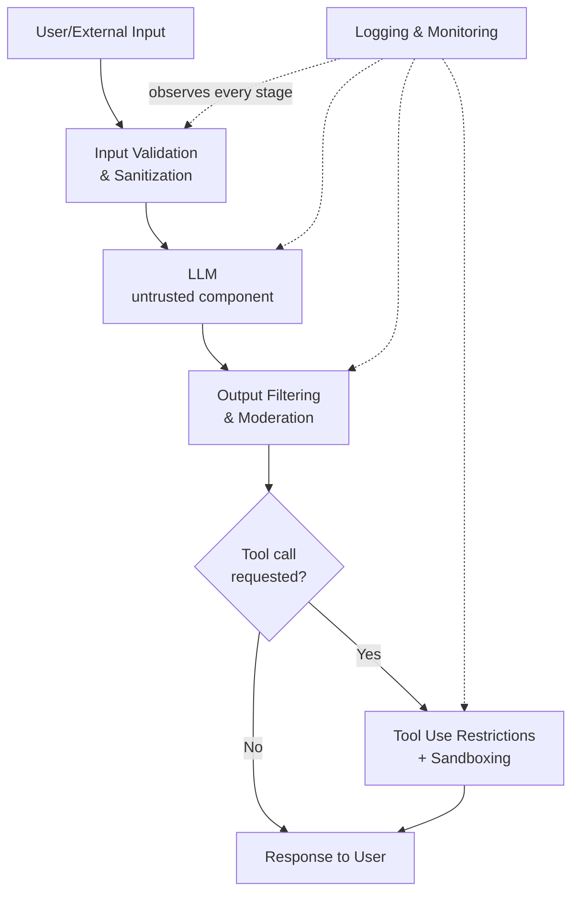

# Securing LLM Applications

This is the final technical lesson in Path 12 — pulling every attack category covered so far (prompt injection, jailbreaks, poisoning, agentic risks, supply chain) into a single, practical answer to the question every team building an LLM feature eventually asks: **how do we actually secure this thing?**

## The foundational mindset — treat the LLM as untrusted

Every control in this lesson flows from one core principle: **the LLM itself is not a trusted component in your architecture** — not because the model is malicious, but because its behavior can be manipulated by adversarial input in ways traditional software components generally can't be. Just as Path 07 teaches never trusting client-side input, LLM security requires never fully trusting the model's own output or reasoning as inherently safe, applying the exact same "trust nothing you don't verify" discipline to a fundamentally new kind of component.

## The core controls, layer by layer

- **Input validation and sanitization.** While you can't perfectly filter out prompt injection (Path 12's prompt injection lesson established this is fundamentally hard), basic hygiene still matters: length limits, stripping unusual encoding tricks, and flagging inputs matching known injection/jailbreak patterns for extra scrutiny or logging.
- **Output filtering and moderation.** Before a model's response reaches a user (or, more critically, before it's used to trigger a tool call), pass it through a separate moderation check — a second, independent system evaluating whether the output violates policy, rather than relying solely on the primary model's own training to have refused correctly.
- **Rate limiting and monitoring.** Both a standard defense against abuse (Path 07/08's general web security controls apply directly) and a specific defense against systematic model extraction attempts (Path 12's attack taxonomy lesson) and brute-force jailbreak probing.
- **Prompt hardening and system prompt protection.** While a determined attacker can often eventually extract a system prompt, structuring it to explicitly instruct the model to disregard any instructions appearing within user-supplied or tool-retrieved content raises the bar meaningfully, even without being a complete guarantee.
- **Tool use restrictions and sandboxing.** Directly implementing the least-privilege and sandboxing principles from Path 12's agentic AI risks lesson — every tool call available to the model should be the minimum necessary, executed in an isolated environment, ideally gated behind human confirmation for anything consequential.
- **Logging and auditing of all interactions.** Every prompt, tool call, and response should be logged in enough detail to reconstruct what happened during an incident — the AI-specific equivalent of the DFIR logging discipline from Path 11, and essential input for the governance monitoring covered in the previous lesson.

## PII redaction and data loss prevention for LLM traffic

A control category worth calling out specifically, distinct from general output moderation: **DLP (Data Loss Prevention) for LLM traffic** scans both inbound prompts and outbound responses for sensitive data patterns — credit card numbers, government IDs, API keys, internal hostnames — before they cross the trust boundary in either direction. This matters in both directions for genuinely different reasons: on the way in, it prevents users from accidentally pasting sensitive data into a prompt that might get logged or sent to a third-party model provider; on the way out, it catches a case where the model has somehow retained or reconstructed sensitive information from its training or retrieved context (echoing Path 12.6's model inversion and membership inference risks) and prevents it from leaking into a response. Unlike general-purpose output moderation, DLP patterns are typically deterministic, regex-and-pattern-based checks rather than another LLM call judging content — a deliberately simpler, more auditable layer specifically because catching a leaked social security number shouldn't itself depend on a second probabilistic system getting it right.

## Prompt versioning and testing in CI/CD

Recall Path 11's DevSecOps lab — the same "shift left" discipline applies directly to system prompts and LLM application configuration, which are effectively part of your application's logic even though they're just text rather than compiled code. Treating prompts as versioned artifacts (checked into source control, reviewed via pull request like any other code change) rather than something edited casually in a production dashboard means every change to safety-relevant instructions goes through the same review process as a code change. Pairing this with an automated test suite — a lightweight version of the red-teaming playbook from Path 12.11, run automatically in CI on every prompt change — catches the exact regression scenario flagged in this lesson's tip below *before* a weakened prompt ever reaches production, rather than discovering it days later when someone notices a previously-blocked jailbreak working again.

## Defense in depth, not a silver bullet

No single control here fully solves prompt injection or jailbreaking — this is an active, unsolved area of AI security research, not a checklist you complete once and forget. The realistic goal, exactly as with traditional application security throughout this course, is **defense in depth**: multiple independent layers, so that a single bypass (a jailbreak slipping past prompt hardening, say) still gets caught by output moderation or blocked by tool-access restrictions before causing real harm.

:::tip Regularly red team your own application
Point Path 12's red teaming playbook lesson directly at your own production LLM application, on a recurring schedule — not just once before launch. Since model providers update underlying models and your own prompts/features evolve, a control that worked last month may quietly stop working today, exactly the regression risk the red teaming playbooks lesson flagged.
:::

:::challenge Design a secure architecture
Design a secure architecture for an LLM application that allows tool use (web search and code execution) while minimizing the risks covered throughout this path. Explicitly address: input handling, output filtering, which of the two tools require human confirmation before executing (and why), and what you'd log for incident response.
:::

## Key terms

- **Defense in depth** — layering multiple independent security controls so a single bypass doesn't lead directly to compromise.
- **Output moderation** — an independent check on a model's response before it reaches a user or triggers an action.
- **Prompt hardening** — structuring a system prompt to resist having its instructions overridden by later, untrusted input.

## Recap

- Treating the LLM itself as an untrusted component — never assuming its output or reasoning is inherently safe — is the foundational principle every other control in this lesson builds on.
- Real security comes from layered, defense-in-depth controls (input handling, output filtering, tool restrictions, logging) rather than any single fix.
- LLM application security requires ongoing, recurring red teaming, not a one-time pre-launch check, since both the underlying models and the application itself change over time.

???refs
- [OWASP Top 10 for LLM Applications](https://owasp.org/www-project-top-10-for-large-language-model-applications/) — the umbrella reference for every control category in this lesson.
- [NIST AI Risk Management Framework](https://www.nist.gov/itl/ai-risk-management-framework) — pairs directly with the governance lesson for organizational-level implementation guidance.
???

## 🎓 Path complete

You've now covered how LLMs actually work, why AI security is a genuinely new field, prompt injection, jailbreaks, the OWASP LLM Top 10, poisoning and adversarial ML, AI red teaming methodology and hands-on practical labs, agentic AI risks, the full attack taxonomy, governance at organizational scale, structured red teaming playbooks, supply chain risks, and — in this lesson — how to actually secure an LLM application end to end. This is one of the newest, fastest-moving specializations in security, and you now have a genuinely solid foundation in it.

**Explore more →** [Path 13 — Career Prep](#/lesson/13-career-prep) · [CTF Zone](#/lesson/14-ctf-challenges)
