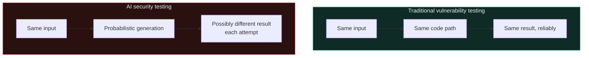

# Why AI security is different

Path 12.1 gave you the mechanical foundation. This lesson makes explicit exactly how AI security both **rhymes with** and **fundamentally differs from** everything you've learned in Paths 07-11 — essential framing before diving into specific attack techniques.

## The core theme: probabilistic, not deterministic

Every vulnerability class in Path 07 has a **deterministic** signature — the same SQL injection payload against the same unpatched code produces the same result, every single time. LLMs are **probabilistic** — the same prompt injection attempt might succeed on one attempt and fail on the next, even against the exact same model and system prompt, because generation involves an element of randomness (often called "temperature") and because models can be genuinely inconsistent in edge cases.

This has a direct, practical consequence for how you must test: a single failed jailbreak attempt (Path 12.4) doesn't prove a model is safe from that attack — and a single successful one doesn't necessarily mean it will reliably succeed again. AI red-teaming (Path 12.7) therefore requires **statistical thinking** — running many attempts and measuring success *rates*, not simple binary pass/fail testing the way a traditional penetration test (Path 09) typically operates.

## No patch, in the traditional sense

Recall Path 06.2's vulnerability/patch cycle — a SQL injection gets fixed by changing the vulnerable code, with a clear, verifiable before/after. LLM "vulnerabilities" (a model that can be jailbroken into producing harmful content, or that's susceptible to a specific prompt injection pattern) are addressed through **retraining, fine-tuning, or additional safety layers** — processes that are expensive, slow, and don't offer the same clean, verifiable guarantee that a specific traditional code patch does. A model provider might reduce a specific jailbreak's success rate from 40% to 2% through additional training, but rarely to a provable, permanent 0%.

## The trust boundary problem, reinforced

Recall Path 12.1's context window discussion — this deserves direct comparison to Path 07's web vulnerabilities, since the *pattern* is genuinely the same even though the *mechanism* differs:

| Web vulnerability (Path 07) | LLM equivalent |
|---|---|
| SQL injection — user input treated as SQL code | Prompt injection — untrusted text treated as instructions |
| XSS — user input treated as executable JavaScript | Indirect prompt injection via documents/websites the model processes |
| SSRF — tricking a server into making unauthorized requests | Tricking an agentic LLM into taking unauthorized tool actions |
| IDOR — missing authorization checks on direct object access | Missing authorization checks on what data/tools an LLM can access per-user |

Recognising these parallels is genuinely useful — much of your Path 07 intuition **transfers directly** to reasoning about LLM security, even though the underlying defensive techniques (Path 12.3-12.6) are often quite different in practice.

## New, genuinely novel risk categories

Beyond the direct parallels above, LLM systems introduce risks with **no clean traditional-security analogue**:

- **Hallucination** — an LLM confidently generating false information, with no malicious input required at all. This isn't "exploitation" in the traditional sense — it's an inherent limitation of how these models generate text, with direct security implications when hallucinated information influences a security decision (e.g., a model incorrectly summarizing a log file's security-relevant content).
- **Training data poisoning** — an attacker who can influence a model's *training data* (rather than its runtime input) can embed subtle, hard-to-detect backdoors or biases that activate only under specific, attacker-chosen conditions — a fundamentally different attack surface than anything in Path 07-11, targeting the model-building pipeline itself rather than a deployed application.
- **Model extraction/theft** — an attacker systematically querying a model to reconstruct a functionally similar copy, effectively "stealing" the intellectual property and potentially the safety training investment without ever breaching traditional infrastructure at all.
- **Emergent, hard-to-predict capabilities** — LLMs sometimes exhibit capabilities or failure modes that weren't explicitly designed or fully anticipated by their own creators, discovered only through extensive real-world use or dedicated red-teaming — a genuinely unusual property compared to traditional software, where behaviour is at least in principle fully determined by its source code.

## The defender's dilemma — safety vs. capability tradeoffs

Recall Path 06.1's CIA triad tension — LLM safety measures face an analogous, often more acute tradeoff: overly restrictive safety filtering makes a model frustratingly unhelpful for legitimate use cases (a security researcher asking about malware behaviour for defensive purposes, a nurse asking about medication overdose thresholds for patient safety), while overly permissive behaviour risks genuine harm. Unlike a firewall rule, which can be precisely scoped, LLM safety behaviour is trained holistically and doesn't have the same crisp, auditable on/off boundary — a recurring theme you'll see across Path 12.3-12.6's specific techniques.

## Why this matters especially now, for your own career

Recall Path 11.8's closing point about specialisation timing. AI security is a genuinely **young field** — the OWASP LLM Top 10 (Path 12.5) was first published only in 2023, and the practices, tooling, and even terminology are actively evolving as this course is being written. This creates a distinctive opportunity compared to the mature fields in Path 11: fewer established practitioners, rapidly growing organizational demand (as more companies rush to deploy LLM-powered features, per Path 12.8's career discussion), and genuine room for someone building deep expertise now to become a recognised specialist relatively quickly — directly relevant to Ishfaq's own active AI evaluation/red-teaming work (Mercor, Alignerr/OpenClaw) referenced throughout this course's development.

## A grounded, non-hyped perspective

It's worth stating directly: LLM security discourse is sometimes prone to hype in both directions — some framing suggests AI systems are recklessly, uniquely dangerous in ways that dwarf all prior technology; other framing dismisses AI security concerns as overblown since "it's just autocomplete." Neither extreme is accurate or useful. The genuinely productive framing, and the one this entire path adopts: LLM-integrated systems have **real, specific, learnable security properties** — some genuinely novel, many recognisable variations on patterns you already know from Paths 07-11 — deserving the same rigorous, methodical treatment as any other technology in this course, no more and no less.

## 🧪 Lab — Compare a traditional and an AI vulnerability side by side

Pick one vulnerability from Path 07 (e.g., XSS) and write a short comparison table with its closest LLM security analogue (indirect prompt injection, covered fully in Path 12.3):

1. What's the "untrusted input" in each case?
2. What's the "trusted context" each input is incorrectly blended into?
3. What's a traditional defensive technique for the web version (output encoding, for XSS)?
4. What might an analogous — but necessarily different — defensive approach look like for the LLM version? (You'll get the actual answer in Path 12.3/12.6 — this is a genuinely useful exercise in reasoning it through yourself first.)

:::challenge Test yourself
Why can't LLM safety vulnerabilities typically be "patched" with the same clean, verifiable certainty as a traditional software vulnerability like SQL injection?

Show answer
A SQL injection fix involves changing a <strong>specific, auditable code path</strong> (e.g., switching to parameterised queries) — you can point to the exact line changed and verify, deterministically, that the specific attack no longer works. LLM behaviour emerges from a <strong>probabilistic neural network</strong> shaped by training, not a fixed, line-by-line logic path — addressing a specific jailbreak or unsafe behaviour typically requires additional training or fine-tuning that shifts the model's overall behaviour <em>statistically</em>, reducing the success rate of a given attack without offering the same clean, provable, permanent guarantee that a traditional code patch provides. This is a direct consequence of the probabilistic-vs-deterministic distinction covered at the start of this lesson.

:::

## Key terms

- **Probabilistic generation** — LLM outputs can vary between attempts even given identical input, unlike deterministic traditional software.
- **Hallucination** — an LLM confidently generating false information, an inherent limitation rather than an exploitation technique.
- **Training data poisoning** — attacking the model-building pipeline itself, rather than a deployed application's runtime.
- **Model extraction** — reconstructing a functionally similar copy of a model through systematic querying.

## Recap

- LLM security differs fundamentally from traditional security in being probabilistic rather than deterministic, requiring statistical rather than binary testing approaches.
- Many LLM vulnerabilities directly parallel Path 07's web vulnerabilities (prompt injection ≈ SQLi/XSS, agentic tool abuse ≈ SSRF), while others (hallucination, training data poisoning, model extraction) have no clean traditional analogue.
- LLM safety fixes come through retraining/fine-tuning rather than clean, verifiable code patches.
- The safety-vs-capability tradeoff is more acute and less crisply scopable than traditional security controls.
- AI security's youth as a field creates genuine specialisation opportunity, without needing to overstate or understate its risks.

???refs
- [OWASP Top 10 for LLM Applications](https://owasp.org/www-project-top-10-for-large-language-model-applications/) — the framework detailed fully in Path 12.5.
- [Anthropic — Core Views on AI Safety](https://www.anthropic.com/news/core-views-on-ai-safety) — a grounded, non-hyped perspective from a leading AI lab.
- [NIST AI Risk Management Framework](https://www.nist.gov/itl/ai-risk-management-framework) — official US government guidance on AI-specific risk.
- [Simon Willison — Prompt injection writing](https://simonwillison.net/series/prompt-injection/) — extensive, grounded, practitioner-level writing on this exact topic, covered technically in Path 12.3.
???

**Next up →** [Prompt injection](#/lesson/12-ai-security/prompt-injection)
