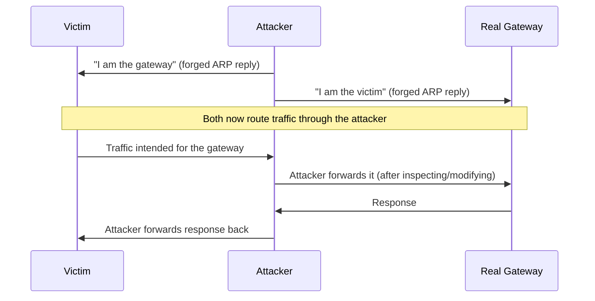

# ARP Spoofing, Hands-On

Path 02's common-network-attacks-overview lesson introduced ARP spoofing by name. This lesson goes hands-on with exactly how it works and how it's detected, directly setting up the MITM lesson later in this path, since ARP spoofing is genuinely one of the most common ways a real local-network MITM actually gets established.

## A quick reminder of what ARP does

**ARP (Address Resolution Protocol)** maps an IP address to a physical MAC address on a local network — when your device wants to send traffic to `192.168.1.1`, it needs to know which physical network interface that address actually belongs to, and ARP is how it finds out.

## Why ARP has no built-in trust mechanism

ARP was designed decades ago, for small, trusted local networks, with no authentication built in at all — any device can broadcast an ARP reply claiming to own any IP address, and other devices on the network will generally believe it without question, updating their own ARP tables (called **ARP cache poisoning**) to reflect the false claim.

## The actual attack, step by step

The attacker sends forged ARP replies to both the victim (claiming to be the gateway from Path 02's routing lesson) and the gateway (claiming to be the victim), positioning themselves directly in the middle of all traffic between the two — a textbook MITM setup, established purely through ARP's lack of authentication.

## Detecting ARP spoofing

- **Static ARP entries** — manually configuring critical devices (like the gateway) with a fixed, unchangeable ARP entry prevents them from being overwritten by a forged reply, though this doesn't scale well across a large network
- **ARP monitoring tools** — software watching for the same IP address suddenly claiming a different MAC address, a strong, specific signal of an active spoofing attempt
- **Dynamic ARP Inspection (DAI)** — a switch-level feature (available on many managed switches) that validates ARP packets against a known-good binding table, dropping forged replies before they ever reach their intended victim

## Why VLANs help, but don't fully solve this

Directly connecting to Path 02's switches-and-VLANs lesson: since ARP spoofing only works within the same local broadcast domain, segmenting a network into smaller VLANs limits how many devices any single spoofing attempt can actually affect — but it doesn't eliminate ARP's fundamental lack of authentication within whatever segment an attacker does manage to reach.

:::challenge Test yourself
Why does ARP spoofing succeed even against a network with a properly configured, secure Wi-Fi password (WPA2/WPA3, from Path 02)?

Show answer
A strong Wi-Fi password controls who can <em>join</em> the network in the first place — but ARP spoofing is an attack that happens <em>after</em> a device is already legitimately connected, exploiting ARP's complete lack of built-in authentication for devices that are already, legitimately, part of the same local network. A strong Wi-Fi password doesn't protect against a malicious insider, a compromised device already on the network, or an attacker who's separately obtained legitimate access (through a guessed password, a WPS vulnerability, or simply being handed the Wi-Fi password by an unsuspecting host) — once <em>any</em> device is on the same local network segment, ARP spoofing is a completely separate, unrelated vulnerability that a strong join-time password does nothing to address.

:::

## Key terms

- **ARP cache poisoning** — updating a device's ARP table with a false, attacker-supplied IP-to-MAC mapping.
- **Dynamic ARP Inspection (DAI)** — a switch-level feature validating ARP packets against a known-good binding table.

## Recap

- ARP spoofing exploits ARP's complete lack of built-in authentication, letting an attacker forge replies claiming to own an IP address they don't actually control.
- The classic attack positions an attacker as a MITM between a victim and the gateway by simultaneously spoofing both directions.
- Static ARP entries, ARP monitoring, and Dynamic ARP Inspection are the standard defenses — and VLANs limit the blast radius of a successful attempt without eliminating the underlying weakness entirely.

**Next up →** [Firewalls, VPNs, proxies](#/lesson/12-network-security/firewalls-vpns)
