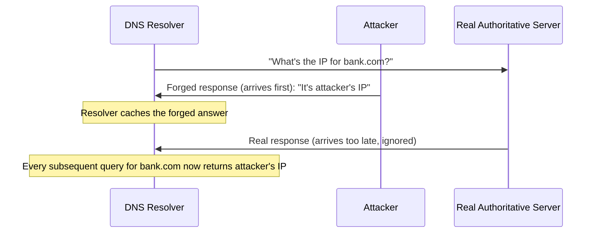

# DNS Attacks, Hands-On

Path 02's common-network-attacks-overview lesson introduced DNS spoofing by name; Path 05's caching lesson mentioned cache poisoning generally. This lesson goes properly hands-on with how DNS specifically gets attacked, directly setting up the MITM lesson that follows.

## DNS cache poisoning: the classic attack

Recall Path 02's DNS lesson: a **DNS resolver** caches answers to avoid repeatedly querying the same information. **DNS cache poisoning** exploits this caching behavior — an attacker floods a resolver with forged DNS responses, attempting to get a malicious IP address cached under a legitimate domain name before the real, authoritative answer arrives.

Once poisoned, *every* user relying on that resolver receives the attacker's malicious IP address for the targeted domain, until the cache entry expires — a genuinely powerful attack, since a single successful poisoning affects every subsequent query, not just one victim.

## DNS hijacking: attacking the infrastructure directly

**DNS hijacking** takes a more direct route — compromising the actual DNS settings themselves (a home router's configured DNS server, an ISP's resolver, or even a domain's registrar account) to redirect queries to an attacker-controlled server permanently, rather than relying on a race-condition-style cache-poisoning attempt.

## DNSSEC: the cryptographic defense

**DNSSEC (DNS Security Extensions)** adds cryptographic signatures (directly applying Path 06's digital-signatures concepts) to DNS responses, letting a resolver verify that an answer genuinely came from the legitimate authoritative source and wasn't forged or tampered with in transit — directly closing the exact gap both cache poisoning and hijacking exploit.

:::tip DNSSEC adoption remains genuinely incomplete
Despite being a mature, well-understood standard, DNSSEC adoption across the internet remains far from universal — configuring it correctly requires coordination between a domain owner and their registrar, and a misconfiguration can actually break a domain's DNS resolution entirely if done carelessly. This is exactly why DNS spoofing remains a genuinely real, current threat category, not a solved historical problem.
:::

## DNS over HTTPS (DoH) and DNS over TLS (DoT): protecting the query itself

Beyond verifying the *answer's* authenticity (DNSSEC's job), **DoH** and **DoT** encrypt the DNS *query* in transit, directly applying Path 06's TLS concepts to prevent an on-path attacker from even observing which domains a user is looking up — a genuinely different protection than DNSSEC, addressing confidentiality rather than integrity.

:::challenge Test yourself
Why do DNSSEC and DNS-over-HTTPS solve genuinely different problems, even though both are described as "DNS security" measures?

Show answer
DNSSEC addresses <strong>integrity and authenticity</strong> — cryptographically proving that a DNS answer genuinely came from the legitimate authoritative source and wasn't forged or tampered with, directly defending against cache poisoning and hijacking. DNS-over-HTTPS addresses a completely different property, <strong>confidentiality</strong> — encrypting the query itself so an attacker positioned on the network (an ISP, a coffee shop Wi-Fi operator, an on-path attacker) can't observe which domains a user is actually looking up, even if that query's eventual answer is completely legitimate and unforged. A DNS setup could have one without the other: DNSSEC-verified answers that are still visible in plaintext to network observers, or encrypted queries whose answers still aren't cryptographically verified against forgery — which is exactly why a genuinely complete DNS security posture uses both together, each closing a different gap.

:::

## Key terms

- **DNS cache poisoning** — flooding a resolver with forged responses, attempting to get a malicious answer cached before the legitimate one arrives.
- **DNSSEC** — cryptographic signatures added to DNS responses, verifying authenticity and preventing forgery.
- **DNS over HTTPS (DoH) / DNS over TLS (DoT)** — encrypting the DNS query itself in transit, protecting confidentiality rather than authenticity.

## Recap

- DNS cache poisoning and DNS hijacking are the two main attack patterns, exploiting caching behavior and infrastructure compromise respectively.
- DNSSEC cryptographically verifies DNS response authenticity, directly closing the gap both attacks exploit — though adoption remains genuinely incomplete across the internet.
- DoH and DoT solve a separate, complementary problem — encrypting the query itself for confidentiality, distinct from DNSSEC's integrity guarantee.

**Next up →** [Man-in-the-middle attacks](#/lesson/12-network-security/mitm)
