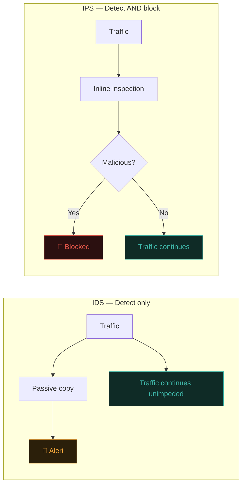
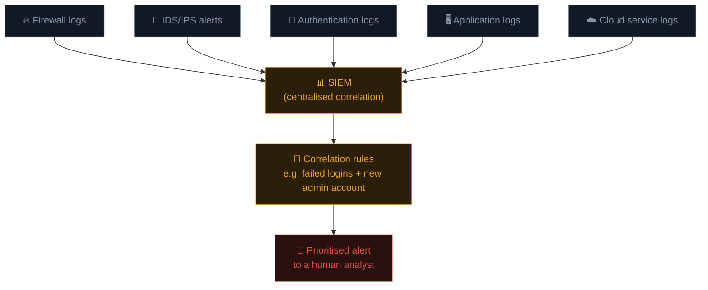

# IDS, IPS & SIEM

Firewalls decide what traffic is *allowed*. But allowed traffic can still be malicious — a valid login attempt that's actually a brute-force attack, legitimate-looking HTTP requests that are actually SQL injection. This lesson covers the systems that **watch, detect, and respond** to what's actually happening on the network and across an organisation's systems.

## IDS — Intrusion Detection System

An **IDS** monitors network traffic (or host activity) and **alerts** on suspicious patterns — it observes and reports, but doesn't block anything itself.

### Two detection approaches

- **Signature-based** — matches traffic against a database of known-malicious patterns (similar to antivirus signatures from Path 10.4). Fast and accurate for known threats; blind to novel attacks.
- **Anomaly-based** — establishes a baseline of "normal" behaviour, then flags significant deviations. Can catch novel attacks; prone to false positives if the baseline isn't well-tuned.

### Network IDS vs Host IDS

- **NIDS (Network IDS)** — monitors traffic at a network chokepoint, watching everything passing through (conceptually similar to running Wireshark continuously with automated alerting).
- **HIDS (Host IDS)** — runs on an individual machine, monitoring file integrity, system calls, logs, and local activity for signs of compromise.

### Snort — the classic open-source NIDS

```bash
# Example Snort rule structure:
alert tcp any any -> any 80 (msg:"Possible SQL injection attempt"; content:"UNION SELECT"; sid:1000001;)
```

This rule alerts whenever any TCP traffic to port 80 contains the literal string "UNION SELECT" — directly recognisable from Path 11.6's SQL injection lesson. Real rule sets (like Snort's community rules, or the commercial Emerging Threats ruleset) contain thousands of such signatures covering known exploits, malware C2 patterns, and scanning behaviour.

## IPS — Intrusion Prevention System

An **IPS** does everything an IDS does, but sits **inline** (directly in the traffic path, not just passively monitoring a copy) and can actively **block** malicious traffic in real time, rather than just alerting after the fact.



The tradeoff: an IPS can actually stop an attack in progress, but a **false positive** means legitimate traffic gets blocked too — a much higher-stakes mistake than a false alert from a passive IDS. Tuning an IPS's rules carefully (and often starting new rules in "alert only" mode before enabling active blocking) is a genuine, ongoing operational discipline.

## EDR — the modern host-level evolution

Recall **EDR (Endpoint Detection and Response)** from Path 10.4 — it's essentially a modern, far more sophisticated evolution of HIDS, combining signature and behavioural detection with active response capability (isolating a compromised machine from the network, killing malicious processes) and deep forensic visibility for investigators.

## SIEM — Security Information and Event Management

Real organisations generate an overwhelming volume of security-relevant data — firewall logs, IDS alerts, authentication logs, application logs, cloud service logs — from dozens or hundreds of different systems. A **SIEM** centralises, correlates, and helps analysts make sense of all of it in one place.

### What a SIEM actually does



The real value is **correlation** — individually, "50 failed logins from an unusual country" and "a new admin account created 5 minutes later" might each seem low-priority in isolation, but a SIEM correlation rule connecting the two events in sequence produces a much higher-confidence, higher-priority alert than either alone.

### Popular SIEM platforms

- **Splunk** — the long-standing enterprise leader, powerful but often expensive at scale.
- **Elastic Security (ELK stack)** — open-source, hugely popular, built on Elasticsearch/Logstash/Kibana.
- **Microsoft Sentinel** — cloud-native, deeply integrated with Azure and Microsoft 365 environments.
- **Wazuh** — free, open-source, combines SIEM and HIDS capability, great for learning.

## The SOC — Security Operations Center

The **SOC** is the team (and physical/virtual space) responsible for continuously monitoring an organisation's security posture, triaging SIEM alerts, and coordinating incident response. A typical SOC structure:

| Tier | Role |
|---|---|
| **Tier 1 analyst** | Initial alert triage — is this a false positive, or does it need escalation? |
| **Tier 2 analyst** | Deeper investigation of escalated alerts, initial containment actions |
| **Tier 3 / Threat hunter** | Proactive hunting for threats not yet caught by existing detections, deep forensic investigation |
| **SOC manager** | Oversees operations, coordinates with broader incident response and leadership |

Many security careers genuinely begin in a **Tier 1 SOC analyst** role — it's one of the most common, accessible entry points into the industry, and directly builds the skills (log analysis, pattern recognition, escalation judgment) this entire lesson has been describing.

## SOAR — automating the SOC's repetitive response steps

A natural next step beyond SIEM alerting is **SOAR (Security Orchestration, Automation, and Response)** — platforms that take a triaged alert and automatically execute a predefined sequence of response actions, rather than requiring an analyst to manually perform each step by hand. A typical SOAR **playbook** for a phishing alert might automatically: pull the sender's reputation from a threat-intelligence feed, check whether any other employees received the same email, quarantine the message across all mailboxes, and open a ticket — all before a human analyst even looks at it, at which point they're reviewing a pre-assembled case rather than starting an investigation from scratch. This directly echoes Path 04's automation lesson, applied specifically to the SOC context: SOAR doesn't replace the Tier 1 analyst's judgment, it eliminates the repetitive 80% of an investigation (gathering context, running standard checks) so their attention concentrates on the genuinely ambiguous 20% that needs a human decision.

## Deception technology — honeypots as a detection strategy

A fundamentally different approach to detection, worth knowing about even briefly: a **honeypot** is a decoy system deliberately built to look like a real, valuable target (a fake database server, a fake set of admin credentials) with no legitimate purpose whatsoever — meaning any interaction with it at all is, by definition, suspicious, since no real user or system should ever have a reason to touch it. This flips the usual signature/anomaly detection problem on its head: instead of trying to distinguish malicious traffic from an enormous volume of legitimate traffic, a honeypot generates a clean, high-confidence signal precisely because its baseline expected activity is exactly zero. Honeypots are commonly used both defensively (an early-warning tripwire inside a real network) and for research (observing real attacker techniques safely in an isolated, deliberately exposed environment) — Path 19's CTF material and Path 16's advanced topics both touch on deception-based defence as a distinct discipline from the detect-known-patterns approach this lesson has focused on.

## MITRE ATT&CK, revisited — now as a detection framework

Recall Path 10.3's MITRE ATT&CK model. In practice, SIEM correlation rules and IDS signatures are very often explicitly mapped to specific ATT&CK techniques — letting a SOC team reason about their **detection coverage** systematically ("do we have a rule that would catch T1110 — Brute Force? What about T1078 — Valid Accounts?") rather than relying on ad-hoc, unstructured rule creation.

## 🧪 Lab — Set up basic host monitoring

A lightweight, hands-on introduction to HIDS-style thinking, entirely on your own Kali VM:

```bash
# auditd — Linux's built-in audit logging framework, a simple HIDS building block
sudo apt install auditd -y
sudo systemctl enable --now auditd

# Watch for changes to a sensitive file:
sudo auditctl -w /etc/passwd -p wa -k passwd_changes

# Trigger it:
sudo useradd testuser

# Check what was logged:
sudo ausearch -k passwd_changes
```

You've just built a tiny, genuine example of exactly the kind of host-level monitoring that HIDS/EDR tools do at much larger scale — watching a sensitive resource and logging who touched it and when.

:::challenge Test yourself
An organisation's IDS alerts on 200 failed login attempts from a single IP within one minute. Five minutes later, a SIEM correlation rule also notices a new admin-level account was created on the same server. Individually, why might a Tier 1 analyst underrate either event alone, and why does the SIEM's correlation of both together matter?

<details><summary>Show answer</summary>Failed logins alone are extremely common (typos, expired passwords, automated bots) and often low-priority individually. A new admin account alone might just be routine IT activity. But <strong>correlated in sequence</strong> — a burst of failed logins immediately followed by a new privileged account being created on that same system — strongly suggests a successful brute-force compromise followed by privilege escalation, exactly the kind of pattern a SIEM is specifically designed to surface that a human reviewing isolated log streams might otherwise miss.</details>
:::

## Key terms

- **IDS / IPS** — detect-only vs detect-and-block network/host monitoring systems.
- **Signature-based / anomaly-based detection** — matching known patterns vs flagging deviations from a baseline.
- **SIEM** — centralises and correlates security logs from across an organisation.
- **SOC** — the team responsible for continuous monitoring and incident triage/response.
- **Correlation rule** — a SIEM rule connecting multiple individually-low-priority events into a higher-confidence alert.

## Recap

- IDS detects and alerts; IPS detects and actively blocks, inline in the traffic path.
- Signature-based detection catches known threats fast; anomaly-based can catch novel ones with more false positives.
- SIEM platforms centralise logs from across an organisation and correlate events for higher-confidence alerting.
- SOC teams triage and investigate alerts in tiers, often mapping detection coverage to MITRE ATT&CK techniques.
- Tier 1 SOC analyst is one of the most common, accessible entry points into a security career.

???refs
- [Snort official site](https://www.snort.org/) — the classic open-source IDS/IPS.
- [Wazuh documentation](https://documentation.wazuh.com/) — free, open-source SIEM/HIDS, excellent for hands-on learning.
- [MITRE ATT&CK — Detections](https://attack.mitre.org/) — mapping detection coverage to real techniques.
- [SANS — What is a SOC?](https://www.sans.org/blog/what-is-a-security-operations-center-soc/) — accessible overview of SOC structure and operations.
???

**Next up →** [Network Security Monitoring Tools](#/lesson/12-network-security/network-security-monitoring-tools)
