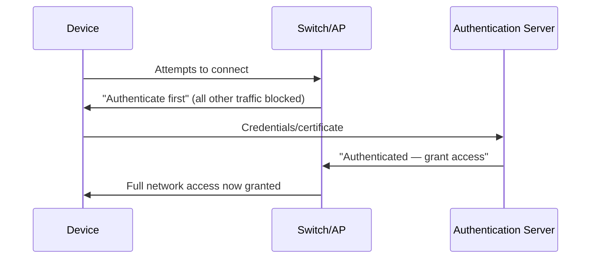

# Network Access Control (NAC)

Every control covered so far in this path assumes a device has already joined the network. This lesson covers the layer that decides whether a device gets to join at all — genuinely the network-level equivalent of the identity-verification concepts from Path 24's Zero Trust material.

## What NAC actually does

**Network Access Control (NAC)** verifies a device's identity and security posture *before* granting it network access, rather than trusting any device that can physically connect — directly extending Path 24's device-trust-posture lesson from an individual endpoint decision to a network-wide enforcement point.

## 802.1X: the standard authentication framework

**802.1X** is the widely-used standard for port-based network access control, requiring a device to authenticate (often via a certificate or credentials) before a switch port or Wi-Fi access point allows any other traffic through at all:

Until authentication succeeds, the device can only communicate with the authentication server itself — genuinely no other network access exists at all, directly applying the default-deny principle from Path 02's firewalls lesson at the physical connection point itself.

## Posture assessment: checking more than just identity

Modern NAC deployments often go beyond simple authentication, checking a connecting device's actual security posture — is its antivirus up to date (Path 00's updates lesson), is its OS patched, is it free of known malware — before granting full access, and can quarantine non-compliant devices to a restricted remediation network instead of the full production network.

## Why NAC matters specifically for BYOD and guest scenarios

Directly connecting to Path 24's remote-work lesson's coverage of BYOD: an organization allowing personal devices onto its network faces a genuine dilemma — refusing all personal devices hurts productivity, but trusting them unconditionally expands the attack surface significantly. NAC provides a practical middle ground: personal devices can connect, but only after meeting a defined posture bar, and often routed to a more restricted network segment (directly connecting to this path's segmentation lesson) regardless of how well they check out.

:::challenge Test yourself
Why is 802.1X described as enforcing access control "at the physical connection point itself," and why does that matter compared to a firewall rule applied later?

Show answer
802.1X operates directly at the switch port or wireless access point a device is physically connecting through — before that device is granted any meaningful network access at all, it can only reach the authentication server, with every other destination blocked by default. A firewall rule applied later in the network path assumes the device has already gained <em>some</em> level of network connectivity to reach that firewall in the first place — meaning an unauthenticated or non-compliant device could potentially reach and interact with other systems on the same local segment before ever hitting a downstream firewall rule that might catch it. Enforcing access control at the very first point of physical connection closes this gap entirely: a non-compliant device simply never gets network connectivity to attempt anything at all, rather than being caught and blocked somewhere further down the path after it's already had some opportunity to act.

:::

## Key terms

- **NAC (Network Access Control)** — verifying a device's identity and security posture before granting network access.
- **802.1X** — the standard framework for port-based network access authentication.
- **Posture assessment** — checking a device's actual security state (patch level, antivirus status) as part of the access decision, not just its identity.

## Recap

- NAC and 802.1X enforce access control at the physical connection point itself, before a device gains any meaningful network access at all — the strongest possible position for a default-deny policy.
- Posture assessment extends beyond identity verification, checking a device's actual security state before granting full access.
- NAC provides a practical middle ground for BYOD and guest scenarios, directly connecting to Path 24's remote-work and device-trust material.

**Next up →** [Wi-Fi security & attacks](#/lesson/12-network-security/wifi-security)
