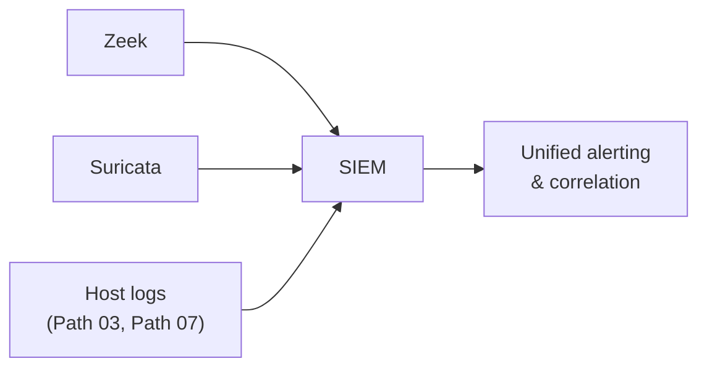

# Network Security Monitoring Tools

The IDS/IPS/SIEM lesson covered the concepts. This lesson names the actual, widely-used tools implementing them — genuinely useful vocabulary for reading job postings and real security operations documentation.

## Zeek (formerly Bro): network traffic analysis

**Zeek** doesn't work like a traditional signature-based IDS — instead of just matching known attack patterns, it generates detailed, structured logs of network activity (connections, DNS queries, HTTP transactions, and more), turning raw traffic into a genuinely queryable dataset. This directly extends the network-forensics lesson's manual pcap analysis into something automated and continuous, running against live traffic rather than a single after-the-fact capture.

## Suricata: signature-based and behavioral detection

**Suricata** is an open-source IDS/IPS engine, genuinely comparable to the classic Snort tool the ids-ips-siem lesson likely mentioned, but built with multi-threading and modern protocol support in mind — capable of both signature-based detection (matching known attack patterns) and some behavioral analysis.

## Security Onion: a complete, pre-built monitoring platform

**Security Onion** bundles Zeek, Suricata, and several other monitoring and analysis tools into a single, pre-configured Linux distribution — genuinely practical for a small organization or a home lab wanting real network security monitoring without assembling and integrating each individual tool from scratch, directly connecting to Path 03's distro-choice lesson.

## Why these tools matter beyond just "more logging"

Directly connecting to Path 08's logging-monitoring lesson's core point: monitoring tools only provide value if they're actually configured to capture the *right* signal and someone is positioned to act on the alerts they generate. A Security Onion deployment that nobody ever reviews provides essentially the same real-world protection as no monitoring at all — the tool itself is necessary but not sufficient, exactly the "controls need enforcement and measurement" theme from Path 10.

## How these tools connect to SIEM

A SIEM (from the ids-ips-siem lesson) typically ingests logs and alerts *from* tools like Zeek and Suricata, correlating network-level signals with the host-level logs from Path 03 and Path 07 into a single, unified view — no individual tool alone provides the complete picture an analyst actually needs during an investigation.

:::challenge Test yourself
Why does Zeek's approach — generating detailed structured logs rather than only matching known attack signatures — provide value a purely signature-based IDS can't?

Show answer
A purely signature-based tool can only alert on patterns it already knows to look for — a genuinely novel attack technique, or one deliberately crafted to avoid a known signature, sails straight through undetected. Zeek's structured logging approach instead captures a detailed, queryable record of what actually happened on the network — every connection, every DNS query — regardless of whether any specific pattern within it matches a known attack signature. This means an analyst can retroactively investigate a newly-disclosed vulnerability or attack technique against historical Zeek logs, even if no signature existed to catch it in real time when it actually occurred, and can spot genuinely novel anomalies (unusual connection patterns, unexpected protocol usage) that a signature-only tool would have no way to flag at all.

:::

## Key terms

- **Zeek** — a network security monitoring tool generating detailed, structured logs of traffic activity rather than relying purely on signature matching.
- **Suricata** — an open-source IDS/IPS engine supporting both signature-based and behavioral detection.
- **Security Onion** — a pre-configured Linux distribution bundling several network monitoring tools together.

## Recap

- Zeek, Suricata, and Security Onion are the standard open-source tools implementing the IDS/IPS/SIEM concepts covered in the previous lesson.
- Zeek's structured-logging approach provides value beyond pure signature matching, enabling retroactive investigation of threats that didn't have a known signature at the time they occurred.
- These tools only provide real protection when properly configured and actively monitored — the same "enforcement and measurement matter as much as the control itself" theme from Path 10.

**Next up →** [Network Access Control (NAC)](#/lesson/12-network-security/network-access-control)
