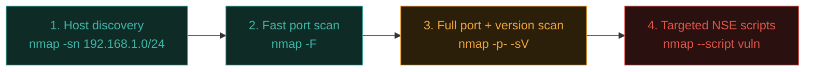

# Nmap — network scanning

**Nmap** ("Network Mapper") is the single most iconic tool in network security — a free, open-source scanner that answers the fundamental question every attacker and defender needs answered first: *what's actually out there, and what's it running?*

## What Nmap actually does

At its core, Nmap sends carefully crafted packets to a target and studies the responses to determine:

- Which hosts on a network are alive
- Which ports are open on those hosts
- Which services are running on those ports (and often their exact version)
- Which operating system the host is likely running

## Your first scan

```bash
# Basic scan of a single host (only checks the 1,000 most common ports by default):
nmap scanme.nmap.org

# Scan a specific IP:
nmap 45.33.32.156

# Scan an entire subnet:
nmap 192.168.1.0/24
```

`scanme.nmap.org` is Nmap's own official, legal practice target — explicitly set up by the Nmap project for people to learn on.

## Understanding the output

```
PORT     STATE    SERVICE
22/tcp   open     ssh
80/tcp   open     http
9929/tcp open     nping-echo
31337/tcp filtered Elite
```

- **open** — a service is actively listening and responding.
- **closed** — the port is reachable, but nothing is listening.
- **filtered** — a firewall is blocking Nmap from determining the state at all — it can't tell if it's open or closed.

## Scan types — how Nmap actually probes

### TCP SYN scan (the default, "stealth" scan)

```bash
sudo nmap -sS scanme.nmap.org
```

Sends a SYN packet (recall the three-way handshake from Path 02) and studies the response — but **never completes** the handshake, historically making it less likely to be logged by older, less sophisticated applications (though modern firewalls/IDS still typically detect it easily). Requires root/sudo because it crafts raw packets directly.

### TCP Connect scan

```bash
nmap -sT scanme.nmap.org
```

Completes the **full** TCP handshake — slower and more easily logged, but doesn't need elevated privileges, useful when you can't get root.

### UDP scan

```bash
sudo nmap -sU scanme.nmap.org
```

UDP (Path 02) has no handshake, making scanning fundamentally slower and less reliable — but essential, since services like DNS, SNMP, and many IoT protocols run over UDP.

### Version and service detection

```bash
nmap -sV scanme.nmap.org
```

Goes beyond "port 80 is open" to actually identify **what's running** — `Apache httpd 2.4.41`, `OpenSSH 8.2p1`, etc. This is hugely valuable for finding services running known-vulnerable versions.

### OS detection

```bash
sudo nmap -O scanme.nmap.org
```

Analyses subtle differences in how different operating systems implement the TCP/IP stack to guess the target's OS.

### Aggressive scan — everything at once

```bash
sudo nmap -A scanme.nmap.org
```

Combines OS detection, version detection, script scanning, and traceroute into one comprehensive (and noisy, slow) scan.

## Nmap Scripting Engine (NSE) — the real power

Nmap ships with hundreds of **scripts** (written in Lua) that go far beyond simple port scanning — checking for specific vulnerabilities, grabbing detailed banners, even attempting safe exploit checks.

```bash
# Run default, safe scripts against detected services:
nmap -sV -sC scanme.nmap.org

# Run a specific vulnerability-focused script:
nmap --script vuln scanme.nmap.org

# Check for a specific well-known vulnerability (example: SMB):
nmap --script smb-vuln-ms17-010 -p 445 <target>

# HTTP-specific enumeration scripts:
nmap --script http-enum -p 80 <target>
```

Script categories include `safe`, `vuln`, `auth`, `brute`, `discovery`, `exploit` — always understand what a script actually does before running it against anything you don't own, since some scripts can be intrusive.

## Timing and stealth

```bash
nmap -T4 scanme.nmap.org     # T0 (paranoid, very slow) through T5 (insane, very fast)
```

Faster scans are more likely to be detected and can overwhelm fragile targets; slower scans are stealthier but take much longer. `-T4` is a common, reasonable default for most learning/testing purposes.

## Output formats — for later automation

```bash
nmap -oN results.txt scanme.nmap.org      # normal text output
nmap -oX results.xml scanme.nmap.org      # XML, parseable by other tools
nmap -oG results.grep scanme.nmap.org     # "grepable" format
nmap -oA results scanme.nmap.org          # all three formats at once
```

You'll parse this XML output with Python in Path 14/10 as part of building automated recon pipelines — exactly the kind of tool-chaining you practised conceptually back in Path 11.3.

## Firewall/IDS evasion techniques — and why to use them carefully

Nmap includes several options specifically designed to slip past basic firewalls and intrusion detection systems, worth knowing by name even as a beginner since they illustrate how scan detection actually works under the hood. `-f` fragments probe packets into smaller pieces, sometimes evading simple packet-inspection rules that only examine whole packets; `-D decoy1,decoy2,ME` sends the same scan from several spoofed source addresses simultaneously alongside your real one, making it harder for a defender to tell which source was the genuine scanner; `--data-length` pads packets to avoid signature-based detection tuned to Nmap's default packet sizes. These techniques matter far more for understanding *how IDS/IPS systems work* (Path 12.5 covers the defensive side directly) than for routine use — on any legitimate, authorised engagement, being detected by the client's own monitoring is usually a fine, even desired, outcome, since it tests whether their detection actually works.

## A realistic scanning workflow



```bash
# 1. Which hosts are alive? (no port scan, just discovery)
nmap -sn 192.168.1.0/24

# 2. Quick scan of the 100 most common ports on live hosts:
nmap -F 192.168.1.5

# 3. Full 65,535-port scan with version detection:
nmap -p- -sV 192.168.1.5

# 4. Targeted vulnerability scripts based on what step 3 found:
nmap --script vuln -p 445,3306 192.168.1.5
```

This staged approach — broad and fast first, narrow and deep later — is exactly how real network assessments (and Path 14's methodology) actually proceed, rather than blasting every possible check against every possible host from the start.

## Nmap vs its modern, faster cousins

Nmap remains the standard, but it isn't the only scanner worth knowing. **Masscan** trades Nmap's depth for raw speed — capable of scanning the entire IPv4 address space for a single port in minutes rather than the hours a full Nmap sweep would take, making it the tool of choice for internet-wide research rather than focused, in-depth single-target assessment. **RustScan** takes a hybrid approach: it uses its own extremely fast initial port discovery, then hands the results off to Nmap automatically for the detailed version/OS/script detection Nmap does best — combining Masscan-like speed for the "which ports are even open" question with Nmap's depth for everything after. Understanding when raw speed matters (a huge external attack surface, Path 15's bug bounty recon) versus when depth matters (a focused internal assessment) is exactly the judgment call a working network security professional makes routinely.

## 🧪 Lab — Full Nmap sweep against your own lab

Using your Kali VM and the isolated Host-only network from Path 03.7, if you have a second VM (Metasploitable or similar) set up:

```bash
# Discover it on your host-only network:
sudo nmap -sn 192.168.56.0/24

# Full scan with version detection and default scripts:
sudo nmap -sV -sC -p- 192.168.56.20

# Save all output formats for your notes:
sudo nmap -sV -sC -p- -oA lab-scan 192.168.56.20
```

If you don't yet have a second VM, run every command in this lesson against `scanme.nmap.org` instead — every technique transfers directly.

:::danger LEGAL BOUNDARY, REINFORCED
Nmap is a completely legal, standard tool — but scanning networks or hosts you don't own or have explicit written authorization for is illegal in most jurisdictions, exactly as established in Path 01. `scanme.nmap.org` and your own lab VMs are always safe; random IPs found online are never fair game.
:::

:::challenge Test yourself
A port shows as "filtered" rather than "open" or "closed" in your Nmap results. What does that specifically tell you?

<details><summary>Show answer</summary>Nmap couldn't determine whether the port is actually open or closed because something — almost always a <strong>firewall</strong> — is blocking or dropping the probe packets before a definitive response comes back. It's genuinely ambiguous from Nmap's perspective, distinct from a "closed" port which actively responds saying nothing is listening.</details>
:::

## Key terms

- **Nmap** — the standard network scanning and host/service discovery tool.
- **SYN scan / Connect scan** — the two main TCP scanning techniques, differing in stealth and privilege requirements.
- **NSE (Nmap Scripting Engine)** — the Lua-based scripting system extending Nmap far beyond basic port scanning.
- **Host discovery** — determining which hosts on a network are alive, before port-scanning them individually.

## Recap

- Nmap answers "what's out there and what's running" — the essential first step of network reconnaissance.
- Open/closed/filtered are the three fundamental port states Nmap reports.
- NSE scripts extend Nmap into vulnerability detection, not just port discovery.
- A staged workflow (discover → fast scan → deep scan → targeted scripts) mirrors real professional methodology.

???refs
- [Nmap official documentation](https://nmap.org/book/man.html) — the definitive, thorough reference.
- [Nmap Scripting Engine documentation](https://nmap.org/book/nse.html)
- [scanme.nmap.org](https://scanme.nmap.org/) — the project's own official legal practice target.
- [Nmap Cheat Sheet — StationX](https://www.stationx.net/nmap-cheat-sheet/) — a handy quick reference.
???

**Next up →** [Wireshark & packet analysis](#/lesson/12-network-security/wireshark)
