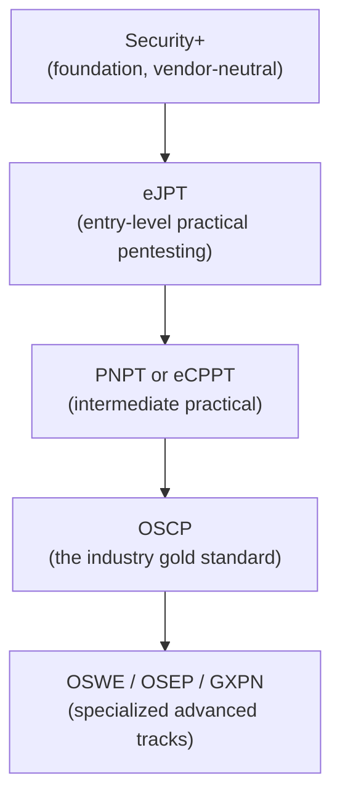

# Certifications that actually help

Certifications are one of the most debated topics in security career advice — some hiring managers barely glance at them, others use them as a hard filter for interviews. The honest truth is: **not all certs are equal, timing matters enormously, and a cert without hands-on skill behind it is close to worthless.** This lesson gives you an honest, practical roadmap.

## Why certifications matter (and why they don't, alone)

Certifications serve two real purposes: they signal to recruiters and ATS filters that you've hit a recognized bar, and — for the *good* ones — they force you to build real hands-on skill in the process of earning them. The problem is that some certifications are pure multiple-choice memorization with little practical value, while others (like OSCP) are grueling, entirely hands-on exams that genuinely prove capability. Employers, especially in offensive security, increasingly know the difference.

:::warn A cert is not a substitute for skill
Passing a multiple-choice exam about SQL injection is not the same as being able to find and exploit one in a live environment. Always pair certification study with hands-on practice — the labs and CTF challenges throughout this course exist specifically to build that muscle alongside the credentials.
:::

## A practical roadmap for freshers

1. **CompTIA Security+** — the standard entry-level foundation certification. Widely recognized (often literally required for many US government/defense-adjacent roles), vendor-neutral, and covers core concepts: CIA triad, risk management, cryptography basics, network security fundamentals. Multiple-choice, no hands-on lab component — treat it as proof of foundational knowledge, not practical skill.
2. **eJPT (eLearnSecurity Junior Penetration Tester)** — a genuinely practical, affordable, beginner-friendly certification with a real hands-on exam. An excellent first "prove you can actually do it" credential, and a natural next step once you've completed the offensive-security paths in this course.
3. **PNPT (Practical Network Penetration Tester) or eCPPT** — intermediate practical certifications that simulate a real pentest engagement more closely, including report writing (an underrated, essential skill covered later in this path).
4. **OSCP (Offensive Security Certified Professional)** — the closest thing this industry has to a gold-standard certification for offensive security. A grueling 24-hour hands-on practical exam followed by a report-writing period. Widely respected, and frequently listed as a preferred (sometimes required) qualification for penetration testing roles.
5. **OSWE, OSEP, GXPN and other advanced tracks** — specialized advanced certifications (web exploit development, evasion techniques, exploit development) pursued once you've established a strong offensive security foundation and want to specialize deeply.

## Defensive/blue-team track (an equally valid path)

Not everyone wants to go offensive. If SOC analysis, incident response, or defensive security appeals to you more (also strongly covered in Paths 08 and 11), consider this parallel track instead:

- **Security+** (same foundation as above)
- **BTL1 (Blue Team Level 1)** — hands-on, affordable, defensive-focused equivalent to eJPT
- **GCIH / GCFA (SANS/GIAC)** — respected, though notably expensive, incident response and forensics certifications
- **CISSP** — broad, management-adjacent, generally more valuable several years into a career rather than as a first certification

## Timing — the mistake almost everyone makes

The single most common mistake: attempting an expensive, practical certification (especially OSCP) *before* building sufficient hands-on foundation through free practice. This wastes money and often ends in a failed attempt that dents confidence unnecessarily.

:::tip The right order
Build hands-on skill first (this course, TryHackMe, Hack The Box, home labs) → attempt a certification once you can already comfortably do most of what it tests → use the certification as *confirmation and a credential*, not as your primary learning method.
:::

## Cost matters — a realistic budget view

Certification costs vary enormously, and there's no need to spend money you don't have to prove skill early on:

| Certification | Approx. cost (varies by region/promos) | Notes |
|---|---|---|
| Security+ | $370–400 | One-time exam fee |
| eJPT | $200 | Includes exam + some training material |
| PNPT | $400–500 | Includes exam voucher |
| OSCP | $1,600+ | Includes 90-day lab access + exam |
| CISSP | $750+ | Plus annual membership fees after passing |

Free platforms (TryHackMe, Hack The Box, this course itself) let you build and *prove to yourself* substantial skill before spending a dollar on formal certification — a smart way to sequence a limited budget.

## 🧪 Hands-on lab — build your certification plan

1. Decide which track resonates more right now: offensive (pentesting) or defensive (blue team/SOC) — it's fine to be unsure; this course's later paths (09 Ethical Hacking, 08 Network Security) will help you decide with real hands-on exposure either way.
2. Pick the *first* certification from the appropriate roadmap above — resist the urge to jump straight to OSCP or CISSP.
3. Research its actual exam format (multiple-choice vs. hands-on practical) and required prerequisite skills.
4. Write a concrete 60-day plan: which weeks you'll spend on hands-on practice (TryHackMe/Hack The Box rooms relevant to the exam objectives), and when you'll actually schedule the exam.
5. Save this plan in your notes — you'll revisit and refine it as you progress through the remaining career-prep lessons.

:::challenge Test yourself
Why is attempting OSCP before building substantial hands-on foundation considered a common, costly mistake?

Show answer
OSCP is an entirely hands-on, practical 24-hour exam requiring you to actually compromise multiple machines under time pressure — it tests applied skill, not memorized facts. Attempting it without first building that hands-on skill through cheaper or free practice (CTFs, home labs, guided platforms) means paying a substantial fee (lab access plus exam) for what often becomes, in effect, expensive additional practice time rather than a genuine certification attempt — and a failed attempt costs both money and confidence. The efficient path is building real skill first through free/cheap practice, then using the certification to formally confirm and credential skill you've already largely built.

:::

## Key terms

- **Security+** — foundational, vendor-neutral entry certification.
- **OSCP** — the industry's gold-standard hands-on offensive security certification.
- **BTL1 / GCIH** — defensive/blue-team equivalents to offensive-track certifications.
- **CISSP** — broad, management-adjacent certification, typically more valuable later in a career.

## Recap

- Certifications matter most when paired with genuine hands-on skill — never treat one as a substitute for the other.
- Build skill first through free/cheap practice, then use certification to confirm and credential it, not to learn from scratch.
- Both offensive (eJPT → PNPT/eCPPT → OSCP) and defensive (Security+ → BTL1 → GCIH/GCFA) tracks are valid, well-respected paths.
- Sequence your budget wisely — free platforms can prove substantial skill before you spend a dollar on formal certification.

???refs
- [OffSec — OSCP](https://www.offsec.com/courses/pen-200/) — official course and certification information.
- [TryHackMe](https://tryhackme.com/) — free/affordable hands-on practice directly relevant to most of these certifications.
- [CompTIA Security+](https://www.comptia.org/certifications/security) — official certification details.
???

**Next up →** [Building projects & GitHub portfolio](#/lesson/13-career-prep/github-portfolio)
