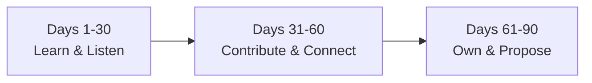

# Your first 90 days in a security job

Getting the offer is a huge milestone — but how you handle your first 90 days often determines whether you become someone the team trusts with real responsibility, or someone who quietly struggles for the next year. This final lesson covers how to start strong.

## The three phases of a strong first 90 days

- **Days 1–30 — learn and listen.** Your job right now is absorption, not impact. Learn the company's tools, processes, existing documentation, and — critically — the *reasons* behind decisions that might look odd from the outside (there's almost always context you don't have yet).
- **Days 31–60 — contribute and connect.** Start taking on real tasks independently, ask increasingly specific (not just orienting) questions, and build relationships across the team, not just with your direct manager.
- **Days 61–90 — own and propose.** By now you should be capable of owning small pieces of work end-to-end, and you can start thoughtfully proposing improvements — now backed by real context rather than outsider assumptions.

## Learning the company's actual environment

Every security team's toolchain and processes differ meaningfully from what you practiced on TryHackMe, Hack The Box, or in this course's labs — and that's completely expected, not a sign you weren't prepared:

- **Learn their specific tools and platforms quickly** — the SIEM they use, their ticketing system, their internal documentation/wiki, their specific cloud environment. Ask for a walkthrough rather than trying to reverse-engineer everything alone.
- **Document as you go** — write your own notes on processes as you learn them; you'll both retain it better and often end up with genuinely useful documentation the team didn't have before (a legitimately great early contribution).
- **Understand escalation paths** — who do you actually contact for a critical finding at 2am? What's the real (not just documented) process? Knowing this before you need it matters enormously.

:::tip Ask "why," not just "how"
"How do I use this tool" gets you through today's task. "Why do we do it this way instead of X" builds the deeper understanding that lets you eventually improve the process — and it signals genuine engagement, which managers consistently notice and value in new hires.
:::

## Mindset — the difference that actually matters

:::warn The "impostor syndrome" trap
Nearly everyone starting a new security role feels behind at first — the tools, codebase, and internal context are unfamiliar, and it's easy to interpret normal onboarding confusion as evidence you're not actually qualified. This feeling is close to universal among new hires (including senior ones changing companies) and is not a reliable signal about your actual competence. Give yourself the same 90-day runway everyone genuinely needs.
:::

- **Be humble and eager to learn** — even if you're technically strong, every organization has its own quirks, and assuming you already know their environment better than the people who built it tends to land poorly.
- **It's genuinely okay not to know everything.** "I don't know, but I'll find out and follow up" is a completely acceptable, professional answer — far better than guessing confidently and being wrong.
- **Focus on impact over looking smart.** Quietly fixing a real problem earns more long-term trust than a flashy demonstration of knowledge that doesn't actually help the team.

## Building relationships on the team

- **Shadow more senior teammates** when possible — watching how an experienced analyst or engineer actually works (their process, their shortcuts, their judgment calls) teaches things no documentation captures.
- **Ask for feedback proactively**, rather than waiting for a formal review cycle — a simple "how do you think that went?" after a task shows self-awareness and accelerates your growth.
- **Find quick, real wins.** A small automation that saves the team 20 minutes a week, or cleaning up a piece of confusing documentation, builds credibility fast without requiring deep tenure or seniority.

## A realistic 90-day plan template

| Timeframe | Focus | Example goals |
|---|---|---|
| Days 1–30 | Learn & listen | Complete onboarding, shadow 3+ teammates, document the team's core tools/processes in your own notes |
| Days 31–60 | Contribute & connect | Own your first small task end-to-end, ask for feedback after it, build relationships beyond your direct manager |
| Days 61–90 | Own & propose | Take ownership of a recurring responsibility, propose one specific improvement backed by concrete observations |

## 🧪 Hands-on lab — build your own 90-day plan

1. Using the table above as a template, write out specific, realistic goals for each 30-day phase — tailored to whatever role you're aiming for (SOC analyst, pentester, AppSec engineer, etc.).
2. Identify 3 things you'd want to learn or document in your first 30 days regardless of the specific company (tooling, escalation paths, team norms).
3. Draft one "quick win" idea you might realistically be able to contribute in your first 60 days, based on common pain points you've read or heard about in similar roles.
4. Save this plan alongside your resume, portfolio, and job search tracker from earlier lessons — you now have a complete, connected career-prep toolkit spanning from application to your first quarter on the job.

:::challenge Test yourself
Why is attempting to "prove yourself" with a flashy technical contribution in the first 30 days often a worse strategy than simply learning and listening?

Show answer
In the first 30 days, you're missing enormous amounts of context about the team's existing processes, prior decisions, tooling constraints, and the specific reasons things are done a certain way — context that often isn't written down anywhere and can only be absorbed by observing and asking. A flashy contribution made without that context frequently either duplicates existing work, misses an important constraint the team already knows about, or inadvertently steps on a colleague's ongoing effort, which can damage trust rather than build it. Learning and listening first isn't passivity — it's building the context that makes your later contributions actually land well, rather than needing to be walked back or redone.

:::

## Key terms

- **Onboarding** — the structured (or unstructured) process of ramping up in a new role.
- **Escalation path** — the defined process for who to contact and how, for time-sensitive or critical issues.
- **Quick win** — a small, achievable early contribution that builds credibility without requiring deep tenure.

## Recap

- The first 90 days follow a natural arc: learn and listen, then contribute and connect, then own and propose.
- Learn the team's specific tools and reasoning, not just the tasks — ask "why," not just "how."
- Impostor syndrome in a new role is close to universal and not a reliable signal of your actual competence.
- Small, real quick wins build more credibility early on than flashy demonstrations made without full context.

???refs
- [The First 90 Days (concept overview)](https://hbr.org/2017/05/the-first-90-days) — Harvard Business Review's widely referenced framework for role transitions.
???

**Congratulations!** You've completed Path 13 — and with it, the entire KashSec Academy journey from absolute zero to job-ready. You now have a resume, a portfolio strategy, a certification roadmap, interview preparation, a networking approach, and a plan for your first 90 days. Keep learning, keep building, and keep showing up in the community — that's genuinely most of what it takes from here.
