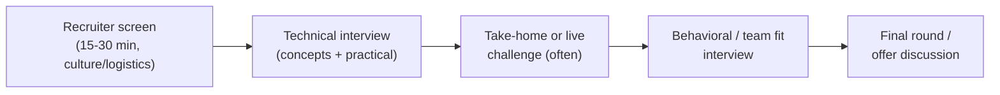

# Interview preparation

Landing an interview is only half the battle — security interviews typically combine deep technical questioning with behavioral assessment, and being strong at one while unprepared for the other is a common way promising candidates lose offers. This lesson covers how to prepare for both halves properly.

## The typical security interview structure

Not every process includes all of these stages, and order varies, but this general shape holds across most companies: an initial screen, one or more technical rounds, sometimes a practical exercise, and a behavioral/culture-fit conversation.

## Technical preparation — know your tools deeply

- **Be ready to explain your tools, not just name them.** "I've used Burp Suite" is weak; "I use Burp's Repeater to manually manipulate and resend requests when testing for IDOR or auth bypass issues" demonstrates actual understanding.
- **Be ready to live-demo something small** — many interviewers will ask you to walk through a lab, a script, or explain a finding from your portfolio in real time. Rehearse this out loud beforehand; explaining technical work smoothly under mild pressure is its own skill.
- **Review the fundamentals hard** — the OWASP Top 10, the CIA triad (Confidentiality, Integrity, Availability), common network protocols and ports, the difference between symmetric/asymmetric encryption, and privilege escalation basics come up constantly across almost every security interview, regardless of specialization.
- **Practice explaining concepts simply.** A common (and genuinely useful) interview question is some version of "explain [X] to a non-technical person." This tests communication ability, which matters enormously in real security work — most of your audience day-to-day won't be fellow security engineers.

:::tip A strong answer structure for technical questions
State the concept clearly first, give a concrete example, then (if relevant) mention the defense/mitigation. E.g.: *"SQL injection happens when user input is concatenated directly into a database query instead of being parameterized — for example, entering `' OR '1'='1` into a login field can bypass authentication entirely. The fix is always parameterized queries, which treat input as pure data rather than executable code."* This structure signals depth without rambling.
:::

## Common technical question categories (with real examples)

| Category | Example question |
|---|---|
| **Fundamentals** | "Explain the CIA triad and give a real example of each being violated." |
| **Web security** | "Walk me through how you'd test a login form for SQL injection." |
| **Networking** | "What's the difference between TCP and UDP, and when would an attacker prefer one?" |
| **Linux** | "How would you find files with the SUID bit set, and why does that matter?" |
| **Scenario-based** | "You find a critical vulnerability in production on a Friday afternoon — walk me through what you do." |

Scenario-based questions like the last one are testing judgment and process as much as raw technical knowledge — there's rarely one "correct" answer, but a structured, calm response (assess severity → notify the right people → document → follow established escalation process) reads far better than either panic or overconfidence.

## Behavioral preparation — the STAR method

Behavioral questions ("Tell me about a time you disagreed with a teammate," "Describe a challenging project") are best answered using the **STAR method**:

- **Situation** — brief context.
- **Task** — what you specifically needed to do.
- **Action** — what you actually did (the bulk of your answer should live here).
- **Result** — the outcome, ideally with some measurable detail.

Prepare 4–5 STAR stories in advance covering common themes: overcoming a technical challenge, handling disagreement, learning something quickly under pressure, and a mistake you made and what you learned from it. Having these ready prevents the common failure of freezing up or rambling when asked an unexpected behavioral question.

:::warn Don't skip researching the company
"Why do you want to work here?" is one of the most common questions asked, and a generic answer ("I want to grow my career") is immediately noticeable. Spend 20–30 minutes before any interview reading the company's product, recent news, and — if it's a security-specific role — their engineering or security blog if they have one. A specific, informed answer stands out disproportionately given how few candidates actually do this.
:::

## Questions you should ask them

Interviews are two-way. Prepared, genuine questions ("What does the on-call rotation actually look like for this team?" "What's the biggest security challenge the team is facing right now?") signal real engagement and also genuinely help you evaluate whether the role is right for you.

## 🧪 Hands-on lab — run your own mock interviews

1. Pick 5 technical questions from the categories above and write out full answers using the "concept → example → mitigation" structure.
2. Draft 4–5 STAR-formatted behavioral stories from your own experience (school projects, CTFs, jobs, even non-technical work — the format matters more than the setting).
3. Do 3 mock interviews this week — record yourself answering out loud (even alone), or better, practice with a friend or a peer also going through this course. Review the recordings critically: are you rambling, using filler words, or actually landing the point clearly?
4. Pick one company you'd realistically consider and research it for 20 minutes — write down 2 specific things you'd mention if asked "why us?"

:::challenge Test yourself
Why is the STAR method (Situation, Task, Action, Result) more effective than answering behavioral questions with a general, unstructured story?

Show answer
Unstructured behavioral answers tend to either ramble with excessive context, bury the actual point, or skip the outcome entirely — leaving the interviewer unclear on what you specifically contributed and whether it worked. STAR forces a compact structure that front-loads just enough context (Situation, Task), spends the majority of the answer on what <em>you</em> actually did (Action — the part interviewers most care about), and closes with a concrete outcome (Result), which is both easier for the interviewer to follow and more persuasive because it clearly isolates your individual contribution and its measurable impact.

:::

## Key terms

- **STAR method** — Situation, Task, Action, Result — a structure for answering behavioral interview questions.
- **CIA triad** — Confidentiality, Integrity, Availability — the foundational model of information security goals.
- **Take-home challenge** — a practical exercise (often a small pentest, code review, or written analysis) completed outside the live interview.

## Recap

- Security interviews typically blend technical depth with behavioral/culture-fit assessment — prepare for both.
- Know your tools well enough to explain *why*, not just name them; rehearse explaining your own projects out loud.
- Use "concept → example → mitigation" for technical answers, and STAR for behavioral ones.
- Research the company specifically, and prepare genuine questions of your own — interviews go both ways.

???refs
- [OWASP Top 10](https://owasp.org/Top10/) — near-guaranteed to come up in some form in a web security interview.
- [The STAR Interview Method](https://www.themuse.com/advice/star-interview-method) — a clear, practical explainer with examples.
???

**Next up →** [Networking & community](#/lesson/13-career-prep/networking-community)
