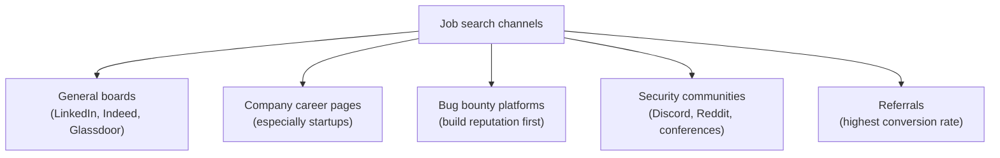

# Job search strategy

With a solid resume and portfolio in place, the next challenge is finding and winning the right opportunities. Security hiring is a genuinely competitive, sometimes confusing market — this lesson covers where to actually look, how to apply effectively, and how to avoid the two most common traps: applying nowhere seriously, and applying everywhere carelessly.

## Where security jobs actually live

- **LinkedIn** — the dominant platform for security roles. An optimized profile (matching resume terminology, an actual headshot, a headline stating your focus area) gets found by recruiters actively searching, not just by applications you submit.
- **Indeed, Glassdoor, and region-specific boards** (e.g., Naukri in India) — high volume, useful for casting a wide net, though also the most competitive channel since anyone can apply with one click.
- **Company career pages directly** — startups and mid-size companies especially often hire juniors and post roles here before (or instead of) large job boards, with less competition than the big aggregators.
- **Bug bounty platforms** (HackerOne, Bugcrowd) — beyond direct payouts, a public reputation here (even without huge earnings) is a genuinely strong, verifiable signal to employers, and some companies hire directly out of their bounty programs.
- **Security communities and referrals** — Discord servers, local meetups, and conferences are where a surprising number of junior security hires actually happen, because a referral or a recognized community presence bypasses the anonymous-resume-pile problem entirely.

:::tip Referrals dramatically outperform cold applications
Across tech hiring broadly, referred candidates are interviewed and hired at meaningfully higher rates than cold applicants — a referral doesn't guarantee a job, but it reliably gets a resume in front of an actual human instead of only an ATS filter. This is exactly why the networking habits in the next lesson matter for your job search, not just your career long-term.
:::

## Applying effectively — quality over blind volume

- **Tailor your resume for every application** — even 15 minutes of adjusting keywords and emphasis to match a specific posting measurably outperforms a single generic resume blasted everywhere.
- **Apply even if you don't meet 100% of the requirements.** Job postings are frequently a wishlist, not a strict bar — research consistently shows candidates (especially from underrepresented groups) tend to under-apply relative to their actual qualification, while others apply confidently at 60–70% match. If you meet most of the core requirements, apply.
- **Write a short, specific cover letter or note when possible** — even two or three genuine sentences about why this specific role/company interests you outperforms a generic template, and takes little extra time once you have a solid base to adapt.
- **Track every application** — a simple spreadsheet (company, role, date applied, status, follow-up date) prevents both duplicate applications and forgotten follow-ups, and helps you notice patterns (which types of roles are actually responding).

## Following up without being annoying

A polite follow-up 7–10 days after applying, if you haven't heard back, is normal and generally well-received — not pushy. Keep it short: reaffirm interest, briefly mention one specific reason you're a good fit, and ask about timeline. If you land an initial interview, a brief thank-you note within 24 hours referencing something specific from the conversation is a small habit that measurably helps you stand out.

## Entry-level titles worth targeting, beyond "penetration tester"

A common mistake among freshers is fixating narrowly on "penetration tester" job titles specifically, when the actual entry points into security are considerably broader and often easier to land first. **SOC Analyst (Tier 1)** roles, referenced back in Path 08.5, are consistently one of the highest-volume, most accessible entry points, requiring solid fundamentals rather than deep offensive specialisation. **Security Analyst**, **IT Security Support**, **GRC (Governance, Risk, and Compliance) Analyst**, and even general **IT/helpdesk roles at security-focused companies** all provide genuine industry entry and exposure, often with a clearer path to more specialised roles once you've built internal credibility and a track record. Searching only for your dream title from day one artificially shrinks the pool of realistic opportunities — a first role doesn't have to be the final destination, and internal transfers within a company are often easier to land than an external application to the exact specialised role you actually want.

## Working with recruiters — internal vs. agency

It's worth understanding the two distinct types of recruiters you'll encounter, since they serve different purposes. **Internal (in-house) recruiters** work directly for the hiring company and represent its interests specifically — building a relationship with one at a company you're genuinely interested in can lead to being considered for future openings even beyond the role you originally applied for. **Agency/external recruiters** work across multiple client companies simultaneously and are typically compensated per successful placement — they can be genuinely useful for surfacing opportunities you wouldn't find yourself, but it's worth remembering their incentive is closing a placement, not necessarily finding your ideal long-term fit, so maintain your own judgment about whether a role a recruiter pushes is actually right for you rather than deferring entirely to their enthusiasm.

## Handling rejection — a real, expected part of the process

Rejection, including silence with no response at all, is extremely common in this market and rarely reflects your actual worth as a candidate — it often comes down to internal headcount changes, a slightly closer-matching candidate, or factors entirely outside your control. Track rejections without over-analyzing each one individually; instead, look for *patterns* across many applications (e.g., "I keep getting rejected after the technical interview stage specifically") — that's genuinely useful signal for what to improve next.

:::warn Watch for job scams
Security's popularity has unfortunately attracted job scams — postings requesting payment for "training materials," offers with no interview process at all, or requests for sensitive personal/financial information very early on are red flags. Legitimate employers never ask you to pay them for the opportunity to work.
:::

## 🧪 Hands-on lab — build your search system

1. Set up a simple application tracker (a spreadsheet is enough): columns for company, role, date applied, source, status, and next follow-up date.
2. Optimize your LinkedIn profile: a clear headline stating your focus area (e.g., "Aspiring Penetration Tester | CTF Player | KashSec Academy"), a summary matching your resume's key terms, and your best project or two pinned/featured.
3. Find 5 realistic roles this week — a mix of large-board listings and at least one from a specific company's own careers page — and apply to each with a tailored resume.
4. Set a calendar reminder to follow up on each application after 7–10 days if you haven't heard back.

:::challenge Test yourself
Why does applying only to roles where you meet 100% of the listed requirements often work against candidates, especially freshers?

Show answer
Job postings frequently describe an idealized "wishlist" candidate rather than a strict minimum bar, and many of the listed requirements are negotiable, trainable on the job, or simply aspirational on the recruiter's part. Waiting to apply only when every single requirement is met means missing a large number of roles you'd realistically be competitive for — and research on application behavior consistently shows this self-filtering disproportionately causes qualified candidates to apply to far fewer roles than they're actually capable of getting. Applying at roughly 60–70% match on core requirements, while being honest about what you don't yet know in the actual interview, is a far more effective strategy than waiting for a "perfect" match that rarely exists.

:::

## Key terms

- **ATS** — Applicant Tracking System, software that filters/ranks applications (see the resume lesson for detail).
- **Referral** — an internal employee vouching for or forwarding a candidate, which meaningfully increases interview odds.
- **Application tracker** — a simple log of every job applied to, its status, and follow-up dates.

## Recap

- Security jobs live across general boards, company career pages, bug bounty platforms, and — most powerfully — community/referral channels.
- Tailor every application, apply even without a perfect requirements match, and track everything.
- A short, polite follow-up after 7–10 days of silence is normal and often effective.
- Rejection is common and rarely personal — look for patterns across many applications rather than over-analyzing any single one.

???refs
- [HackerOne](https://www.hackerone.com/) and [Bugcrowd](https://www.bugcrowd.com/) — build a public bug bounty reputation that doubles as a hiring signal.
- [LinkedIn's guide to optimizing your profile](https://www.linkedin.com/business/talent/blog/product-tips/tips-to-improve-your-linkedin-profile) — practical, broadly applicable advice.
???

**Next up →** [Interview preparation](#/lesson/13-career-prep/interview-prep)
